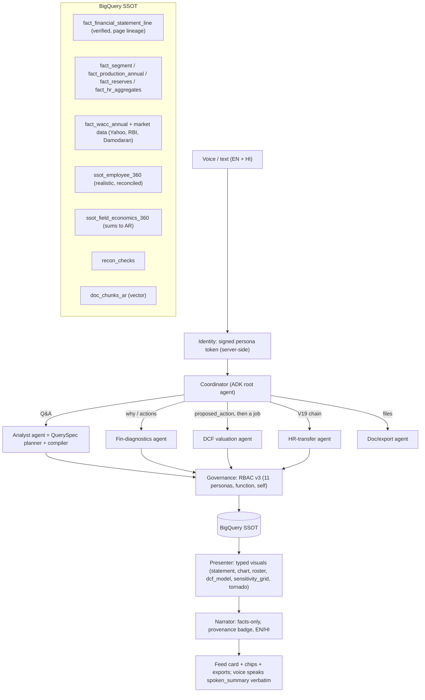
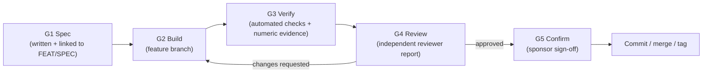

# Yukti AI: Build Charter & Process v3 (`BUILD.md`)

**Status:** Active · **Version:** v3 (re-baselined 23-Oct-2026) · **Baseline for v3:** branch `wip/pre-v3-snapshot` @ `e7de82f` (on top of tag `upgrade-H1` @ `5f64d8c`) · **Owner:** Amandeep Saini (Product Sponsor)
**Companion docs:** [Feature List v3](feature_list_and_verbatims/feature_list/feature_list.md) · [Upgrade Checklist v3](UPGRADE_CHECKLIST.md) · [Bug Register](BUG_REGISTER.md) · [Specs](docs/specs/) · [Behaviours](docs/behaviour/) · [Delegation Plan](DELEGATION.md) · [v3 packets](docs/delegation/packets/v3/) · [Decision Log](docs/DECISIONS.md) · [Verbatims V1–V23](feature_list_and_verbatims/verbatims/)
**Previous charter (archived):** [`docs/archive/v2_2026-10-22/BUILD.md`](docs/archive/v2_2026-10-22/BUILD.md). Its "U1–U5, B1–B4, H1 completed" claims were partly contradicted by the 23-Oct diagnosis; see §7.

> [!IMPORTANT]
> **Rule of this build (unchanged): no step counts as done until it has passed all five gates in §4: Spec → Build → Verify → Review → Confirm.**
> **New in v3, the truth rule:** a step that touches data or answers is not Done without **numeric** evidence: exact values checked against the real SSOT or the AR page. "Renders / HTTP 200 / has rows" is never acceptance.

---

## 1. Purpose & Outcome

v2 made Yukti look executive-grade. v3 makes it **true and agentic**: every number traceable to a public document, every HR fact realistic and reconciled, and specialist agents doing real analysis. Outcomes:

1. **Real numbers, zero error (V18):** income statement, balance sheet and cash flow by year come from ONGC Annual Reports (with page lineage), backfilled by NSE XBRL. A labelled Yahoo consolidated view is used as a cross-check.
2. **Realistic, reconciled people and field data (V19, V23):** one comprehensive Employee-360 BigQuery table covering pay, benefits and cost. Field economics sum exactly to company AR totals.
3. **Every persona served (V17):** CMD, DIR_HR, DIR_FIN, and E1–E4 in both HR and Finance (11 personas). Each gets answers plus insights, or a polite, policy-correct refusal.
4. **End-to-end executive workflows:** V19 (Delhi cohort → names → Excel → email to Director HR) and V20 (statement → year → WACC → why → top-5 actions).
5. **Agentic platform (V22):** one interface, a coordinator and specialist agents. The DCF agent asks permission, runs in the background, and returns a full model with sensitivity and downloadable assumptions.
6. **9/10 presentation (V21):** statements as statements, a correct waterfall, an Excel-class chart portfolio, and exports in every common format.

**Order (sponsor decision 5, V23):** P0 Stabilise → P1 Real finance SSOT → P2H/P2F in parallel → P3 Agents + DCF (after P1) → P4 Visual (can start after P0, in parallel) → P5 One brain, eval, redeploy.

---

## 2. Scope

| In scope (v3) | Out of scope |
|---|---|
| Public-data acquisition (ARs, NSE XBRL, Yahoo, RBI, Damodaran) into `knowledge/public_sources/` | Scraping sites whose ToU forbid it (Screener, Moneycontrol); any workaround of blocked endpoints (BSE API, MCA) |
| Real financial SSOT + anchor tables (segment, production, reserves, BRSR HR aggregates) | Real employee-level data (never public; stays synthetic, labelled) |
| Regenerated, realistic synthetic HR (Employee-360) and field economics, reconciled to real totals | Production SSO / multi-tenant IAM (demo uses a signed persona token; IAP noted for prod) |
| 11-persona RBAC, identity hardening | Investment advice (the DCF is labelled illustrative) |
| Coordinator + agents (analyst, fin_diagnostics, dcf, hr_transfer, doc_export), jobs API | Live Google Drive write-back (an honest download for now; Drive OAuth is a later option) |
| Statement visual, chart portfolio, export suite, voice dedupe, one-brain consolidation, numeric eval, Cloud Run redeploy | — |

---

## 3. Target Architecture (v3)

Design principles (v3):
1. **Numbers come only from verified SSOT rows and deterministic engines** (insights, variance, WACC, DCF). The LLM plans, routes and narrates; it never does arithmetic and never asserts data coverage on its own.
2. **Every number shows its provenance:** Verified AR p.N / Yahoo (consolidated) / Modelled / Illustrative / Local snapshot. A wrong label is a Blocker bug.
3. **Real anchors, synthetic detail:** synthetic employee and field records must reconcile to real aggregates through automated `recon_checks`. Mismatches block publication.
4. **One brain:** one route for all data questions. Fast-paths survive only as deterministic, tested intents (screen control, export, greeting).
5. **Agents are explicit:** long or complex analyses are *proposed* (`proposed_action`), confirmed by the user, and run as tracked jobs (`job`).
6. **Typed visuals, not free-form UI:** the agent chooses from a whitelisted visual catalogue, so layouts stay deterministic and testable.
7. **RBAC on the spec and the result**, with server-side identity. The persona never comes from free text.

---

## 4. Build Process: the Five Gates (Confirmation & Review Mechanism)

Every step in [`UPGRADE_CHECKLIST.md`](UPGRADE_CHECKLIST.md) goes through these gates in order:

| Gate | What happens | Artifact / evidence | Who |
|---|---|---|---|
| **G1 Spec** | Goal, acceptance criteria and verification method are written **before** code, in the checklist row and the linked `docs/specs/SPEC-xx` + `docs/behaviour/BEH-xx`. Phase-level specs are confirmed by the sponsor before the phase starts. | Checklist entry + spec section + behaviour scenarios | Agent writes, **sponsor confirms per phase** |
| **G2 Build** | Implement on branch `v3/<phase-id>` (never on `main`). Small, reviewable diffs. Keep existing comments and docs. | Diff on the branch | Agent (owner per checklist) |
| **G3 Verify** | Run the step's checks: `pytest`, `tsc`, `next build`, golden numeric eval subset, `recon_checks`, Playwright screenshots, BigQuery spot checks. Attach outputs. | Evidence block in the review file | Agent / FL runner |
| **G4 Review** | An **independent reviewer agent** (fresh context, read-only) checks the diff against the spec, the behaviours and §4.1. Verdict: **Approve** / **Changes requested** / **BLOCKED (needs decision)**. | `docs/reviews/<step-id>.md` from the [template](docs/reviews/REVIEW_TEMPLATE.md) | Reviewer agent |
| **G5 Confirm** | Phase-end demo with the BEH scenarios live (voice + text), golden-eval scorecard against the last gate. Sponsor signs off. | Sign-off line in the checklist + `docs/reviews/<phase>_gate.md` | **Sponsor** |

**Commit policy (D-12):** local commits on `v3/*` after each G4-approved step are allowed. Never push. Merge to `main` and tag `v3-<phase>` only after G5. **Nothing is pushed or deployed without an explicit sponsor instruction.**

**G4 loop cap & escalation:** at most **3** review rounds per step (Flash steps move to Opus after 2, per `DELEGATION.md`). After that, or on **BLOCKED**, the step is marked ⛔ and escalated with an OD-x entry in `docs/DECISIONS.md`.

**Change control for new verbatims (mid-phase):** new verbatim → saved in `feature_list_and_verbatims/verbatims/` → feature list updated → D-x/OD-x logged → checklist steps added (G1) → sponsor confirms the phase. Work in progress is never silently re-scoped.

### 4.0 Delegation (cost-optimised execution)
Per [`DELEGATION.md`](DELEGATION.md): **Opus (O)** handles specs, contracts, RBAC, SQL safety, planner/coordinator, financial extraction rules, the DCF engine design, integration and reviews. **Flash (F)** handles well-specified implementation from a packet in [`docs/delegation/packets/v3/`](docs/delegation/packets/v3/). **Flash-lite (FL)** runs commands and collects evidence. Every F/FL output gets a separate Opus G4 review. Flash never reviews Flash.

### 4.1 Review checklist (used by the G4 reviewer)
- [ ] Meets every acceptance criterion in the spec and the linked BEH scenarios (each cited with evidence)
- [ ] **Numeric truth:** values checked against the SSOT/AR (golden subset, `recon_checks` PASS); no plug lines; no fabricated fallbacks
- [ ] **Provenance:** source badges match the actual source used; synthetic/illustrative labelled
- [ ] No regressions: tests green, golden eval not worse than the last gate, `tsc` + `next build` clean
- [ ] RBAC: no persona sees data beyond its policy (11-persona matrix); text, visual and export agree; persona not changeable from free text
- [ ] No hard-coded numbers or entity codes that should come from data or config
- [ ] No secrets, no generated artefacts committed, no unrelated changes
- [ ] Accessibility and theme: light (default) and dark both render; contrast is acceptable
- [ ] Performance: no new blocking calls on the event loop; orb/feed hold ~60 fps
- [ ] Docs updated: feature status, checklist ticks, bug register, decision log

### 4.2 Definition of Done (per step)
A step is **Done** only when: acceptance criteria are met **with numeric evidence where applicable**, G3 evidence is attached, G4 says Approve, the checklist box is ticked with a link to the review file, and the related `BUG-xx` rows are closed in [`BUG_REGISTER.md`](BUG_REGISTER.md). A **phase** is Done when every step is Done **and** the sponsor has signed off at G5.

### 4.3 Truth rules (new in v3)
1. **No "PASS" from shape-only tests.** Every eval or stress test must assert values (the golden set), not just HTTP 200 + rows.
2. **No self-certifying identities.** Checks such as A = E + L must compare to the AR-reported totals, not to totals the builder computed.
3. **Degraded mode is visible.** If BigQuery or the LLM is unavailable, the UI says so. Local snapshots carry a "Local snapshot" badge.
4. **Status words are reserved:** ✅ only with G4 evidence. Docs that overstate status are bugs (tracked in the register).

---

## 5. Phase Overview (details in [`UPGRADE_CHECKLIST.md`](UPGRADE_CHECKLIST.md))

| Phase | Name | Main features | Gate metric (numeric) |
|---|---|---|---|
| **P0** | Stabilise | FEAT-031, FEAT-032 (quick part), test baseline | ADC valid; pytest failures due to the environment = 0; escalation test fails closed; no false provenance label in 20 sampled answers |
| **P1** | Real finance SSOT + public data | FEAT-018, 019, 020 (+ anchors for 021/022, WACC inputs) | 100% AR subtotals within ₹0.05 cr; Yahoo FY23–26 within ₹1 cr; finance golden set (≥ 30 Q) 100% exact |
| **P2H** | HR: personas, V19, Employee-360, field economics | FEAT-017, 021, 022, 023 | 11-persona matrix 100%; `recon_checks` 100% PASS; BEH-02 + BEH-06 pass |
| **P2F** | Finance diagnostics (V20) | FEAT-024, 011 (finance) | BEH-03 passes; every action quantified + cited; 0 canned text |
| **P3** | Coordinator + agents + DCF (V22) | FEAT-028, 029, 007 (v3 contract) | BEH-05 passes by voice + text; DCF fixture exact to ₹0.01/share |
| **P4** | Visual 9/10 + exports (V21) | FEAT-025, 026, 027, 015, 004, 016 | Finance rubric ≥ 9/10 (light + dark); waterfall ends at reported PAT; ₹/Devanagari export check passes |
| **P5** | One brain, eval, redeploy | FEAT-030, 002, 009, 013, 014 | Golden eval ≥ 95% numeric exact; feedback1–4 regressions 100%; Cloud Run serves the green build |

---

## 6. Quality Gates & Metrics (v3)

| Metric | Current (23-Oct diagnosis) | Target at P5 |
|---|---|---|
| Finance values matching AR (spot check) | ~31/60 (BS/CF 1/17) | 100% (all verified lines) |
| `recon_checks` (HR + field vs AR) | none exist | 100% PASS |
| Personas implemented / tested | 5 of 11 / 5 | 11 / 11 |
| V19 chain (5 turns) | 3/5 in code, 0/5 live | 5/5 (CMD, DIR_HR); E-levels aggregate/refuse correctly |
| V20 chain (6 turns) | 1/6 | 6/6 |
| V22 DCF flow | 0 | end-to-end voice + text |
| Golden numeric eval (user phrasings, multi-turn) | not measured (stress test is shape-only) | ≥ 95% exact |
| Refusal governance / escalation | escalation possible | 100%, zero leaks |
| Backend tests | 260 P / 70 F / 13 E | 100% green (+ new tests per step) |
| Median latency p50 (data Q) | ~5 s | ≤ 5 s; DCF job ≤ 60 s with progress |
| Chart/statement rubric | ~5/10 finance | ≥ 9/10 |

---

## 7. Baseline Record (v3 start, 23-Oct-2026)

- **Snapshot:** branch `wip/pre-v3-snapshot` @ `e7de82f` holds all previously uncommitted work (R11–R16, `financial_build/`, feedback, verbatims 17–22).
- **Verified working:** conversation feed, floating panel, light/dark, Leda voice (when ADC is valid), the RBAC masking engine for 5 personas (77 offline tests), HR synthetic headcount/diversity calibrated to AR, real ARs FY21–FY26 + 50+ real policies on disk, `tsc` + lint clean.
- **Known broken:** see [`BUG_REGISTER.md`](BUG_REGISTER.md) (34 items; 13 Blockers). Key items: invented finance components with plug lines; no Yahoo ingestion; no V22; V19 steps 4–5; V20 mostly missing; persona escalation; Cloud Run on baseline rev `00001`.
- **Environment notes:** ADC must be valid (`gcloud auth application-default login`), then restart the servers. Local URLs: UI `:3200`/`:3300`, backend `:8095`. Cloud Run `yukti-ai` (asia-south1, project `ongc-hr-finance-agent`) is IAM-protected.

---

## 8. Branching, Tagging & Rollback

- `main` holds only sponsor-confirmed states. v3 tags: `v3-P0` … `v3-P5`.
- Work branches: `v3/P0-stabilise`, `v3/P1-fin-ssot`, `v3/P2H-hr`, `v3/P2F-fin-diag`, `v3/P3-agents`, `v3/P4-visual`, `v3/P5-ship`, all branched from `wip/pre-v3-snapshot`.
- Rollback: `git checkout upgrade-H1` (last v2 tag) or the last `v3-*` tag, then rebuild the frontend and restart both servers.
- Feature flags: `YUKTI_PLANNER=1` (brain), `YUKTI_FIN_SSOT_V3=1` (read `fact_financial_statement_line`; off = legacy tables with a "Local/legacy" badge), `YUKTI_COORDINATOR=1` (agents), `NEXT_PUBLIC_STATEMENT_VISUAL=1`.
- **BigQuery:** new objects are created alongside the old ones (`fact_*`, `ssot_employee_360`, `ssot_field_economics_360`, `recon_checks`) and never replace in place until P5. DDL is versioned in `yukti/backend/sql/` or Dataform.
- **Cloud Run rollback:** `gcloud run services update-traffic yukti-ai --project ongc-hr-finance-agent --region asia-south1 --to-revisions=<previous-revision>=100`.

---

## 9. Change Log

| Date | Change | By |
|---|---|---|
| 2026-10-22 | v2 charter, baseline `baseline-v0.2`, phases U0–U5, B1–B4, H1 (see archived charter for detail) | Agent + G4 reviewers |
| 2026-10-23 | **Deep diagnosis vs V1–V22** (5 parallel audits): finance data invented beyond headline lines; V22 missing; V19 steps 4–5 and most of V20 missing; persona escalation; five v2 "Done" claims downgraded | Agent |
| 2026-10-23 | **Sponsor decisions 1–7 (V23):** AR as zero-error primary + XBRL + labelled Yahoo view; downloads approved; WIP snapshot `wip/pre-v3-snapshot`; v3 docs in place (v2 archived to `docs/archive/v2_2026-10-22/`); DCF after P1; Gemini clauses labelled Illustrative; realistic Employee-360 + field economics reconciled to AR | Sponsor |
| 2026-10-23 | **v3 charter**, feature list v3 (FEAT-017…032), checklist v3 (P0–P5), `BUG_REGISTER.md`, specs SPEC-01…11, behaviours BEH-01…07, v3 delegation packets | Agent |
