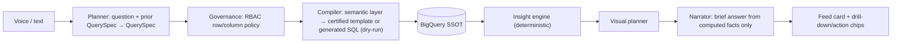
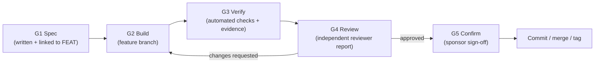

# Yukti AI: Build Charter & Process (`BUILD.md`)

**Status:** Active · **Baseline:** `baseline-v0.2` (commit `fbe3594`, 2026-10-22) · **Owner:** Amandeep Saini (Product Sponsor)
**Companion docs:** [Feature List](feature_list_and_verbatims/feature_list/feature_list.md) · [Upgrade Checklist](UPGRADE_CHECKLIST.md) · [Delegation Plan](DELEGATION.md) · [Decision Log](docs/DECISIONS.md) · [Review Template](docs/reviews/REVIEW_TEMPLATE.md) · [Verbatims](feature_list_and_verbatims/verbatims/)
**Previous plan (archived):** [`docs/archive/BUILD_overnight_2026-10-20.md`](docs/archive/BUILD_overnight_2026-10-20.md). Its "all items done/PASSED" claims were not reproducible on 2026-10-22; see §7.

> [!IMPORTANT]
> **Rule of this build: no step counts as done until it has passed all five gates in §4: Spec → Build → Verify → Review → Confirm.** Nothing is merged to `main` or deployed without your explicit confirmation.

---

## 1. Purpose & Outcome

Upgrade Yukti AI, the voice-first HR & Finance agent for the ONGC CMD, from a working demo (`baseline-v0.2`) to an executive-grade product:
1. **Feels premium:** a calm infinity-ribbon voice orb, a running conversation feed, executive visual polish (Verbatims 11, 12).
2. **Thinks granularly:** every answer goes from a count to who / where / compared with what / so what / next action (Verbatim 13, plus the sponsor's "granular insights" ask).
3. **Is governed:** CMD and Directors see everything (D-10); E1–E4 get aggregated summaries or refusals (D-11), and the text and the visuals always agree (Verbatims 3, 13, 14, 15).
4. **Presents data beautifully, any way you ask:** sensible default visuals, re-plot on request into any compatible chart type, and charts of the highest professional standard (Verbatim 15, FEAT-015).

**Order (Verbatim 14, D-4):** UI first, then the brain, then hardening and deploy.

---

## 2. Scope

| In scope | Out of scope (for this upgrade) |
|---|---|
| Frontend shell: feed, orb, design system, visuals, roster table | New data domains beyond the current `hrfin_gold` / `hrfin_silver` SSOT |
| Answer-contract v2 (forward-compatible with the brain) | Real SSO / identity integration (persona stays a selector) |
| Brain: semantic layer, QuerySpec planner, insight engine, RBAC masking | Production multi-tenant hardening |
| Eval harness gates, Cloud Run redeploy | Changes to the synthetic data generators, unless a gap is proven (logged as a decision) |

---

## 3. Target Architecture

Design principles:
1. **Numbers come only from BigQuery and the insight engine.** The LLM plans and narrates; it never does arithmetic.
2. **The semantic layer is generated from the data** (INFORMATION_SCHEMA plus profiled values), so the catalog can't drift from it.
3. **A follow-up is a small change to the previous spec**, not a keyword hack.
4. **RBAC is enforced on the spec and the result**, never only on the question text.
5. **The UI renders contract v2.** UI work defines the fields the brain will later fill (forward-compatible, D-4).
6. **Restraint in UI:** improve polish (type, depth, motion), not the number of controls (design recommendations doc).

---

## 4. Build Process: the Five Gates (Confirmation & Review Mechanism)

Every step in [`UPGRADE_CHECKLIST.md`](UPGRADE_CHECKLIST.md) goes through these gates in order:

| Gate | What happens | Artifact / evidence | Who |
|---|---|---|---|
| **G1 Spec** | The step's goal, acceptance criteria and verification method are written in the checklist **before** code. Phase-level specs are confirmed by the sponsor before the phase starts. | Checklist entry with acceptance criteria | Agent writes, **sponsor confirms per phase** |
| **G2 Build** | Implement on branch `upgrade/<phase-id>` (never on `main`). Small, reviewable diffs. Keep existing comments and docs. | Diff on the branch | Agent |
| **G3 Verify** | Run the step's listed checks: `tsc`, `next build`, `pytest`, eval subset, Playwright screenshots, BigQuery spot checks. Attach outputs. | Evidence block in the review file (commands + results + screenshots) | Agent |
| **G4 Review** | An **independent reviewer agent** (fresh context, read-only) checks the diff against the spec and the review checklist (§4.1). Verdict: **Approve** / **Changes requested**. "Changes requested" loops back to G2. | `docs/reviews/<step-id>.md` from the [template](docs/reviews/REVIEW_TEMPLATE.md) | Reviewer agent |
| **G5 Confirm** | Phase-end demo: screenshots or a live walk-through, eval scorecard compared with the baseline. Sponsor signs off. | Sign-off line in the checklist + `docs/reviews/<phase>_gate.md` (scorecard, delegation metrics, escalations) + decision log entry if anything changed | **Sponsor** |

**Commit policy (pending OD-4):** until OD-4 is decided, commits happen **only after G5 sign-off**, or when the sponsor explicitly asks. If OD-4 = (b), local commits on `upgrade/*` after each G4-approved step are also allowed. Each confirmed phase is merged to `main` and tagged `upgrade-<phase-id>`. **Nothing is pushed or deployed without an explicit instruction.**

**G4 loop cap & escalation (all owners, Opus and Flash):** at most **3** review rounds per step (Flash steps move to Opus after 2, per `DELEGATION.md`). After that, or immediately when a reviewer returns **BLOCKED (needs decision)**, the step is marked ⛔ and escalated to the sponsor with a new OD-x entry in `DECISIONS.md`.

**Change control for new verbatims (mid-phase):** new verbatim → saved in `feature_list_and_verbatims/verbatims/` → feature list updated (new/changed FEAT) → D-x/OD-x logged → checklist steps added or changed (G1) → sponsor confirms whether it enters the current phase or a later one. Work in progress is never silently re-scoped.

### 4.0 Delegation (cost-optimised execution)
Work is split per [`DELEGATION.md`](DELEGATION.md):
- **Opus (lead):** specs, high-risk code (contracts, RBAC, SQL safety, planner, audio, app state), integration and reviews.
- **Flash:** well-specified implementation from a written **task packet**.
- **Flash-lite:** runs commands and collects evidence.

The checklist's **Owner** column says who executes each step. **Every Flash or Flash-lite output gets a separate G4 review by an Opus reviewer in a fresh, read-only context.** Flash never reviews Flash. Two failed reviews on the same packet move the step to Opus.

### 4.1 Review checklist (used by the G4 reviewer)
- [ ] Meets every acceptance criterion in the spec (each one cited with evidence)
- [ ] No regressions: tests green, eval not worse than the last gate, `tsc` + `next build` clean
- [ ] RBAC: no persona sees data beyond its policy (FEAT-010); text and visual agree
- [ ] No hardcoded numbers or entity codes that should come from data or config
- [ ] No secrets, no generated artefacts committed, no unrelated changes
- [ ] Accessibility and theme: light (default) and dark both render; contrast is acceptable
- [ ] Performance: no new blocking calls on the event loop; orb/feed hold ~60 fps
- [ ] Docs updated: feature status, checklist ticks, decision log if behaviour or policy changed

### 4.2 Definition of Done (per step)
A step is **Done** only when: acceptance criteria are met, G3 evidence is attached, the G4 review says Approve, and the checklist box is ticked with a link to the review file. A **phase** is Done when every step is Done **and** the sponsor has signed off at G5.

---

## 5. Phase Overview (details in [`UPGRADE_CHECKLIST.md`](UPGRADE_CHECKLIST.md))

| Phase | Name | Main features | Gate metric |
|---|---|---|---|
| **U0** | Governance & baseline | Docs, decision log, delegation, FEAT-014 eval baseline re-run | Docs confirmed (U1 may start once U0.2 + OD-1 confirmed; U0.4/U0.5 run in parallel) |
| **U1** | Design system foundation | FEAT-005 + FEAT-015 chart theme: tokens, typography, surfaces, theme, chart design system | Visual review sign-off; token grep = 0 hard-coded hex |
| **U2** | Conversation feed + contract v2 | FEAT-001, FEAT-007 | Verbatim 11 acceptance criteria in a browser test |
| **U3** | Infinity-ribbon voice orb + voice fixes | FEAT-004, FEAT-013 | 4 states distinct, ≥ 55 fps (target 60) on the demo laptop, mic/barge-in tests |
| **U4** | Executive polish | FEAT-005 | Visual review sign-off (light + dark) |
| **U5** | Visual system, any-chart re-plot, roster & comparison components | FEAT-003, FEAT-015, FEAT-006 (UI), FEAT-010 (UI), FEAT-011 (UI) | Every question-bank visual type renders from fixtures |
| **B1** | Semantic layer truth | FEAT-008 | Zero catalog/data mismatches; tests green |
| **B2** | QuerySpec planner | FEAT-009, FEAT-002 | Eval: root ≥ 80%, follow-ups ≥ 60% |
| **B3** | Granular data + RBAC policy | FEAT-006 (data), FEAT-010 | Roster correct vs BigQuery; RBAC matrix 100% |
| **B4** | Insight engine | FEAT-011 | ≥ 2 grounded insights per data answer; 0 invented numbers |
| **H1** | Harden, full eval & deploy | FEAT-012, FEAT-014 | Eval targets met; Cloud Run URL verified |

---

## 6. Quality Gates & Metrics

| Metric | Baseline (2026-10-20 eval) | Target at H1 |
|---|---|---|
| Root questions correct | 55.1% | ≥ 90% |
| In-session follow-ups correct | 21.7% | ≥ 85% |
| Multilingual paraphrases | 37.5% | ≥ 85% |
| Held-out stress prompts | 44.0% | ≥ 80% |
| Refusal governance | 95.9–100% | 100% (zero leaks) |
| Median latency (p50) | 5.4 s | ≤ 5.0 s |
| Backend tests | 28/28 | 100% green (+ new tests per step) |

The U0 step re-runs the eval on `baseline-v0.2` because the P1 fixes changed behaviour since 2026-10-20.

---

## 7. Baseline Record (`baseline-v0.2`, 2026-10-22)

- **Verified working locally:** `/api/turn`, `/ws/live` voice turn (model `gemini-3.8-live`, voice Leda), export create and download, RBAC refusal for E2_HR, 28/28 backend tests, `tsc` and `next build`.
- **Known open defects:** the P2/P3 list in the bug audit. Most are absorbed by phases B1–B4 and H1 (mapping in `UPGRADE_CHECKLIST.md` Appendix A).
- **Environment notes:** ADC must be valid (`gcloud auth application-default login`), and servers must be **restarted** after re-auth. Local URLs: UI `:3200`, backend `:8095`. Cloud Run (`yukti-ai`, asia-south1) runs **pre-baseline** code and is IAM-protected.

---

## 8. Branching, Tagging & Rollback

- `main` holds only sponsor-confirmed states. Tags: `v0.1` → `baseline-v0.2` → `upgrade-U0` → `upgrade-U1` … `upgrade-H1`.
- Work branches: `upgrade/U1-design-system`, `upgrade/U2-feed`, and so on.
- Rollback: `git checkout baseline-v0.2` (or the last `upgrade-*` tag), then rebuild the frontend and restart both servers.
- Feature flags for demo safety: `YUKTI_PLANNER=1` for the brain (default off until B2 passes its gate) and `NEXT_PUBLIC_FEED_V2=1` for the new UI feed (default off until U2 passes G5).
- **Cloud Run rollback:** `gcloud run services update-traffic yukti-ai --project ongc-hr-finance-agent --region asia-south1 --to-revisions=<previous-revision>=100`.
- **BigQuery rollback (B-phases):** new views and tables are created as `*_v2` alongside the existing ones (never replaced in place). Rollback means re-pointing config to the previous object. DDL for every new object is versioned in `yukti/backend/sql/`.

---

## 9. Change Log

| Date | Change | By |
|---|---|---|
| 2026-10-22 | Baseline `baseline-v0.2` committed and tagged; this charter created; overnight plan archived | Agent (sponsor-approved, Verbatim 14) |
| 2026-10-22 | **D-24:** per-phase G5 waived; single final acceptance; phases merge into `upgrade/integration` |
| 2026-10-22 | **U0 signed off** ("go ahead", V15). Decisions D-10…D-14 recorded; FEAT-015 (any-chart re-plot + chart excellence) added with steps U1.5, U5.7–U5.9 |
| 2026-10-22 | `DELEGATION.md` added (Opus/Flash/Flash-lite split, separate Opus review of all Flash work); doc set passed G4 review in 3 rounds ([U0.2 review](docs/reviews/U0.2.md)) | Agent (sponsor request 05:26) |
| 2026-10-22 | **U1–U5 UI & Visual Phases completed and G4-approved:** design tokens & contrast (`U1`), scrollable conversation feed & contract v2 (`U2`), borderless Aurora wave voice orb (`D-29`) & voice pipeline fixes (`U3`), executive polish & primitives migration (`U4`, `U4.8`), virtualised `RosterTable`, `CompareRenderer`, any-chart compatibility/transform engine, and `20/20` chart rubric excellence pass (`U5`, `U5.9`) | Agent + G4 Reviewers |
| 2026-10-22 | **B1–B4 Brain Phases completed and G4-approved:** 86-table `semantic_catalog.json` + unified entity dictionary (`B1`), structured-output `QuerySpec` planner + deterministic SQL compiler (`B2`), roster grain + 25-cell `rbac_policy.yaml` + `< 5` small-cell suppression (`B3`), deterministic insight engine + drill-down chips + grounded narrator (`0` ungrounded numbers) + V4 Finance chain (`B4`) | Agent + G4 Reviewers |
| 2026-10-22 | **H1 Hardening, Gate Eval & Docs completed (`H1.1`–`H1.4`, `H1.5a`, `H1.6`):** async BigQuery/ADK/Live tool offload, SQL safety hardening, path-traversal-safe exports, bounded session/ADK/cache memory, HTTPS/WSS `server.js` proxy with upstream abort, Cloud Run container supervision, and final demo script (`docs/demo_script.md`) | Agent + G4 Reviewers |

