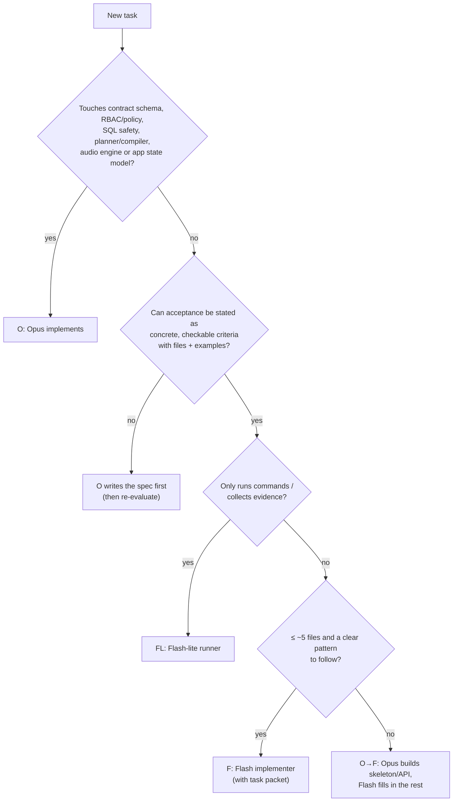
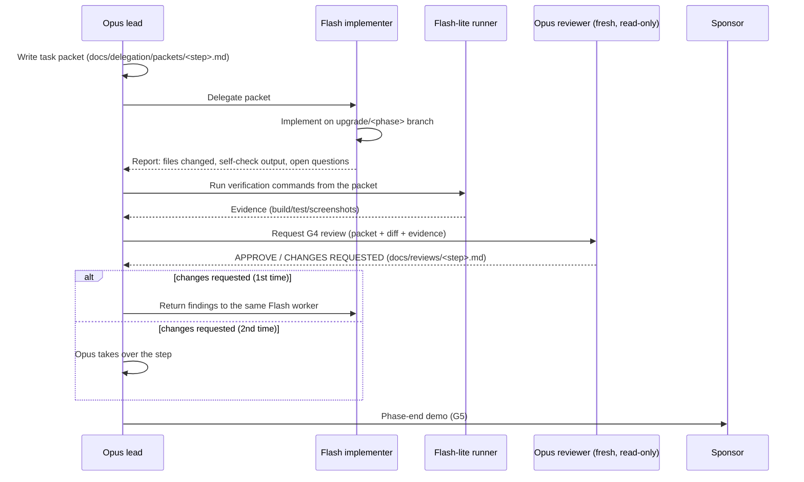

# Yukti AI: Work Delegation Plan (`DELEGATION.md`)

**Purpose:** cut token cost without lowering quality. **Opus** (the lead model, `Model: inherit`) handles design, risky logic, integration and reviews. **Flash** models handle well-specified grunt work. **Every Flash output is reviewed separately** before it counts as done.
**Linked:** [`BUILD.md`](BUILD.md) §4 (five gates) · [`UPGRADE_CHECKLIST.md`](UPGRADE_CHECKLIST.md) (Owner column) · [Task packet template](docs/delegation/TASK_PACKET_TEMPLATE.md) · [Review template](docs/reviews/REVIEW_TEMPLATE.md)

---

## 1. Roles & models

| Code | Role | Model (`invoke_subagent` Model) | Used for | Never used for |
|---|---|---|---|---|
| **O** | **Lead engineer** | Opus · `inherit` | Specs, architecture, contracts, RBAC/security, planner/compiler, insight logic, complex UI state (feed, orb, audio), integration, writing task packets, **reviewing Flash output**, phase demos | Mechanical edits Flash can do from a packet |
| **F** | **Implementer** | `flash` | Well-specified code from a task packet: components to a defined API, refactors with clear rules, fixtures, unit tests from given cases, scripts, styling passes, doc updates | Schema/contract changes, RBAC/policy, SQL safety, architecture choices, anything without a packet |
| **FL** | **Runner** | `flash_lite` | Running commands and collecting evidence: builds, tests, eval runs, screenshots, perf traces, grep/lint checks, BigQuery spot checks from given SQL | Editing source code |
| **R-O** | **Independent reviewer** | Opus · `inherit`, **fresh context, read-only** | G4 review of **every** step (BUILD §4.2). F/FL steps also get the delegation consistency checks (§3 rule 4); high-risk Opus steps get the full RBAC/security checklist | Implementing fixes (it reports; the executor fixes) |
| **S** | **Sponsor** | Human | G5 sign-off, open decisions, go-ahead for commit/push/deploy | — |

**Owner notation in the checklist:** `O` · `F` · `FL` · `O→F` (Opus writes spec/skeleton, Flash completes) · `F→O` (Flash drafts, Opus finalises) · `FL→O` (Flash-lite runs, Opus interprets) · `O→F + FL` · `O + S` (Opus executes with sponsor go-ahead).

---

## 2. Decision rule: who does a task?

---

## 3. Flash workflow & separate review (accuracy + consistency)

**Rules**
1. **No packet, no delegation.** Flash only works from a written [task packet](docs/delegation/TASK_PACKET_TEMPLATE.md): goal, exact files, do-not-touch list, acceptance criteria, examples, commands to self-check, output format.
2. **Flash stops and asks** (does not guess) when the spec is ambiguous, a change needs a file outside the packet, a contract or type must change, or a self-check fails twice.
3. **Separate review is mandatory for every F task:** automated checks (FL evidence) **plus** an R-O review in a fresh context against the packet. Flash never reviews its own work or another Flash's work.
4. **Consistency checks in every Flash review:** naming and design tokens follow U1; no hard-coded hex, numbers or entity codes; contract fields used exactly as typed; patterns match neighbouring code; no unrelated edits; comments and docs preserved.
5. **Two strikes:** a second "Changes requested" on the same packet moves the step to Opus. The reason is logged in the review file. This tunes future delegation.
6. **FL output is evidence, not judgement:** Opus or the reviewer interprets results; FL only reports.
7. **Commits** follow `BUILD.md` §4 (currently only after G5, pending OD-4). **Flash and Flash-lite never commit, push, reset, check out branches, deploy, or write to BigQuery.**
8. **Evidence spot-check:** once per phase, R-O re-runs one FL command to catch misread or fabricated output.
9. **Scope check:** each packet states a base SHA and a max file count; G4 verifies with `git diff --stat <base>..`.

---

## 4. Step-by-step ownership (summary; the checklist has the authoritative Owner column)

| Phase | O (Opus) | F (Flash) | FL (Flash-lite) | R-O review |
|---|---|---|---|---|
| **U0** | U0.2 docs, U0.4 subset *selection* | U0.4 subset *script* | U0.4 eval run, U0.5 screenshots | all |
| **U1** | U1.1 token set, U1.3 primitive APIs | U1.1 hex→token sweep, U1.2, U1.3 adoption, U1.4 contrast script | screenshots, grep checks | all |
| **U2** | U2.1 contract v2, U2.2 feed state, U2.3 TurnCard, U2.5 refine semantics, U2.6 session API | U2.1b v2 fixtures, U2.4 scroll, U2.6 UI wiring, U2.7 layout modes | Playwright runs | all (U2.1–U2.3, U2.6 high-risk) |
| **U3** | U3.1–U3.6 orb + audio engine + mic lifecycle + SR fallback | — | U3.7 perf traces, voice scripts | all (audio high-risk) |
| **U4** | design sign-off | U4.1–U4.5 polish to spec | screenshots | all |
| **U5** | U5.2 roster API + masking states, U5.5 row-normalisation util, U5.4 send API | U5.1 audit draft, U5.2 table features, U5.3, U5.4 chips UI, U5.5 adoption, U5.6 | fixture sweep, Playwright | all; U5.1 finalised by O |
| **B1** | B1.1 spec + table list, B1.2 entity dictionary, B1.3 rewrite function + cases | B1.1 generator, B1.3 tests, B1.4 | B1.5 gate eval, catalog profiling | all |
| **B2** | B2.1–B2.5 planner/compiler, expected specs for golden set | B2.2b golden-test cases | B2.6 gate eval | all (high-risk) |
| **B3** | B3.1 compiler roster grain, B3.2 designation decision, B3.3–B3.4 RBAC, B3.5 document access check | B3.1 column mapping, B3.5 transfer-note UI/doc wiring | B3.2 bq checks, B3.6 gate eval | all (RBAC high-risk) |
| **B4** | B4.1 API + 2 reference insights, B4.2, B4.3, B4.5 finance chain spec | B4.1 remaining insight types + tests, B4.4, B4.5 golden cases | B4.6 gate eval | all |
| **H1** | H1.1 async, H1.2 SQL safety, H1.3a security, H1.5b deploy (+S) | H1.3b hardening, H1.5a Dockerfile, H1.6 docs | H1.4 full eval | all |

**Actual split (checklist, 67 steps):** Opus 26 (39%), Flash 19 (28%), Mixed 18 (27%), Flash-lite 3 (4%), Sponsor 1 (1%). Opus tokens go mainly to specs, high-risk code and reviews; mixed steps put the risky core with Opus and the volume with Flash.

---

## 5. Fields added to support delegation

| Document | Field added | Purpose |
|---|---|---|
| `UPGRADE_CHECKLIST.md` | **Owner** column (`O`/`F`/`FL`/`O→F`/`F→O`/`FL→O`/`O + S`) per step | Who executes |
| `UPGRADE_CHECKLIST.md` | **Packet** link column for F/FL steps | The exact brief the model received |
| `docs/reviews/REVIEW_TEMPLATE.md` | **Executor model**, **Reviewer model**, **Packet**, **Strike count** | Proves separate review; tracks two-strike rule |
| `docs/delegation/TASK_PACKET_TEMPLATE.md` | New template incl. **Base SHA**, **Budget**, **Max files**, no-git/no-deploy rule | Standard Flash brief; scope verifiable at G4 |
| `docs/delegation/packets/` | One file per delegated step | Audit trail |
| `BUILD.md` §4 | Delegation rule + "Flash work always gets an R-O review" | Process anchor |
| `docs/DECISIONS.md` | D-8 delegation model | Decision record |

---

## 6. Cost & quality tracking

| Metric (per phase) | Where recorded |
|---|---|
| Steps by owner (O / F / FL) and first-pass approval rate of F steps | Phase gate file `docs/reviews/<phase>_gate.md` |
| Two-strike escalations (count and reason) | Review files → summarised at the gate |
| Defects found at G5 that review missed | Gate file; triggers a review-checklist update |

If the Flash first-pass approval rate drops below 70% in a phase, Opus tightens packets (more examples, smaller scope) before delegating further.
