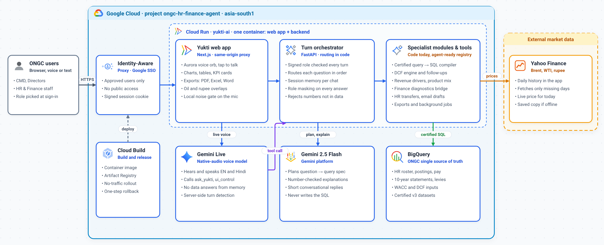

# Yukti AI — Architecture

**Yukti is one voice agent backed by a deterministic, tool-driven engine.** Gemini Live talks with the user. Code decides which specialist answers. Every number comes from BigQuery, the DCF engine or market data, never from a language model.

- **In-app page:** `/architecture`. It opens from the network icon in the top bar, e.g. https://yukti-ai-b6cmgrx7ka-el.a.run.app/architecture (behind IAP).
- **Source for the page:** [`yukti/frontend/src/app/architecture/page.tsx`](../yukti/frontend/src/app/architecture/page.tsx). Keep it in step with this document.



Full-size vector: [architecture/yukti_architecture.svg](architecture/yukti_architecture.svg)

## 1. Single agent or multi-agent?

**Single agent today, with a multi-agent-ready registry.**

| Part | What it is | What it decides | Produces numbers? |
|---|---|---|---|
| Gemini Live (`gemini-3.8-live`) | AI agent, the only one | Listens and speaks; calls the tools `ask_yukti`, `ui_control` and `control_screen` | Never |
| Turn orchestrator (`app/turn_runner.py`) | Code | Which handler answers, in a fixed order | No |
| Specialist modules (`app/agents/registry.yaml`) | Code, matched by regex triggers in `app/agents/coordinator.py` | DCF, finance diagnostics, HR transfers, document export, analyst | Yes, computed in code |
| Gemini 2.5 Flash | AI, called as a function | Turns the question into a JSON query spec; writes explanations and small talk | No; numbers are checked against the data |
| BigQuery `hrfin_*_v3` | Data | HR and finance records | Yes, the source of truth |
| Yahoo Finance (`app/market/`) | External data | Brent, WTI, USD/INR, with daily history cached in the app | Yes |

Registry entries hold `id`, `class`, `requires_role`, `triggers`, `examples` and, for DCF, the job steps. Any handler can be replaced by a true LLM sub-agent (e.g. an ADK agent that explains the on-screen chart) without changing the orchestrator, role checks or data guardrails. The legacy ADK agent (`app/agent.py`) is disabled (`YUKTI_LEGACY_AGENT=0`).

## 2. How one question flows

1. **The user asks** by voice or text. The signed persona cookie carries the role.
2. **Gemini Live** calls `ask_yukti(question)`. It does not answer data questions from memory.
3. **`turn_runner.py` routes** in a fixed order:
   1. FY clarification or UI command
   2. DCF follow-ups (`app/finance/dcf/followup.py`)
   3. Coordinator: regex over the registry, then the role gate, then the confirmation gate for `dcf_agent`, which runs as a background job
   4. Revenue drivers and mix
   5. Oil and rupee overlays
   6. Planner pipeline
   7. Smalltalk fallback (`app/brain/smalltalk.py`)
4. **Planner pipeline:** Gemini 2.5 Flash produces a QuerySpec in JSON. A deterministic compiler builds certified SQL, which runs on BigQuery. The presenter builds charts, tables and KPI cards.
5. **Checks:** `enforce_contract` applies role-based masking. The narrator rejects any number that is not in the result.
6. **Gemini Live** reads the grounded answer aloud while the canvas renders it.

## 3. Guardrails

- Numbers come only from BigQuery, the DCF engine or market data.
- The LLM plans; code writes the SQL.
- The role is checked every turn, and restricted fields are masked.
- DCF runs only after the user confirms the assumptions.
- IAP is in front of Cloud Run; there is no public access.

## 4. Platform

- Google Cloud project `ongc-hr-finance-agent`, region `asia-south1`.
- One Cloud Run service, `yukti-ai`. A single container runs the Next.js `server.js` (a same-origin proxy for `/api/*`, `/health` and `/ws/live`) and FastAPI on port 8095.
- The Firestore job store falls back to in-memory if Firestore is unavailable.
- Releases: Cloud Build → Artifact Registry → `gcloud run deploy --no-traffic --tag` → startup check → `update-traffic`. One-step rollback is listed in `APP_LINK.md`.

## 5. Regenerating the diagram

The diagram is generated as SVG with official Google Cloud product icons, then rendered to PNG with headless Chrome:

```bash
google-chrome --headless --disable-gpu --no-sandbox --force-device-scale-factor=2 \
  --window-size=1520,620 --screenshot=yukti_architecture.png file://$PWD/yukti_architecture.svg
```

Copy both files to `docs/architecture/` and `yukti/frontend/public/architecture/`.
