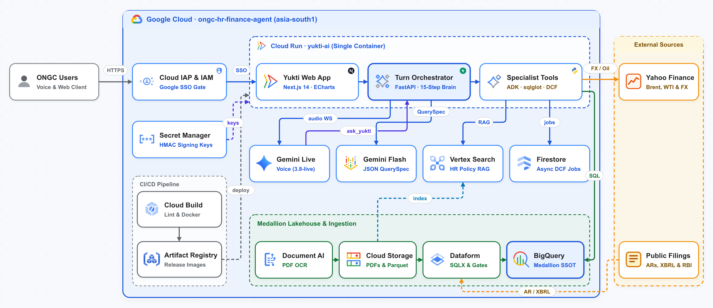
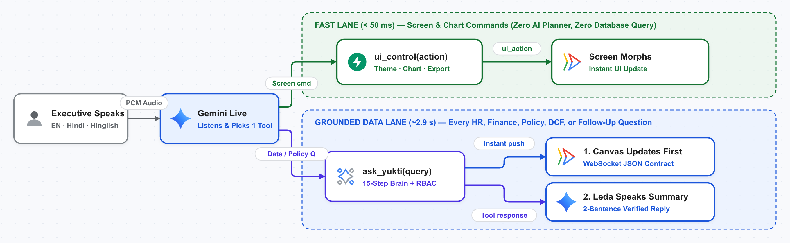
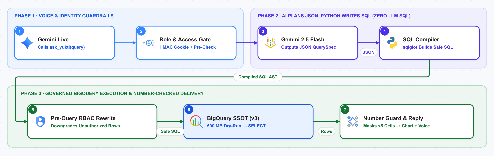
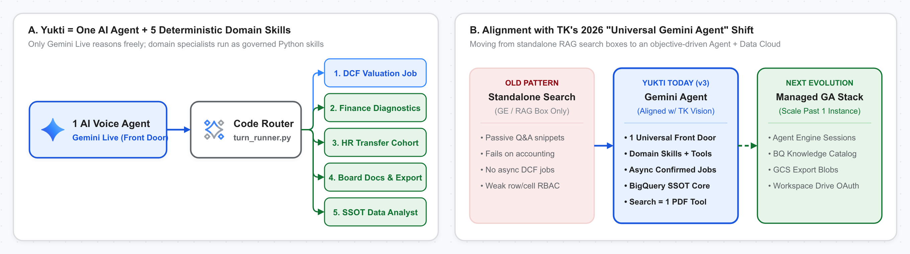

# Yukti AI (`HR and Finance_ONGC`) — Visual Architecture & Flow Guide

> **Interactive HTML Portal:** Open [`architecture/yukti_architecture_portal.html`](architecture/yukti_architecture_portal.html) in any browser to click service cards and step through the 7-stage BigQuery SQL pipeline interactively.

---

## 1. End-to-End Cloud Architecture (18 Services)

Yukti runs inside a single IAP-protected Cloud Run service (`yukti-ai`) backed by Vertex AI (`Gemini Live`, `Gemini 2.5 Flash`, `Vertex AI Search`), `Firestore` async jobs, and a reconciled `BigQuery` v3 Medallion lakehouse:

---

## 2. How Gemini Voice Works (Two-Lane Routing)

**Gemini Live (`gemini-3.8-live`) is strictly the voice front door—never the calculator.** When an executive speaks, Gemini Live listens in Indian English, Hindi, or Hinglish and chooses **one of two lanes**:

1. **Fast Lane — `ui_control(action, value)` (`< 50 ms`):** Voice commands like *"Make it a bar chart"*, *"Dark mode"*, *"Overlay live Brent"*, or *"Download as Excel"* morph the screen directly with **zero LLM planning and zero database queries**.
2. **Grounded Data Lane — `ask_yukti(query)` (`~2.9 s`):** Every question about numbers, people, policies, DCF valuation, or document drafting goes to the 15-step Python Brain (`yukti/backend/app/turn_runner.py`). Once verified, **the visual card hits the screen immediately** over WebSocket while `Leda` speaks a crisp 2-sentence summary.
3. **Voice Safety Locks (`yukti/backend/app/live_session.py`):** Forbidden from answering numbers from memory; refuses spoken role-switch attempts (*"Make me CMD"*); uses a half-duplex echo gate so speaker playback never re-triggers the mic.

---

## 3. From Voice to BigQuery SQL (7 Steps, Zero LLM-Written SQL)

**Neither Gemini Live nor Gemini 2.5 Flash ever writes SQL.** Instead, Gemini Flash only creates a simple JSON checklist (`QuerySpec`), and deterministic Python code builds and guards the SQL:

1. **Voice Call:** `Gemini Live` hears the question and calls `ask_yukti(query)`.
2. **Role & Access Gate:** `turn_runner.py` verifies the tamper-proof HMAC cookie role and blocks unauthorized topics upfront.
3. **JSON Plan (No SQL):** `Gemini 2.5 Flash` (`planner.py`) turns the question into a structured JSON `QuerySpec` (metric, dimensions, filters, period).
4. **SQL Compiler:** Python (`compiler.py`) maps that JSON against Yukti's 86-table catalog and builds read-only parameterized SQL via `sqlglot`.
5. **Pre-Query RBAC Rewrite:** If a role lacks clearance for employee names, `rbac.py` automatically rewrites the query to safe grade-level totals before BigQuery runs.
6. **BigQuery Execution:** Asserts a **500 MB dry-run cap**, then queries `hrfin_gold_v3` in `asia-south1`.
7. **Number Guard & Reply:** Masks small cells (`< 5` people), rejects any spoken sentence containing unverified digits (`narrator.py`), updates the screen, and speaks the verified summary.

---

## 4. Uni-Agent Model & Alignment with TK's 2026 "Gemini Agent" Strategy

- **Uni-Agent Today, Plug-In Ready:** Only `Gemini Live` is an autonomous conversational agent (the legacy multi-tool ADK SQL loop is disabled via `YUKTI_LEGACY_AGENT=0`). The 5 entries in `yukti/backend/app/agents/registry.yaml` run as fast Python skills—though any entry can later be swapped for a bounded ADK sub-agent without changing RBAC or routing.
- **Aligned with Thomas Kurian's 2026 "Gemini Agent" Shift:** Instead of treating standalone enterprise search (`GE`) as the whole brain, Yukti uses **Gemini as one universal front-door agent** equipped with **domain Skills**, **confirmed async jobs** (`dcf_agent` → `Firestore`), and **BigQuery SSOT**—scoping `Vertex AI Search` strictly to HR policy PDFs.
- **Next 3 Upgrades for Full Managed Google Scale:** (1) Move in-memory sessions & local exports to **Agent Engine / Firestore + GCS** to scale past `--max-instances=1`; (2) sync `semantic_model.yaml` to **BigQuery Knowledge Catalog**; (3) add **Workspace OAuth** for live Google Drive Docs/Sheets creation.
