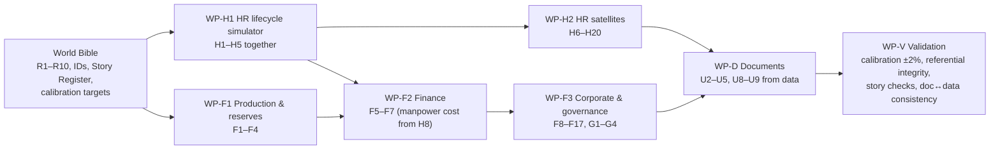

# ONGC HR & Finance Agent: Data Requirements Specification v1

> [!IMPORTANT]
> **Approach:** generate one **complete, internally consistent "ONGC world"** that covers all 95 questions in a single pass. Generate it **in the formats ONGC actually has**: SAP extracts, Excel workbooks, scanned PDFs, policy documents. Then ingest it into GCP through the same pipeline a real rollout would use. The demo then shows the ingestion story as well as the answers. Access control is deferred to the end.

---

## 0. Ground rules for all generated data

| Rule | Value |
|---|---|
| Demo "today" | 19-Oct-2026 (FY27, H1 closed) |
| History window | HR FY2001–FY27 YTD (so 25-year tenures exist); Finance/Production FY2017–FY27 YTD (10 years, monthly) |
| Calibration | Totals must match `knowledge/public_sources/grounding_data/FACTS.md` within ±2%. Examples: 23,117 regular employees (13,781 executives / 9,336 non-executives) at 31-Mar-26; women 8.2%; SC 15.02% / ST 11.35%; PwD 523; employee cost ₹10,211 cr; revenue ₹1,32,508 cr; PAT ₹32,894 cr; capex ₹35,878 cr; 20.5 MMT oil, 19.97 BCM gas; CSR ₹949 cr; Assam headcount 3,561 |
| Flow constraints (FACTS) | FY26: only 167 hires vs. ~1,350–1,420 separations; executive turnover 7.4% / non-executive 3.1%; age bands <30: 9.6%, 30–50: 66%, >50: 24.4%; Offshore ₹92,406 cr revenue / Onshore ₹40,102 cr; royalty ₹12,965 cr, OIDB cess ₹13,034 cr; **windfall tax (SAED) ended Dec-2024**, so W4 becomes "what did the removal add?"; lifting cost ~US$11.5/boe (proxy) |
| Modelled (not public) | Grade-wise headcount, asset-level headcount (except Assam 3,561), asset-level P&L and production, OBC share, contract labour. Must be plausible and must sum to the public totals. |
| Real names | Real work centres, assets, basins, institutes, fields, subsidiaries and Board roles (Chairman & CEO, Director HR, Director Finance, etc.). **Employees, vendors and individual transactions are fictional.** |
| Keys | One global ID scheme shared by every table and document (§1). A transfer order PDF must name employees and dates that exist in `posting_history`. |
| Determinism | All structured generators are Python, seeded, re-runnable; no LLM-typed numbers |
| Planted stories | ~15 findings with exact target numbers, logged in the Story Register (§1.3), so we know the "right answer" in advance |

---

## 1. World Bible (I write this first; every generator reads it)

### 1.1 Canonical reference data
| ID | Entity | Rows | Key attributes | Source of truth |
|---|---|---|---|---|
| R1 | Work centres | ~45 | wc_id, name, type (asset/basin/plant/institute/office/service), director_owner, city, state, sector (W/E/S/N/NE), **cluster_id**, **hard_station_cat**, onshore/offshore | ONGC Organogram 2025 (in FACTS §A2) |
| R2 | Grades | ~17 | E0–E9 (executives), non-executive bands (Groups B/C/D), designation, pay scale min/max | ONGC recruitment ads, AR |
| R3 | Disciplines | ~30 | Drilling, Production, Reservoir, Geology, Geophysics, Chemistry, Mechanical, Electrical, Instrumentation, Civil, Marine, F&A, HR, MM, Legal, IT, Medical, Fire, Security… | ONGC recruitment notices |
| R4 | Fields | ~45 | Real field names (Mumbai High N/S, Heera, Neelam, Bassein, Gandhar, Ankleshwar, Kalol, Santhal, Lanwa, Geleki, Lakwa, Rudrasagar, Tripura gas fields, KG-DWN-98/2, Narimanam, CBM Bokaro…); asset, basin, on/offshore, discovery year, maturity, oil/gas | AR, DGH, public data |
| R5 | Projects | ~60 | KG-98/2, MH redevelopment phases, Daman Upside, pipeline replacement, NE projects; sanctioned cost, start/end, director owner | AR, investor presentations |
| R6 | Cost centres / profit centres | ~400 | SAP-style CO objects mapped to wc_id and field_id | Generated |
| R7 | Customers | ~25 | IOCL, BPCL, HPCL, MRPL, GAIL, CPCL… | Public |
| R8 | Vendors | ~2,000 | Category (rig hire, offshore support vessels, chemicals, logistics, seismic, IT), state, MSE flag | Generated |
| R9 | States/districts | ~100 | CSR geography, aspirational-district flag | Govt list |
| R10 | Calendar, FX, prices | monthly | Brent, crude net realisation, APM gas price, INR/USD, DA% | FACTS §D |

### 1.2 ID conventions
`EMP-######` (CPF-number style) · `WC-xxx` · `FLD-xxx` · `PRJ-xxxx` · `CC-#####` · `PO-##########` · `ORD/HR/yyyy/####` (office orders) · `DOC-xxx` (documents).

### 1.3 Story Register (planted findings; exact numbers fixed in the Bible)
| # | Story | Question(s) it answers |
|---|---|---|
| S1 | 412 executives at Corporate HQ Delhi with ≥5 years; 138 of them beyond the 10-year cumulative cap; 31 exempt (retiring within 3 years) | C1, P11, T2 |
| S2 | NE stations (Assam, Jorhat, Tripura, Silchar) 9% short of executives; 260 E3–E5 have never had a hard posting | C2, H2, P12 |
| S3 | Rajahmundry and Eastern Offshore grew headcount the most (KG-98/2 ramp-up); Mehsana and Cauvery flat or declining | C3 |
| S4 | GM+ retirement cliff: 47 E7+ retire FY27–FY29; 11 critical roles with no ready successor | C4, T3 |
| S5 | Geoscience and drilling: biggest skill gap by 2030 | C5, W2 |
| S6 | Two loss-making mature fields (one Assam, one Cauvery); one Assam field heavily invested yet still loss-making | C6–C8, T1 |
| S7 | One asset where headcount rose 14% while production fell 9% over 5 years | C11 |
| S8 | Highest manpower cost per BOE at a small onshore asset; lowest at Mumbai High | C12, F7 |
| S9 | KG-98/2 delays + one pipeline project ~₹1,100 cr overrun | C9 |
| S10 | MoU: 2 parameters off-track in FY27 H1 | C10, P14 |
| S11 | DPC backlog of 180+ cases >6 months in two disciplines | H5 |
| S12 | Mid-career (E3–E5) resignation spike in IT and Finance | H4 |
| S13 | Contract workforce > regular staff at two plants | X1, X2 |
| S14 | Offshore overtime correlates with lost-time injuries at one asset | X3 |
| S15 | Brent at $60 pushes 6 more fields into loss | W1 |

---

## 2. Structured data: what we generate, in source-native formats

> [!NOTE]
> "Source format" means generators write files the way ONGC systems would export them (SAP field names, Excel layouts). The ingestion pipeline then conforms them into BigQuery. Column lists below are the **conformed (silver) schema**.

### 2.1 HR (source: SAP HCM infotypes, plus Excel and manual registers)
| ID | Table | Grain / rows | Key columns | Source format | Serves |
|---|---|---|---|---|---|
| H1 | employee_master | Employee / ~40k (23,117 active + separated since 2001) | emp_id, name, gender, dob, doj, category (Gen/SC/ST/OBC/EWS), pwd, home_state, discipline, grade, designation, entry_mode, status | SAP PA0002/PA0001 CSV | C1–C5, H6, H7, W2 |
| H2 | posting_history | Posting stint / ~250k | emp_id, wc_id, from_dt, to_dt, posting_type (initial/rotation/request/promotion/hard-station/deputation), order_no | SAP PA0001 CSV | C1, C2, H1, H2, H10, P11, T2, E2, D5 |
| H3 | promotion_history | Promotion / ~90k | emp_id, from_grade, to_grade, eff_dt, dpc_id, mode (time-bound/merit) | SAP PA0000 actions | P12, T3, E4 |
| H4 | dpc_cases | DPC case / ~15k | dpc_id, grade, discipline, due_dt, held_dt, status, pending_reason | Excel tracker | H5, D3 |
| H5 | separations | Exit / ~17k | emp_id, sep_dt, type (superannuation/VRS/resignation/death/removal), age | SAP PA0000 | C4, C5, H4, W2 |
| H6 | sanctioned_posts | wc × discipline × grade band × year / ~30k | sanctioned, in_position | Excel manpower plan | C2, H3, X7 |
| H7 | headcount_snapshot | Derived, monthly | wc, grade, discipline, gender, category, count | View | C3, C11, M1 |
| H8 | payroll_monthly | Employee × month (FY22–FY27) / ~1.6M | basic, DA, cafeteria (≤35%), HRA, overtime_hrs, overtime_amt, PRP (annual), employer CPF | SAP payroll cluster export | C12, C13, F7, D1, X3, W3 |
| H9 | apar_ratings | Employee × year / ~200k | rating (Outstanding…Poor) | SAP / e-APAR | P12, M3 (denial) |
| H10 | succession_plan | Critical E7+ role / ~300 | role, incumbent, retire_dt, successors[], readiness | Excel | C4, T3 |
| H11 | training_records | Attendance / ~300k | emp_id, programme, institute (ONGC Academy, IOGPT, KDMIPE, IDWE…), hours, date | LMS CSV | H8, X6 |
| H12 | training_calendar | Programme / ~600 | programme, institute, dates, eligible grades | Excel | E6 |
| H13 | leave_ledger | Transaction + balance / ~2M | emp_id, leave_type (CL/EL/HPL/CCL/study…), dates, balance | SAP PA2001/PA2006 | E1, P4 |
| H14 | medical_claims | Claim / ~150k | emp_id, hospital, panel_flag, amount, status | Medical system CSV | E3 |
| H15 | grievances_litigation | Case / ~3k | type, forum (CAT/HC/SC/internal), filed_dt, wc, status | Legal register Excel | H9 |
| H16 | contract_workforce | Contract × month / ~60k | contract_id, vendor, wc, category (core/non-core), headcount, cost | SAP MM service entries | X1, X2 |
| H17 | hse_incidents | Incident / ~5k + man-hours by wc-month | wc, date, type, LTI flag, man-hours | HSE system CSV | X3 |
| H18 | travel_claims | Claim / ~200k | emp_id, grade, class, city_cat, amount | SAP Travel | E5, W3 |
| H19 | icc_committees | Station / ~45 | members, chair (POSH committees) | Excel | P9 |
| H20 | vigilance_cases | Case / ~400 (restricted) | emp_id, nature, stage | Manual register | D6, P12 |

### 2.2 Operations and Finance (source: production DB, SAP FI/CO/MM/PS, Excel)
| ID | Table | Grain / rows | Key columns | Source format | Serves |
|---|---|---|---|---|---|
| F1 | production_monthly | Field × month / ~5.4k | oil_mt, gas_mmscm, condensate, water_cut, active_wells | Production DB CSV | C11, C12, C14, F1 |
| F2 | reserves_annual | Field × year / ~450 | 2P oil/gas, in-place volumes; RRR by basin | Excel (Reserves Committee) | C7, F8 |
| F3 | wells_drilled | Well / ~5k | field/basin, type (exploratory/development), spud_dt, cost, result | Drilling DB | F8 |
| F4 | price_fx_monthly | Month / ~120 | Brent, net realisation, APM gas price, INR/USD | Excel | F4, W1, W4 |
| F5 | field_pnl_annual | Field × FY / ~450 | revenue (oil/gas), royalty, cess, SAED/windfall, opex by head (manpower allocated from H8, contract, power, logistics, chemicals), DD&A, EBITDA, PBT | SAP CO-PA export | C6, C8, C14, F3, F4, F10, W1, W4, M4, T1 |
| F6 | cost_ledger | Cost centre × cost element × month / ~300k | amount, cost_element (SAP GL) | SAP FI-CO (COSP/COSS-style) | F1, F7, C12 |
| F7 | capex_budget | Project/asset × FY × month / ~40k | head, BE, RE, actual | Excel BE/RE workbooks + SAP PS actuals | C7, F2, M2, P17 |
| F8 | project_progress | Project × milestone / ~1.5k | planned/actual dates, sanctioned vs. anticipated cost | SAP PS / MS Project export | C9 |
| F9 | purchase_orders | PO line / ~150k | vendor, category, value, wc, planned vs. actual | SAP MM (EKKO/EKPO-style) | F5 |
| F10 | receivables | Invoice / ~60k | customer, amount, due_dt, paid_dt (for ageing) | SAP FI-AR | F6 |
| F11 | forex_hedges | Exposure / ~500 | currency, notional, hedge_ratio, maturity | Treasury Excel | F9 |
| F12 | csr_projects | Project / ~1.5k | state, district, theme, aspirational flag, sanctioned, spent | CSR tracker Excel | P15, X9 |
| F13 | mou_targets | Parameter × FY / ~300 | target scale (Excellent/VG/Good/Fair/Poor), actual | Excel (DPE MoU) | C10, P14 |
| F14 | benefit_liabilities | Scheme × FY / ~50 | gratuity, PRBS, post-retirement medical, leave encashment (actuarial) | Excel (actuary) | X4, P13 |
| F15 | subsidiary_financials | Entity × FY / ~80 | revenue, PAT, dividend to ONGC (OVL, HPCL, MRPL, OGL, OPaL) | AR (real) | X5 |
| F16 | energy_transition | Project × FY / ~200 | MW, capex, emissions Scope 1/2 path, reskilling counts | Excel | X6 |
| F17 | corporate_financials | FY / ~10 | revenue, PAT, dividend/share, payout (real) | AR (real) | E7, P17, F7 |

### 2.3 Governance
| ID | Table | Rows | Source format | Serves |
|---|---|---|---|---|
| G1 | parliament_questions | ~400 | Lok Sabha/Rajya Sabha index + reply PDFs (real + synthetic) | X7 |
| G2 | cag_paras | ~150 | Excel tracker + report PDFs | X8 |
| G3 | rti_applications | ~6k | RTI portal CSV | X8 |
| G4 | board_agenda_index | ~300 | Index pointing to confidential documents | P20, C14 |
| G5 | access_audit_log | Runtime + seeded history | BigQuery | M5 |

---

## 3. Unstructured corpus

| ID | Set | Count | Real / synthetic | Format (to show ingestion variety) | Serves |
|---|---|---|---|---|---|
| U1 | ONGC public policies + govt rules (DPE, CSR Rules, POSH, CVC, GFR…) | ~80 (being collected) | **Real** | Native PDF | P6, P8, P9, P13–P17 |
| U2 | Internal rulebooks: Transfer Policy (JRTP), Leave, CDA, R&P/Promotion, TA/DA, Medical, PRBS, Delegated Powers summary, HR Manual | ~10 | Real excerpts where found; **synthetic, ONGC-style, clause-numbered** otherwise | **Mix: 3 as scanned image PDFs** (OCR demo) | P1–P5, P7, P10, P11, P16, E2, E4, E5, H10 |
| U3 | Office orders and circulars (transfer orders, DA revisions, leave amendments, DPC notifications) | ~150 | Synthetic, **generated from H2/H3** | Scanned PDF + DOCX | T2, E2, audit trail |
| U4 | Confidential: Draft FY27 Transfer Order, Board notes (field divestment, FY27 capex), DPC results, vigilance summary | ~12 | Synthetic, generated from data | DOCX/PDF | D2, D3, P18–P20, C8 |
| U5 | Monthly asset performance MIS reports (per asset, 24 months) | ~400 | Synthetic, numbers pulled from F1/F5/H7 | **Scanned PDF with tables** | C11, T1, X10 |
| U6 | Annual reports, BRSR, investor presentations | ~10 | **Real** | PDF | E7, X5, X6 |
| U7 | Parliament replies + CAG reports | ~60 | Real (collected) + synthetic | PDF | X7, X8 |
| U8 | Excel source workbooks (BE/RE budget, MoU tracker, CSR tracker, manpower plan, succession) | ~40 | Synthetic | XLSX with merged headers (realistic mess) | F2, C10, X9, H3, C4 |
| U9 | Output templates: board note, transfer proposal sheet, Parliament reply format, P&L sheet | 4 | Synthetic | DOCX/XLSX | C14, H10, F10, X7 |

---

## 4. Generation process: work packages for flash models

| WP | Owner model | Output | Acceptance check |
|---|---|---|---|
| WB World Bible | Me (lead) | `data_bank/world_bible/*.yaml` | Reviewed by you |
| WP-H1 HR lifecycle simulator | Flash (writes Python) | SAP-format CSVs H1–H5 | Headcount trend FY13–FY26 matches AR; S1–S5 hold |
| WP-H2 HR satellites | Flash | H6–H20 | Foreign keys valid; S11–S14 hold |
| WP-F1 Production | Flash | F1–F4 | 20.5 MMT / 19.97 BCM; asset shares |
| WP-F2 Field economics | Flash | F5–F7 (SAP CO-PA, FI-CO, Excel BE/RE) | Revenue/PAT/capex totals; S6–S9, S15 hold |
| WP-F3 Corporate & governance | Flash | F8–F17, G1–G4 | CSR ₹949 cr, MoU, liabilities |
| WP-D Documents | Flash (authoring) + script (render/scan) | U2–U5, U8, U9 | Every named employee, date and number traces to tables |
| WP-V Validation | Me + script | `validation_report.md` | All checks pass before ingestion |

**Answer key:** for all 95 questions, a gold answer computed by SQL from the generated data. This becomes the evaluation set.

---

## 5. Ingestion and retrieval: real-world shape, cloud demo

| Source at ONGC | Stays where in real life | Production path to GCP | What the demo does |
|---|---|---|---|
| **SAP ERP** (HCM, FI/CO, MM, PS) | On-prem | **BigQuery Connector for SAP** (SLT replication) or SAP Datasphere → BigQuery; **Cortex Framework** data models for SAP | SAP-format CSVs → GCS → BigQuery raw → Dataform → silver/gold |
| **Operational databases** (production, drilling, HSE) | On-prem (Oracle/SQL Server) | **Datastream** change-data-capture → BigQuery | CSV → GCS → BigQuery |
| **Excel workbooks** | File shares / email | GCS / Drive drop zone → cleaning (Dataform/Python) → BigQuery | Messy XLSX → parser → BigQuery |
| **Scanned reports, policies, circulars** | e-Office / document management | **Document AI** (OCR + layout parser) → GCS → **Vertex AI Search / RAG Engine** | Image PDFs → Document AI → index (OCR shown live) |
| **Native PDFs / DOCX** | Intranet | GCS → Vertex AI Search | Same |

**For data that must stay on-prem (e.g., salaries, vigilance), three patterns. We'll recommend one and show the others on a slide:**
1. **Federated tool call:** the agent runs in the cloud. Sensitive queries go to an on-prem API over Cloud Interconnect / Private Service Connect. Only answers leave the premises.
2. **Replicate de-identified data:** aggregated or pseudonymised marts in the cloud; identities stay on-prem.
3. **Sovereign deployment:** Google Distributed Cloud (air-gapped) runs the same agent and models inside ONGC's data centre.

**Retrieval design (so any question and follow-up works):**
- **Gold layer = a business definitions layer:** curated views plus a glossary of ONGC terms (BOE, lifting cost, the transfer policy's tenure rules, cluster, hard station, BE/RE) and metric definitions.
- **Structured tool:** NL-to-SQL over the gold layer with few-shot examples taken from the answer key.
- **Document tool:** hybrid search with clause-level citations.
- **Joined questions** (e.g., P11, transfer policy + data): the agent reads the rule from the policy, then applies it in SQL.
- **Session memory** for follow-up chains. **Document generator** for Excel/Word outputs.

---

## 6. GCP project recommendation

> [!IMPORTANT]
> **Recommendation:** create a **new dedicated project**, e.g. `ongc-hr-finance-agent`, under the `amandeepsinghs.altostrat.com` org.

| Factor | New project | Reuse `og-agentic-ecosystem` |
|---|---|---|
| Data sensitivity (salary-like, vigilance data) and later access control | Clean IAM boundary | Mixed with operations demos |
| Sovereignty / hand-over story to ONGC | Can be cloned or handed over as one unit | Entangled |
| Cost tracking | Isolated | Shared |
| Setup effort | ~15 min (billing link, enable APIs) | None |
| Portfolio view | Can still link from the ecosystem hub | Native |

Proposed GCS layout: `gs://<project>-hr-fin-raw/{sap,excel,scanned,policies}` → `gs://<project>-hr-fin-curated/`; BigQuery datasets `hrfin_raw`, `hrfin_silver`, `hrfin_gold`, `hrfin_docs_meta`.

---

## 7. Sequence (access control last)
1. World Bible + Story Register → your review
2. Parallel flash generation (all work packages) → validation
3. GCP project + ingestion pipelines (raw → silver → gold, Document AI, search index)
4. Agent: retrieval tools, document outputs, follow-up memory
5. Evaluation: 95 questions × 3 phrasings + follow-up chains vs. the answer key
6. Access control (personas, BigQuery row/column security, document access lists) and the UI
