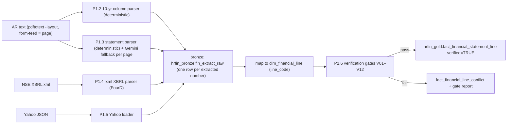

# SPEC-01: Real Financial SSOT, Knowledge RAG and Anchor Tables

**Features:** FEAT-018 (Real Financial SSOT), FEAT-019 (Yahoo ingestion), FEAT-020 (Knowledge RAG over real AR text) · **Phase:** P1 (steps P1.1–P1.11, numbering as in `UPGRADE_CHECKLIST.md`) · **Owner of spec:** O · **Status:** Draft v3 (23-Oct-2026) · **Downstream:** SPEC-02 (WACC/DCF), SPEC-04 (Employee-360), SPEC-05 (Field economics), SPEC-08 (V20 diagnostics), SPEC-09 (statement visual), SPEC-11 (eval)

> [!IMPORTANT]
> **BLUF.** Every financial number Yukti shows must come from one BigQuery table, `hrfin_gold.fact_financial_statement_line`, where each row is extracted (not authored) from an ONGC Annual Report page, an NSE XBRL fact or the Yahoo API, and has passed numeric gates (`verified = TRUE`).
> The current dataset (`financial_build/scripts/build_10yr_financials.py`) is LLM-authored with plug lines. It matches the AR on 31 of 60 spot checks and on only 1 of 17 balance-sheet/cash-flow totals. It is retired, not patched.
> Primary = AR standalone FY17–FY26 + consolidated FY22–FY26 (10-yr summary back to FY13; ARs FY17–FY19 now on disk). Backfill = NSE XBRL FY18–FY21, FY23–FY24. Yahoo = a separately labelled *consolidated* view for FY23–FY26, a cross-check, and the preferred market-data feed. Yahoo is **optional and retryable** (HTTP 429 today), so it is not on the P1 critical path.
> The same pipeline also loads four **anchor tables** (segment, production, reserves, BRSR HR aggregates). SPEC-04 and SPEC-05 must reconcile synthetic data to these tables exactly.

---

## 1. Purpose and verbatim trace

| Verbatim | Requirement | Where this spec answers it |
|---|---|---|
| V18 "income statement, balance sheet and cash flow … from annual statements … every number should be very precise, no room for error" | Zero-error IS/BS/CF by year, structured in BigQuery | §4–§7 |
| V18 "Yahoo Finance … very much structured … source it directly" | Yahoo ingestion with honest labelling | §4.4, §9 |
| V18 "RAG was not the best … Knowledge RAG or some advanced methodology" | Structured line lookup **plus** vector search over real AR text, with page citations | §8 |
| V18 "production flows to the money … to an aggregated level" | Anchor tables that the field/employee layers reconcile to | §10 |
| V20 "display the income statement as you see in Yahoo Finance" | Multi-year statement reads verified rows (layout lives in SPEC-09) | §7.3 |
| V23 decision 1 | AR = zero-error primary; XBRL backfill; Yahoo = labelled consolidated view | §3 |

## 2. Current state (evidence)

| Area | Status | Evidence (from diag reports) |
|---|---|---|
| 10-yr financial dataset | **Broken** | Hard-coded literals `financial_build/scripts/build_10yr_financials.py:29-1120`; BS plug `:1193-1199`; CF plug `:1223`; PBT recomputed from invented components `:1153-1158` (diag_A §1) |
| Identity checks "200 PASS" | **Broken (tautological)** | `verify_pnl_identities.py` re-checks identities the builder enforces (diag_A Bugs #2) |
| Third conflicting copy | **Broken** | `data_bank/landing/governance/corporate_financial_summary.csv` FY17 royalty 7,634.98 vs JSON 8,548 vs AR 11,574.8 (diag_E §1) |
| Ratios | **Broken** | ROCE ≈ 2× AR (FY24 60.08% vs AR 30.60%) `build_10yr_financials.py:1228-1245` |
| Yahoo | **Missing** | No `yfinance`/HTTP code; label only at `build_10yr_financials.py:1364`, `compiler.py:552,587,632,667,708,743`, `presenter.py:155,487` |
| Provenance shown to user | **Broken** | Local JSON fallback reports BigQuery SQL as source `compiler.py:867-1007` (BUG-04) |
| Knowledge RAG | **Broken** | 129 f-string chunks from `RAW_10YR` (`build_and_load_financial_rag.py:117-356`); keyword retrieval `insight_context.py:138-195`; `hrfin_docs.financial_notes_chunks` never queried |
| Real sources on disk | **Available, unused** | AR FY22–FY26 text in `knowledge/public_sources/grounding_data/text/`; 12 NSE XBRL files now in `knowledge/public_sources/grounding_data/xbrl/` (FY18–FY21, FY23–FY24, S+C) |
| Packaging | **Broken** | `Dockerfile:29-36` omits `financial_build/` |

## 3. Source hierarchy (decided, V23 #1)

| Rank | Source | Local path | Coverage | Precision | Role |
|---|---|---|---|---|---|
| 1 | **AR full statements** (Schedule III BS, P&L, Ind AS 7 CF, SOCE, Notes) | `knowledge/public_sources/grounding_data/text/ONGC_AR_FY20xx-yy.txt` (+ `raw/*.pdf`) | Standalone + consolidated FY22–FY26 (each AR also gives the prior-year comparative, so FY21 too) | ₹ million, 2 dp (exact) | **Primary** |
| 2 | **AR "A Decade of Operational and Financial Excellence" 10-yr tables** | AR FY26 p.21–22 (PDF p.23–24) gives FY17–FY26; AR FY24 gives FY15–FY24; AR FY22 gives FY13–FY22 | Standalone summary (~70 lines incl. physical, levies, BS heads, ratios, employees) | ₹ million, 0 dp | **Primary** for FY13–FY21 summary lines and ratios; cross-check for FY22–FY26 |
| 3 | **ARs FY16–FY19** (downloaded 23-Oct, see `knowledge/public_sources/MANIFEST_v3_acquisition.md`) | `grounding_data/text/ONGC_AR_FY2016-17.txt`, `ONGC_AR_FY2017-18.txt` (English, NSE copy; `_HI` = Hindi, numerals only), `ONGC_AR_FY2018-19.txt`, `ONGC_AR_FY2015-16_NSE.txt` (Indian GAAP, so FY16 is **not** Ind AS comparable) | Full standalone + consolidated FY17–FY19 (+ FY16 comparatives in AR FY17) | ₹ million, 2 dp | **Primary** for FY17–FY19 full statements. Validated: FY17/FY18/FY19 revenue, PBT, PAT and equity match the AR FY26 10-yr table (MANIFEST §3) |
| — | AR FY20 and FY21 | `raw/ONGC_AR_FY2019-20.pdf` (283 MB), `raw/ONGC_AR_FY2020-21.pdf` (256 MB) | **Image-only** (OCR skipped) | — | Not used in P1. FY20/FY21 = XBRL + 10-yr table + the comparatives printed in AR FY21-22 (FY21) |
| 4 | **NSE XBRL** (Reg 33 annual results, `in-bse-fin` taxonomy) | `knowledge/public_sources/grounding_data/xbrl/NSE_XBRL_ONGC_FY*_{Standalone,Consolidated}__*.xml` | FY18–FY21, FY23–FY24 (the NSE feed has **no** FY22, FY25, FY26 annual XBRL); context `FourD` = full year, `OneD` = Q4 | **₹1 crore** (`decimals="-7"`) | Backfill FY20 lines not in rank 2/3; cross-check elsewhere |
| 5 | **Yahoo fundamentals-timeseries + chart** | `knowledge/public_sources/market_data/yahoo/` (fetch script `_PENDING_fetch_script_yahoo.py`; currently **HTTP 429**, rate-limited) | **Consolidated only**, FY23–FY26 annual + 5 quarters; prices since 1996; `^NSEI` | Full INR | **Optional and retryable, not on the P1 critical path.** Labelled "Yahoo view (consolidated)", cross-check ≤ ₹1 cr, preferred market-data source for SPEC-02 (fallbacks in §9.1) |
| 6 | Gemini structured table extraction | n/a | Only pages where the rank 1–3 text parse is ambiguous | as printed | Fallback; every value must still pass the gates in §6 |
| ✗ | Screener / Moneycontrol | — | — | — | ToU forbids scraping. **Manual QA only**, never loaded |

**Rule S1.** Standalone and consolidated are never mixed in one series. `scope` is part of every key.
**Rule S2.** If two primary sources disagree, the row is not verified. The disagreement is stored in `fact_financial_line_conflict` (§5.4) and a human resolves it (O). There is no automatic "pick one".

## 4. Extraction pipeline

### 4.1 Page numbering convention (all extractors)
- `source_page` = **1-based physical PDF page** = (count of `\f` before the line in the `pdftotext -layout` output) + 1. This is deterministic and machine-checkable.
- `source_page_label` = the printed folio on that page (e.g. "245"). The UI shows the printed folio ("AR FY24 p.245"); tests use the PDF page.
- Example: FY24 standalone P&L = PDF p.247, printed p.245 (`ONGC_AR_FY2023-24.txt`); FY26 10-yr table = PDF p.23–24, printed p.21–22. For AR FY24–FY26 the offset is a constant +2 on the statement and 10-yr pages (verified); older ARs must be checked per page.
- **Citation convention across v3 docs:** "AR FY24 p.245" = printed folio (what the UI shows); "PDF p.247" is always written with the `PDF` prefix. SPEC-04/05 page refs written as "p.353" are PDF pages.

### 4.2 Deterministic 10-yr table parser (P1.2)
1. Locate the table by the header regex `^A DECADE OF OPERATIONAL AND FINANCIAL EXCELLENCE - STANDALONE` (AR FY26) or the equivalent "Performance at a Glance" header for AR FY22/FY24. Read until the "Ratio and Analysis" block ends.
2. Column header line `Particulars  2025-26  2024-25 …` gives the FY order. A `*` suffix (e.g. `2022-23*`) sets `is_restated = TRUE` for that column (AR FY26 marks FY23, FY20, FY19).
3. Each data line: label = text before the first numeric token; values = the last N numeric tokens (N = column count). Tokens: `1,325,081` → 1325081; `(7,720)` → −7720; `-` → 0 with `is_nil = TRUE`; ratios such as `1.66 : 1` → 1.66 with unit `ratio`.
4. Wrapped labels (e.g. "Profit Before Interest, Depreciation & Tax" / "(PBIDT)", or "Return on Capital Employed (%) (ROCE)" + "-incl. exceptional items") are joined by a label-continuation rule: a line with no numeric tokens that follows a data line is appended to the previous label. Two lines with the same label (ROCE twice) are disambiguated by the continuation text.
5. Indented `-` children (e.g. ` -Royalty`) get `parent_line_code` = the nearest preceding non-indented line.
6. The side-margin chapter tabs ("Overview", "Standalone Financial Statements") are noise: drop any token sequence right of column 165.
7. Output unit `INR_mn`; the loader also derives `value_inr_cr = value / 10` (never rounded in storage).

### 4.3 Full statement parser (P1.3)
- Pages are found by header text: `Standalone Balance Sheet as at`, `Standalone Statement of Profit and Loss for the year`, `Standalone Statement of Cash Flows for`, and the consolidated equivalents. Located today: AR FY24 PDF p.245/247/250; AR FY25 p.271/273/276; AR FY26 p.295/297/300 (standalone); consolidated BS AR FY24 p.421, AR FY25 p.419, AR FY26 p.432.
- Each line yields **two** facts: current year and the prior-year comparative (the AR FY24 BS also has a third, 1-Apr opening column when restated). The comparative is stored with `report_vintage` = this AR (see §5.1) so cross-AR checks can run.
- Columns: `Particulars | Note | CY | PY`. Roman-numeral subtotals (`III Total income (I+II)`) become subtotal lines.
- **Gemini fallback** (`gemini-2.5-pro`, structured output, temperature 0) is used only when the deterministic parse fails gate V01 on a page. Input = the page PNG + text; output schema = `{line_label, note_ref, values[{period_end, value}], page}`. A Gemini value is accepted only if it passes every gate. `extraction_method = 'gemini_table'`, and the prompt + model version is stored in `notes`.
- **Notes extracted in P1** (needed by SPEC-02/04/05/08). Line codes follow the SPEC-05 §5 convention:
  | AR item | Line codes | Consumer | FY26 anchor (pages = PDF pages) |
  |---|---|---|---|
  | Note 30 revenue by product; 10-yr revenue rows | `REV.CRUDE`, `REV.GAS`, `REV.VAP`, `REV.OTHER_OP` | SPEC-05, SPEC-08 | 838,102 / 363,299 / 118,785 / 4,895 ₹ mn (10-yr p.23) |
  | 10-yr quantity sold | `QTY.CRUDE_SOLD`, `QTY.GAS_SOLD`, `QTY.VAP_SOLD` | SPEC-05, SPEC-08 | 18.79 MMT / 15.491 BCM / 2,468 kT |
  | Operations production table (AR FY26 PDF p.55) | `PROD.CRUDE_ONGC`, `PROD.CRUDE_JV`, `PROD.GAS_ONGC`, `PROD.GAS_JV` (also loaded to `fact_production_annual`, §10.2) | SPEC-05, SPEC-02 | 19.332 / 1.170 MMT; 19.533 / 0.434 BCM |
  | **Note 35** production, transportation, selling, distribution and other expenditure (17 opex natures incl. **Staff Expenditure**, + 6 levy lines) | `N35.*` (e.g. `N35.STAFF_EXP`, `N35.ROYALTY`, `N35.OIDB_CESS`) | SPEC-05, SPEC-08 (`M-UNIT`), SPEC-04 | Note 35 AR FY26 p.353; Staff Expenditure 26,521.21 ₹ mn |
  | **Note 35.1** employee benefits expense (gross, with capitalised / allocated parts) | `N351.EMP_TOTAL` + `N351.*` components | SPEC-04 (EMP-R gates), `fact_hr_aggregates` | 102,107.09 ₹ mn (AR FY26 p.354) |
  | Note 36 finance costs incl. unwinding of discount on decommissioning | `PL.FIN_COST`, `N36.UNWIND_DECOM`, `N36.LEASE_INTEREST`, `N36.BORROWING_INTEREST` | SPEC-02 (Kd) | 30,539.42 ₹ mn unwinding (p.345) |
  | **Note 37** DD&A and impairment | `PL.DDA`, `N37.*` incl. `N37.IMPAIRMENT_NET` | SPEC-05, SPEC-08 | 251,338.23 / −2,879.69 ₹ mn (p.356) |
  | **Notes 44.2–44.5** segment information (Offshore / Onshore revenue, result, unallocated, interest/dividend, DD&A, write-offs, impairment by segment) | `SEG.REV.OFF`, `SEG.REV.ON`, `SEG.RES.OFF`, `SEG.RES.ON`, `SEG.UNALLOC`, `SEG.INT_DIV`, `SEG.DDA.*`, `SEG.WO.*`, `SEG.IMP.*` (also in `fact_segment`, §10.1) | SPEC-05 | 924,063.07 / 401,018.29; 343,846.53 / 62,456.98 / −25,438.33 / 88,576.32 (p.368–369) |
  | Note 22.1 lease movement, provisions note (decommissioning), investments note (listed/unlisted, shares held), tax reconciliation (statutory rate), price realisation (Directors' Report) | `N22.*`, `NPROV.DECOM_*`, `NINV.*`, `NTAX.STAT_RATE`, `fact_price_realisation` | SPEC-02, SPEC-08 | lease liabilities 258,218.02 ₹ mn |
  | 10-yr capex and other information | `CAPEX.TOTAL`, `OTH.EMPLOYEES`, `OTH.EMP_EXPENDITURE`, `OTH.DIVIDEND_DECLARED`, `OTH.CSR`, `OTH.EXCHEQUER` | SPEC-02/04/05/11 | 358,784 ₹ mn; 23,117; 102,107 ₹ mn |

### 4.4 XBRL parser (P1.4) and Yahoo loader (P1.5)
- XBRL: `lxml`, namespace `in-bse-fin`. Keep facts with `contextRef="FourD"` (full year) for annual rows and `OneD` for Q4. Value ÷ 1e7 → ₹ cr; `decimals="-7"` means the value is rounded to ₹1 cr, so `precision_inr_cr = 1`. Example: FY21 standalone `RevenueFromOperations` FourD = 681,410,900,000 INR = ₹68,141.09 cr, which equals the AR FY26 10-yr value 681,411 ₹ mn.
- Yahoo: direct JSON (no scraping) from `query1.finance.yahoo.com/ws/fundamentals-timeseries/v1/finance/timeseries/ONGC.NS` (annual + quarterly types) and `/v8/finance/chart/ONGC.NS` and `/^NSEI` (range=max, interval=1d and 1wk, events=div). Raw JSON is saved unmodified to `knowledge/public_sources/market_data/yahoo/<endpoint>_<UTC>.json` and loaded to `hrfin_bronze.yahoo_raw`. All Yahoo statement rows: `scope='consolidated'`, `source_system='yahoo'`.

## 5. Data schemas (BigQuery, project `ongc-hr-finance-agent`)

### 5.1 `hrfin_gold.fact_financial_statement_line` (the SSOT)
Partitioned by `period_end` (yearly), clustered by `scope, statement, line_code`. Grain: one row per (`fiscal_year`, `period_type`, `scope`, `statement`, `line_code`, `source_system`, `report_vintage`).

| # | Column | Type | Null | Notes |
|---|---|---|---|---|
| 1 | `fiscal_year` | STRING | N | `FY24` = 1-Apr-2023 → 31-Mar-2024 |
| 2 | `period_end` | DATE | N | 2024-03-31 |
| 3 | `period_type` | STRING | N | `annual` · `quarter` · `opening` (1-Apr restated opening BS) |
| 4 | `scope` | STRING | N | `standalone` · `consolidated` |
| 5 | `statement` | STRING | N | `pnl` · `balance_sheet` · `cash_flow` · `soce` · `ratio` · `physical` · `other_info` (10-yr "Other Information" block) |
| 6 | `line_code` | STRING | N | FK → `dim_financial_line.line_code` (e.g. `PL.REV_OPS`) |
| 7 | `line_name_as_reported` | STRING | N | Exact label text from the source |
| 8 | `parent_line_code` | STRING | Y | Copied from the dim at load time (denormalised for SQL) |
| 9 | `line_order` | INT64 | N | Display order within statement (from dim) |
| 10 | `value` | NUMERIC | N | As reported, in `unit` |
| 11 | `unit` | STRING | N | `INR_mn` · `INR_cr` · `INR` · `pct` · `ratio` · `INR_per_share` · `days` · `MMT` · `BCM` · `kT` · `count` |
| 12 | `value_inr_cr` | NUMERIC | Y | Derived for money units: `INR_mn/10`; NULL for non-money |
| 13 | `precision_inr_cr` | NUMERIC | Y | 0.001 for AR 2-dp, 0.1 for AR 0-dp (10-yr), 1 for XBRL, 0.0000001 for Yahoo |
| 14 | `sign_convention` | STRING | N | `as_reported` (expenses positive in P&L; outflows negative in CF) |
| 15 | `is_nil` | BOOL | N | Source printed `-` |
| 16 | `is_restated` | BOOL | N | Column marked `*` / "Restated", or value differs from the original-vintage value |
| 17 | `report_vintage` | STRING | N | AR/filing that printed the number, e.g. `AR_FY25` (a FY24 comparative in AR FY25 has `fiscal_year=FY24, report_vintage=AR_FY25`) |
| 18 | `is_latest_vintage` | BOOL | N | TRUE for the most recent vintage of that (FY, scope, line). Default for **trend/multi-year** views (§7.1) |
| 18b | `is_own_vintage` | BOOL | N | TRUE when `report_vintage` = the FY's own AR (`AR_FY24` for FY24). Default for **single-FY statement** views (§7.1) |
| 19 | `source_system` | STRING | N | `ar` · `xbrl` · `yahoo` |
| 20 | `source_doc` | STRING | N | `ONGC_AR_FY2023-24.pdf` · XBRL file name · Yahoo JSON file name |
| 21 | `source_page` | INT64 | Y | Physical PDF page (§4.1); NULL for xbrl/yahoo |
| 22 | `source_page_label` | STRING | Y | Printed folio |
| 23 | `source_table` | STRING | Y | `standalone_pnl`, `ten_year_summary`, `note_36`, xbrl tag, yahoo type |
| 24 | `source_text_line` | INT64 | Y | Line number in the `.txt` (debug) |
| 25 | `source_snippet` | STRING | Y | ≤ 200 chars of the raw line (audit) |
| 26 | `extraction_method` | STRING | N | `text_parse` · `xbrl` · `yahoo_api` · `gemini_table` · `manual` (manual needs `notes` + reviewer) |
| 27 | `extractor_version` | STRING | N | git SHA of the extractor |
| 28 | `extracted_at` | TIMESTAMP | N | |
| 29 | `cross_check_source` | STRING | Y | e.g. `ar_ten_year:AR_FY26`, `xbrl`, `yahoo` |
| 30 | `cross_check_value` | NUMERIC | Y | In `unit` |
| 31 | `cross_check_delta_inr_cr` | NUMERIC | Y | |
| 32 | `verified` | BOOL | N | TRUE only if all applicable gates pass |
| 33 | `verified_rule_ids` | ARRAY<STRING> | N | Gates passed, e.g. `["V01","V02","V05"]` |
| 34 | `failed_rule_ids` | ARRAY<STRING> | N | Empty when verified |
| 35 | `notes` | STRING | Y | Restatement note, Gemini prompt id, manual justification |

### 5.2 `hrfin_gold.dim_financial_line`
One row per canonical line (≈ 180 standalone + 60 consolidated-only + 70 ten-year/ratio/physical). Authored by O in P1.2/P1.3 as a reviewed CSV `financial_ssot/dim_financial_line.csv` and loaded.

| Column | Type | Notes |
|---|---|---|
| `line_code` | STRING PK | Prefix convention (shared with SPEC-04/05): `PL.` P&L face, `BS.`, `CF.`, `SOCE.`, `REV.` revenue by product, `QTY.` quantity sold, `PROD.` production, `LEVY.` 10-yr levies, `N<note>.` note lines (`N35.*`, `N351.*`, `N36.*`, `N37.*`), `SEG.` segment, `CAPEX.`, `RATIO.`, `OTH.` 10-yr other information. Examples: `PL.REV_OPS`, `PL.OTHER_INCOME`, `PL.TOTAL_INCOME`, `LEVY.ROYALTY`, `PL.DDA`, `PL.FIN_COST`, `PL.PBT`, `PL.TAX`, `PL.PAT`, `BS.TOTAL_ASSETS`, `BS.EQUITY.TOTAL`, `BS.CCE`, `CF.CFO`, `CF.CFI`, `CF.CFF`, `CF.CCE_CLOSE`, `RATIO.ROCE`, `QTY.CRUDE_SOLD`, `OTH.EMPLOYEES`, … |
| `statement` | STRING | as §5.1 |
| `display_name` | STRING | CMD-facing label ("Revenue from operations") |
| `parent_line_code` | STRING | Hierarchy for indentation (SPEC-09 statement visual) |
| `level` | INT64 | 0 = statement total, 1 = head, 2 = sub-head, 3 = detail |
| `line_order` | INT64 | Display order |
| `line_kind` | STRING | `detail` · `subtotal` · `total` · `memo` · `ratio` |
| `subtotal_formula` | STRING | e.g. `PL.TOTAL_INCOME = PL.REV_OPS + PL.OTHER_INCOME`; `PL.PAT = PL.PBT - PL.TAX`; used by gate V02 |
| `sign_in_parent` | INT64 | +1 / −1 when rolling into the parent |
| `natural_sign` | STRING | `credit` · `debit` · `inflow` · `outflow` |
| `schedule3_ref` | STRING | Schedule III Division II caption |
| `ar_labels` | ARRAY<STRING> | All label variants seen across ARs (e.g. "Production, transportation, selling and distribution expenditure" FY24 → "… distribution and other expenditure" FY25+) |
| `ten_year_label` | STRING | Label in the 10-yr table, if any |
| `xbrl_tags` | ARRAY<STRING> | `in-bse-fin:RevenueFromOperations` … |
| `yahoo_types` | ARRAY<STRING> | `annualTotalRevenue`, `annualNetIncome`, `annualTotalAssets`, `annualStockholdersEquity`, `annualOperatingCashFlow` … |
| `yahoo_equivalence` | STRING | `exact` · `approx` · `none`. Example: Yahoo `TotalRevenue` ≠ AR revenue from operations (Yahoo includes excise/other items); `NetIncome` = PAT attributable to owners, not total PAT |
| `scope_applicability` | STRING | `both` · `standalone_only` · `consolidated_only` |
| `valid_from_fy`, `valid_to_fy` | STRING | Handles label/structure changes |
| `unit_default` | STRING | |
| `is_kpi` | BOOL | Shown in KPI strips |

### 5.3 `hrfin_bronze.fin_extract_raw`
Every extracted number before mapping: `extract_id, source_system, source_doc, source_page, source_text_line, raw_label, raw_value_text, parsed_value, unit, column_header, scope, statement_guess, extractor_version, extracted_at`. Kept forever for audit; the gold row carries `extract_id` in `notes`.

### 5.4 `hrfin_gold.fact_financial_line_conflict`
`fiscal_year, scope, line_code, source_a, value_a, source_b, value_b, delta_inr_cr, rule_id, status (open|resolved), resolution, resolved_by, resolved_at`. The app never reads it; the gate report (§6.3) lists it.

### 5.5 Views
| View | Definition | Used by |
|---|---|---|
| `hrfin_gold.v_fin_statement_as_reported` | `WHERE verified AND is_own_vintage AND source_system='ar'` (+ XBRL rows for FY20 lines with no own-year AR text) | Single-FY statement templates ("balance sheet for FY24") |
| `hrfin_gold.v_fin_trend_latest` | `WHERE verified AND is_latest_vintage` (AR preferred, XBRL fallback) | Multi-year statements, trend charts, variance engine (SPEC-08), DCF history (SPEC-02) |
| `hrfin_gold.v_fin_yahoo_view` | `WHERE source_system='yahoo' AND scope='consolidated'` | "Yahoo view" requests only |
| `hrfin_gold.v_fin_coverage` | `SELECT scope, statement, MIN(fiscal_year), MAX(fiscal_year), COUNT(DISTINCT line_code) … GROUP BY` | Coverage manifest (SPEC-11 §5) |

## 6. Verification gates (all deterministic; run in P1.6 as `financial_ssot/verify_gates.py`)

| ID | Gate | Rule | Tolerance | Applies to |
|---|---|---|---|---|
| **V01** | Subtotal exact | For each `subtotal`/`total` line with a formula, Σ children (signed) = the AR-printed subtotal | ≤ ₹0.05 cr (AR 2-dp); ≤ ₹0.5 cr when children come from the 0-dp 10-yr table (rounding of N items) | AR rows |
| **V02** | No plugs | No line may be computed to force an identity. Any residual between Σ children and the printed subtotal must be stored as an explicit AR line (e.g. "Other expenses") **as printed**. A line whose `extraction_method` is not one of §5.1 #26 fails | 0 computed lines | All |
| **V03** | Balance sheet identity | `BS.TOTAL_ASSETS` = `BS.EQUITY.TOTAL` + `BS.LIAB.NON_CURRENT.TOTAL` + `BS.LIAB.CURRENT.TOTAL` (all AR-printed totals) | ≤ ₹0.05 cr | BS |
| **V04** | Cash tie-out | `CF.CCE_CLOSE` (CF statement) = `BS.CCE` (BS) for the same FY and scope; `CF.CCE_OPEN(FY)` = `CF.CCE_CLOSE(FY−1)` | ≤ ₹0.05 cr | CF/BS |
| **V05** | P&L chain | `PL.PAT` = `PL.PBT` − `PL.TAX`; `PL.PBT` = `PL.PBT_PRE_EXC` + `PL.EXCEPTIONAL`; TCI = PAT + OCI | ≤ ₹0.05 cr | P&L |
| **V06** | SOCE link | PAT in SOCE retained earnings = `PL.PAT` (attributable to owners for consolidated) | ≤ ₹0.05 cr | SOCE |
| **V07** | Cross-AR comparative | The FY value in AR(FY) = the comparative in AR(FY+1). If different: both rows stored, the later one `is_restated=TRUE`, a `notes` text, and the pair goes to the conflict table **only if** AR(FY+1) does not mark it restated/reclassified | ≤ ₹0.05 cr, else flag | AR |
| **V08** | 10-yr vs statement | 10-yr table value (₹ mn, 0 dp) = full-statement value | ≤ ₹0.1 cr | FY22–FY26 overlap |
| **V09** | 10-yr cross-edition | AR FY22 vs AR FY24 vs AR FY26 10-yr tables agree on overlapping years, or the later edition marks `*` | ≤ ₹0.1 cr or `*` | FY15–FY22 |
| **V10** | XBRL cross-check | XBRL FourD value = AR value | ≤ ₹0.5 cr (XBRL rounded to ₹1 cr) | FY18–FY24 |
| **V11** | Yahoo cross-check (**conditional**: runs only when Yahoo data is loaded; its absence never blocks `verified`) | Yahoo consolidated value = AR consolidated value where `yahoo_equivalence='exact'` | ≤ ₹1 cr | FY23–FY26 consolidated |
| **V12** | Coverage completeness | Every `is_kpi` line exists for every FY in scope (standalone FY17–FY26; consolidated FY22–FY26); 10-yr summary lines FY13–FY26 | 100% | All |

**Known real cases the gates must handle (regression fixtures):**
- **Restatement (V07):** FY24 standalone *Other income* = ₹10,778.19 cr in AR FY24 p.245 (PDF p.247) but ₹10,735.52 cr as the comparative in AR FY25 p.271 (PDF p.273). The AR FY26 10-yr table also gives 34,303 + 73,052 = 107,355 ₹ mn. Expected: two rows; the AR FY24 row `is_own_vintage=TRUE`; the AR FY25 row `is_restated=TRUE, is_latest_vintage=TRUE`; no conflict row if AR FY25 marks the reclassification; otherwise a conflict for O to resolve.
- **Restatement (V07/V09):** FY19 PAT 267,158 ₹ mn as reported vs 267,646 ₹ mn in the AR FY26 10-yr table (FY19 column marked `*`), with equity also changed. FY17 total income 854,558.55 (AR FY17) vs 855,840.73 restated in AR FY18 (MANIFEST_v3 §3). Expected: both stored; single-FY view shows as-reported, the trend shows restated with `†`.
- **Restatement (HR anchors, V07):** FY25 employee cost 107,130 ₹ mn (AR FY25) vs 107,205 ₹ mn (AR FY26 10-yr), and FY25 headcount 24,378 (AR FY25) vs 24,368 (AR FY26). Same rule: single-FY HR answers show as-reported; SPEC-04 trend reconciliation uses latest restated. SPEC-04 must state which vintage each EMP-R gate uses (recommended: the own-year AR for the FY being generated).
- **Cash tie-out (V04):** FY26 standalone CF closing C&CE ₹835.11 mn (AR FY26 PDF p.301) = BS C&CE ₹835.11 mn (PDF p.295). FY24: 345.48 = 345.48 (AR FY24 PDF p.251 / p.245).
- **Label drift (dim):** "Production, transportation, selling and distribution expenditure" (AR FY24) vs "… distribution and other expenditure" (AR FY25, AR FY26) map to one `line_code` with `ar_labels` listing both. The FY24 value is 6,38,289.71 ₹ mn in both ARs, so V07 passes.
- **XBRL precision (V10):** FY21 RevenueFromOperations XBRL ₹68,141.09 cr vs 10-yr 681,411 ₹ mn → Δ ₹0.01 cr → pass.

### 6.3 Gate report
`financial_ssot/out/gate_report_<UTC>.md` + `hrfin_gold.fin_gate_run` (`run_id, gate_id, rows_checked, rows_failed, max_delta_inr_cr, examples JSON`). **Publication rule:** the loader flips `verified=TRUE` only for rows that pass. A gate-run with any V02/V03/V04 failure on a KPI line blocks the P1 phase gate.

## 7. How the app consumes the SSOT

### 7.1 Vintage policy (decided, parent/sponsor recommendation 23-Oct)
Both values are always stored: the **as-reported** value (own-year AR, `is_own_vintage`) and the **latest restated** value (`is_latest_vintage`), with `is_restated` on the later one.
| View type | Default vintage | Why |
|---|---|---|
| Single-FY statement ("balance sheet for FY24") | **As reported** in that FY's own AR (`v_fin_statement_as_reported`) | Matches the document the CMD can open; zero-error against a single page |
| Multi-year statement, trend chart, variance, WACC/DCF history | **Latest restated** (`v_fin_trend_latest`) | One consistent basis across years (the same practice as the AR 10-yr table, which marks restated columns with `*`) |
- When a trend value differs from the as-reported value, the visual shows a `†` footnote. Example: "FY19 PAT ₹26,764.6 cr as restated in AR FY26 p.21; originally ₹26,715.8 cr (AR FY19)".
- Either vintage is available on request ("as originally reported", "restated").

### 7.2 Compiler switch (P1.10a, owner O)
| Template today (`compiler.py`) | Change |
|---|---|
| `_compile_pnl_statement`, `_compile_balance_sheet` (`:594-667`), `_compile_cash_flow`, ratios | Read `v_fin_statement_as_reported` (single FY) or `v_fin_trend_latest` (multi-year) with `scope`, `fiscal_year IN (…)`; columns `line_code, display_name, level, line_kind, value_inr_cr, source_doc, source_page_label, is_restated` |
| `_execute_local_financial_fallback` (`:867-1007`) | Reads a **verified snapshot** `financial_ssot/out/fact_snapshot.parquet` (exported by P1.6 from the same table, same columns). Contract `sources[].kind='data'`, `object='local_snapshot:fact_financial_statement_line@<run_id>'`; caveat "Served from the verified local snapshot of <date>; BigQuery unavailable" (SPEC-11 §6) |
| Yahoo-labelled notes (`compiler.py:552…743`, `presenter.py:155,487`, `pipeline.py:235`) | Deleted. Yahoo label appears only on `v_fin_yahoo_view` answers |
| `semantic_model.yaml` corporate subject | Metrics re-pointed to `line_code`s; add `wacc_pct` (SPEC-02) and coverage metadata |
| Ratios | Reported ratios (`RATIO.*`) come from the AR 10-yr table as printed. Derived ratios (EBITDA margin etc.) use a formula in `dim_financial_line.subtotal_formula`, are labelled `derived_ar` ("Derived from AR", SPEC-11 §7.2) and are **never** relabelled as AR figures. EBITDA is never synthesised from revenue (BUG-09) |

### 7.3 Provenance display rules (FEAT-032)
| Case | UI label in `sources[]` and statement footer |
|---|---|
| AR row | "ONGC Integrated Annual Report FY2023-24, Standalone Statement of Profit and Loss, p.245" (doc + printed page; clickable when the PDF is served) |
| AR 10-yr table row | "ONGC AR FY2025-26, A Decade of Operational and Financial Excellence (Standalone), p.21–22" |
| XBRL row | "NSE XBRL filing (Reg 33), FY2020-21 standalone, rounded to ₹1 cr" |
| Yahoo row | Badge **"Yahoo view · Consolidated"** + "Source: Yahoo Finance ONGC.NS fundamentals, retrieved <date>". Never shown in the same table as standalone AR without a scope column |
| Derived ratio | "Derived: <formula> from verified lines" |
| Local snapshot | Badge **"Local snapshot <date>"** (SPEC-11) |
| Unverified row | Never shown. The compiler filters `verified=TRUE`; a missing line renders "not disclosed" rather than a number |

## 8. Knowledge RAG over real AR text (FEAT-020)

### 8.1 `hrfin_docs.doc_chunks_ar`
| Column | Type | Notes |
|---|---|---|
| `chunk_id` | STRING | `AR_FY26_p0098_c02` |
| `fiscal_year` | STRING | FY of the report |
| `source_doc` | STRING | PDF file name |
| `source_page` / `source_page_label` | INT64 / STRING | §4.1 |
| `section` | STRING | `mdna` · `directors_report` · `notes` · `brsr` · `cmd_letter` · `ten_year` · `other` (from page headers/TOC) |
| `note_no` | STRING | e.g. `36` for Notes |
| `heading` | STRING | Nearest heading |
| `text` | STRING | 300–600 tokens, 60-token overlap, never crossing a page boundary |
| `line_codes` | ARRAY<STRING> | Tagged by dictionary match of `dim_financial_line.ar_labels` + note numbers (enables "chunks that talk about royalty") |
| `entities` | ARRAY<STRING> | Fields/assets/subsidiaries dictionary (`entities.json`) |
| `embedding` | ARRAY<FLOAT64> | `text-embedding-005`, 768-d |
| `embedding_model` | STRING | |
| `text_sha256` | STRING | Dedupe |

Corpus: AR FY22–FY26 (plus FY16–FY19 after P1.1), using the non-`_flow` text for page fidelity. Expected ≈ 18–25k chunks. Vector index `CREATE VECTOR INDEX ix_doc_chunks_ar ON hrfin_docs.doc_chunks_ar(embedding) OPTIONS(index_type='IVF', distance_type='COSINE')`.

### 8.2 Retrieval contract (`app/knowledge/ar_retriever.py`, P1.8 + P2F.5)
1. **Structured first:** numbers always come from the verified views (`v_fin_statement_as_reported` / `v_fin_trend_latest`), never from chunk text.
2. **Hybrid text retrieval:** pre-filter `fiscal_year IN (fy, fy-1)` and, when the question names a line, `line_code IN UNNEST(line_codes)`; then `VECTOR_SEARCH(TABLE hrfin_docs.doc_chunks_ar, 'embedding', (SELECT embedding FROM ML.GENERATE_EMBEDDING(...)), top_k => 8, distance_type => 'COSINE')`; re-rank by section priority (mdna > directors_report > notes > other).
3. Return `[{chunk_id, source_doc, source_page_label, section, heading, text, distance}]`; the narrator cites as `[AR FY26 p.98]`.
4. **Grounding rule (fixes BUG-16):** numbers in the narrative are checked against data rows only; chunk numbers are never whitelisted (SPEC-08 §6).
5. Retire `hrfin_docs.financial_notes_chunks`, `financial_build/data/financial_notes_corpus.jsonl` and `ssot_financial_line_context.json` (P1.10b).

## 9. Yahoo and market-data tables (FEAT-019)
| Table | Grain | Key columns |
|---|---|---|
| `hrfin_gold.fact_financial_statement_line` (`source_system='yahoo'`) | FY × line | consolidated FY23–FY26 + `period_type='quarter'` last 5 quarters |
| `hrfin_gold.fact_market_price_daily` | ticker × date | `ticker (ONGC.NS, ^NSEI), date, open, high, low, close, adj_close, volume, source_doc, retrieved_at` |
| `hrfin_gold.fact_market_dividend` | ticker × ex-date | `amount_inr_per_share, source_doc` |
| `hrfin_gold.fact_shares_outstanding` | FY-end | `shares` (12,580,279,206 = AR share capital ₹62,901 mn ÷ ₹5 face value; Yahoo `OrdinarySharesNumber` cross-check), `source_doc, source_page` |

### 9.1 Market-data provider chain (Yahoo is optional, P1.5 is retryable)
| Priority | Provider | Data | Status 23-Oct |
|---|---|---|---|
| 1 | Yahoo chart + fundamentals JSON (`_PENDING_fetch_script_yahoo.py`, exponential back-off 1 → 60 min, max 6 tries/day) | Daily/weekly prices ONGC.NS + ^NSEI, dividends, consolidated statements | HTTP 429 (rate-limited) |
| 2 | NSE public archives (`nsearchives.nseindia.com`): weekly equity bhavcopy (ONGC close) + index close file (NIFTY 50), Fridays FY15–FY26, ≤ 1 request / 2 s | Weekly closes for beta; FY-end close for market cap | Reachable; **needs sponsor OK** (Open Q5) |
| 3 | Manual seed CSV `knowledge/public_sources/market_data/manual/market_prices_seed.csv` (`ticker,date,close,adj_close,source_url,retrieved_by,retrieved_at`) | FY-end closes only (no beta) | Fallback |
Every row records `provider`. SPEC-02 marks beta `unavailable` and uses the Damodaran EM oil & gas E&P industry beta (`betaemerg`, re-levered) when only priority 3 exists, labelled as such.

Refresh: a daily Cloud Scheduler job may refresh prices later (P5); in P1 it is a one-shot load. Yahoo ToU: store for internal analysis, cite the source, never re-publish raw data.

## 10. Anchor tables for SPEC-04 / SPEC-05 reconciliation

These are **real** (AR/BRSR/PPAC) and are the targets that synthetic layers must sum to. Same lineage columns as §5.1 #19–#35 (abbreviated below as *lineage*).

### 10.1 `hrfin_gold.fact_segment`
| Column | Type | Notes |
|---|---|---|
| `fiscal_year`, `scope` | STRING | Standalone segments = Offshore / Onshore; consolidated = E&P India, E&P outside India, Refining & Marketing, others (as reported) |
| `segment_code` | STRING | `OFFSHORE`, `ONSHORE`, `UNALLOCATED`, `ELIM` … |
| `metric` | STRING | `revenue_external`, `revenue_inter_segment`, `segment_result`, `segment_assets`, `segment_liabilities`, `capex`, `dda`, `impairment` |
| `value_inr_cr` | NUMERIC | |
| *lineage* | | Segment note, AR FY26 PDF p.368–369 |
**Gate S1:** Σ segments + unallocated − eliminations = statement total (revenue, PBT, total assets) ≤ ₹0.05 cr. Note: AR FY26 PDF p.369 says finance cost includes unwinding of the decommissioning discount *not allocated to segments*; it must be an `UNALLOCATED` row, not spread.

### 10.2 `hrfin_gold.fact_production_annual`
| Column | Type | Notes |
|---|---|---|
| `fiscal_year` | STRING | |
| `product` | STRING | `crude_oil`, `condensate`, `natural_gas`, `vap` |
| `basis` | STRING | **`ONGC_standalone`** · **`JV_share`** · **`ONGC_incl_JV`** · `ONGC_incl_JV_condensate` · `sold` (quantity sold, from the 10-yr table) |
| `region` | STRING | `total` · `offshore` · `onshore` (when disclosed) |
| `value`, `unit` | NUMERIC, STRING | MMT / BCM / kT |
| *lineage* | | e.g. FY26 crude ONGC 19.332 + JV 1.170 (AR FY26 PDF p.55) → incl. JV 20.501 (PDF p.9) |
**Gate P1:** `ONGC_standalone + JV_share = ONGC_incl_JV` ≤ 0.002 MMT/BCM (printed rounding: 19.332 + 1.170 = 20.502 vs 20.501). **Gate P2:** PPAC monthly sums (if loaded) = AR annual ≤ 0.5%. SPEC-05 must declare which `basis` its field production sums to (recommended `ONGC_standalone`, the basis of the standalone P&L).

### 10.3 `hrfin_gold.fact_reserves`
`fiscal_year, as_of_date, category (1P|2P|3P|in_place), product (oil|gas|total_O+OEG), region (domestic_ongc|domestic_jv|overseas), value_mmtoe, accretion_mmtoe, rrr, *lineage*`. Example: FY26 2P accretion 44.01 MMTOE, RRR 1.17 (AR FY26 PDF p.98). Feeds the SPEC-02 production profile (reserve life cap).

### 10.4 `hrfin_gold.fact_hr_aggregates`
| Column | Type | Notes |
|---|---|---|
| `fiscal_year` | STRING | |
| `metric` | STRING | `employees_total` (10-yr "Number of Employees"), `employees_permanent_male/female`, `workers_*`, `pwd_*`, `turnover_rate_*`, `median_remuneration_*` (board, KMP, employees by gender), `employee_expenditure_inr_cr` (10-yr "Expenditure on Employees"), `employee_benefits_expense_inr_cr` (= `N351.EMP_TOTAL`, Note 35.1, gross before capitalisation), `capitalised_employee_cost_inr_cr`, `training_hours`, `parental_leave_*` |
| `dimension`, `dimension_value` | STRING | e.g. `gender=female`, `category=executive` |
| `value`, `unit` | NUMERIC, STRING | |
| *lineage* | | e.g. employees FY26 23,117 … FY17 33,660; expenditure on employees FY26 102,107 ₹ mn (AR FY26 10-yr, PDF p.24); BRSR AR FY26 PDF p.139–210 |
**SPEC-04 reconciliation targets:** headcount at FY-end = `employees_total` (exact); Σ employee CTC for the FY = `employee_benefits_expense_inr_cr` (gross) ≤ ₹0.5 cr, and its split into P&L vs capitalised must match the note; gender/PwD shares = BRSR.
**SPEC-05 reconciliation targets:** Σ field opex = `N35.* (non-levy lines)` lines (verified) per FY; Σ field revenue = `PL.REV_OPS` (or `revenue_external` by segment); Σ field production = `fact_production_annual` (declared basis).

### 10.5 `hrfin_gold.fact_price_realisation` (needed by SPEC-08 variance and SPEC-02 defaults)
`fiscal_year, product (crude|gas|vap), realisation_usd_per_bbl | realisation_usd_per_mmbtu, realisation_inr_per_unit, avg_inr_usd, *lineage*`. Extracted in P1.3 from the AR Directors' Report / MD&A and the results press releases (`ONGC_PressRelease_Results_FY23–Q4FY26.html`). Gate R1: `realisation_inr × quantity sold` reproduces the product sales line within ±2% (otherwise flag; it is never forced).

## 11. Retirement plan (P1.10b; runs after the P1.10a compiler switch)
| Artefact | Action | Condition |
|---|---|---|
| `financial_build/scripts/build_10yr_financials.py` | Move to `financial_build/archive/` with a header "RETIRED: LLM-authored, not AR-extracted; see SPEC-01" | After the P1.10a compiler switch passes golden eval finance subset |
| `financial_build/data/ongc_10yr_*.json` | Regenerated **from** the SSOT by `financial_ssot/export_legacy_json.py` (same file names, so unchanged consumers keep working), then deleted once no reader remains (grep = 0) | P1.10b |
| `verify_pnl_identities.py`, `build_and_load_financial_rag.py`, `run_30x4_stress_test.py` | Archive; replaced by `verify_gates.py`, `doc_chunks_ar` loader, numeric golden eval (SPEC-11) | P1.10b / P5 |
| `data_bank/landing/governance/corporate_financial_summary.csv` | Regenerated from the SSOT (columns kept) with a header row comment "derived from fact_financial_statement_line run <id>"; then data_bank tests updated | P1.10b |
| BQ `ssot_corporate_{annual_360,pnl_lines,balance_sheet_lines,cash_flow_lines}` | Replaced by views over the fact table with the old column names; dropped after one release (needs S go-ahead) | P1.10b |
| `hrfin_docs.financial_notes_chunks` | Dropped after `doc_chunks_ar` is live (S go-ahead) | P1.8 |

## 12. Acceptance criteria (numeric, checkable)
| ID | Criterion |
|---|---|
| AC-01 | `fact_financial_statement_line` has verified standalone rows for every `is_kpi` line, FY17–FY26 (V12 = 100%); consolidated FY22–FY26; 10-yr summary lines FY13–FY26 |
| AC-02 | 0 rows with a computed/plug value (V02); `extraction_method='manual'` ≤ 10 rows, each with a reviewer note |
| AC-03 | V01, V03, V04, V05 pass for every FY × scope with full statements |
| AC-04 | The 60-line diag_A §1 spot-check reproduces the **AR** column exactly (e.g. FY24 total assets ₹4,46,020.89 cr; FY25 CFO ₹73,010.24 cr; FY26 PBT ₹42,414.89 cr; FY22 ROCE 29.01%) |
| AC-05 | *(When Yahoo is reachable; not a P1 exit blocker)* Yahoo FY26 consolidated total assets, equity attributable to owners, and CFO match AR consolidated within ₹1 cr: total assets 7,919,051.8 ₹ mn (AR FY26 PDF p.432); **equity attributable to owners** 3,717,677.95 ₹ mn (PDF p.433; Yahoo `StockholdersEquity` excludes NCI — total equity incl. NCI is 4,096,932.70); CFO 1,127,193 ₹ mn (PDF p.439) |
| AC-06 | `doc_chunks_ar` ≥ 15,000 chunks; 100% have `source_page`; a VECTOR_SEARCH for "why did exploratory well write-offs rise in FY25" returns ≥ 1 chunk from AR FY25 in the top 5 |
| AC-07 | `grep -rn "Yahoo" yukti/backend/app` returns only the Yahoo-view code path and tests |
| AC-08 | The compiler serves 0 rows with `verified=FALSE` (unit test with a poisoned row) |
| AC-09 | Anchor gates S1, P1 pass for FY22–FY26; `fact_hr_aggregates.employees_total` present FY13–FY26 |
| AC-10 | Container build includes `financial_ssot/out/fact_snapshot.parquet` (Dockerfile COPY) and the fallback labels itself as local snapshot |

## 13. Test plan
- **Unit (offline):** parser fixtures from real page text (AR FY26 PDF p.23–24, AR FY24 PDF p.245/247/250) → exact expected rows; token parser cases (`(7,720)`, `-`, `1.66 : 1`, `2022-23*`); XBRL FY21 facts; Yahoo JSON fixture.
- **Gate tests:** each gate has a pass fixture and a fail fixture (incl. the FY24 other-income restatement).
- **Integration (BQ, O-run):** load to a `_staging` dataset, run gates, compare counts, then promote.
- **Golden eval (SPEC-11):** ~30 finance questions assert exact values from this table.

## 14. Open questions
1. **Vintage default:** resolved (§7.1: as-reported for single-FY, latest restated for trends). Sponsor to confirm at G5.
2. FY20 full statements: accept XBRL (₹1 cr precision) + 10-yr table + the AR FY21-22 comparatives (FY21), or spend Gemini vision on the image-only FY20/FY21 ARs for full notes? Recommended: no OCR in P1; vision only for notes SPEC-02 needs (P2).
3. Consolidated scope: AR FY17–FY19 + XBRL FY20–FY21 + AR FY22–FY26 give consolidated FY17–FY26, but FY20 only at ₹1 cr precision. Is that acceptable?
4. Hosting PDFs for clickable page links (GCS signed URL) vs citation text only in P1?
5. Market-data fallback while Yahoo returns HTTP 429 (§9.1): may we fetch NSE weekly bhavcopy files (≈ 600 small files per series, throttled) from `nsearchives.nseindia.com`, or should the sponsor supply a manual seed CSV?

## 15. Status matrix
| Item | Status |
|---|---|
| AR text on disk FY22–FY26 | Implemented (raw only) |
| AR FY16–FY19, XBRL downloads | Implemented (on disk, text verified; FY20/FY21 image-only) |
| Yahoo download | Blocked (HTTP 429; retry script ready) |
| RBI 10-yr G-sec FY-end history | Missing (manual seed, SPEC-02 §3.1) |
| Extractors (10-yr, statements, XBRL, Yahoo) | Missing |
| `fact_financial_statement_line`, `dim_financial_line`, gates | Missing |
| `doc_chunks_ar` + VECTOR_SEARCH | Missing |
| Compiler on verified rows; honest provenance | Broken (false labels today) |
| Anchor tables (segment, production, reserves, HR aggregates) | Missing |
| Retirement of `build_10yr_financials.py` and landing CSV | Missing |
