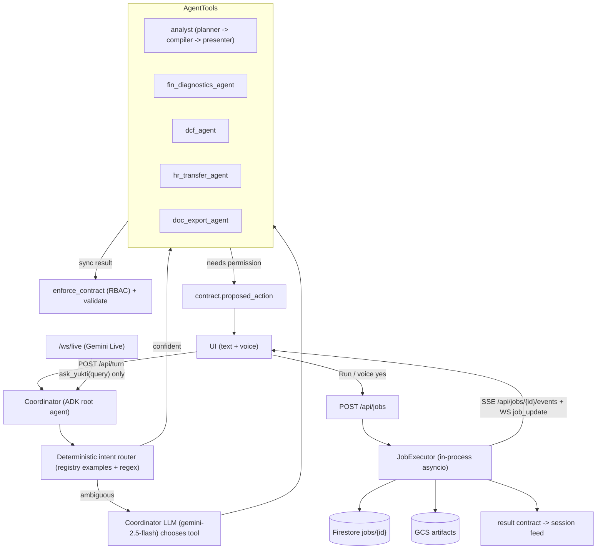

# SPEC-03: Coordinator, Agent Registry, Background Jobs and Permission UX

**Features:** FEAT-028 (Coordinator + agent registry + background jobs + permission UX) · enables FEAT-029 (DCF agent), FEAT-023 (V19 export/email via `hr_transfer_agent`), FEAT-024 (`fin_diagnostics_agent`) · **Phase:** P3 (P3.1 contract, P3.2 jobs, P3.3 coordinator, P3.6 permission UX + voice, P3.7 specialist agents) · **Spec owner:** O (contract, RBAC, jobs = O-only) · **Status:** Draft v3 (23-Oct-2026)

> [!IMPORTANT]
> **BLUF.** V22 asks for one interface that drives several backend agents and asks *"Can I run the DCF agent in the background?"* before it runs. None of this exists today: no orchestrator, sub-agents, jobs, or permission field (diag_D §2).
> Build an ADK **coordinator** (root agent) with five `AgentTool`s: `analyst` (today's planner), `fin_diagnostics_agent`, `dcf_agent`, `hr_transfer_agent`, `doc_export_agent`. Add an **agent registry**, two new contract fields (`proposed_action`, `job`), a **jobs API** with SSE progress, and **Run / Edit assumptions / Cancel** buttons that also accept voice ("yes, run it" / "haan, chalao").
> Recommended execution: **in-process asyncio on Cloud Run** (CPU always allocated, min-instances 1, session affinity), with job state in Firestore and artifacts in GCS. Cloud Tasks stays behind the same interface for later.
> RBAC is enforced server-side twice: at proposal and at job start. DCF is allowed only for CMD and DIR_FIN.

---

## 1. Purpose and verbatim trace
| Verbatim (V22) | Requirement | Section |
|---|---|---|
| "we have a one interface and this interface would be controlling multiple agents on the backend" | One coordinator, many agents | §4 |
| "they can explicitly ask, can I run this agent of discounted cash flow" | `proposed_action` + permission UX | §6, §8 |
| "agents that are running in the background" | Jobs API, progress, completion | §7 |
| "the valuation would come with the exact discounted cash flow model" | Result card + xlsx (SPEC-02, SPEC-09, SPEC-10) | §7.4 |
| V19 steps 4–5 (Excel, email to Dir HR) | `hr_transfer_agent` (SPEC-07 owns content) | §4.2 |

## 2. Current state
| Item | Status | Evidence |
|---|---|---|
| Orchestrator / sub-agents | **Missing** | One ADK `Agent` with 6 tools, `agent.py:193-214` (`create_yukti_agent`); no `sub_agents`/`AgentTool` (diag_D §2) |
| Brains | **Broken (divergent)** | Planner + legacy ADK NL→SQL + Gemini Live re-voicing; ~25 keyword branches in `turn_runner.py` (19 `in q_clean` checks) (diag_D §1) |
| Contract fields for permission/jobs | **Missing** | `yukti/contracts/answer_contract.schema.json` top-level keys end at `ui_action`, `caveat`; `contract_version` enum `[1, 2]` |
| Jobs API / progress stream | **Missing** | `main.py` routes: `/health`, `/admin/cache*`, `/api/turn`, `/api/voice-turn`, `/api/export*`, `/ws/live` |
| Session persistence | **Partial** | In-memory `SessionManager` (`session_memory.py:257-302`); no persistence across instances |
| Reusable pieces | Available | `what_if.py`, `export_tool.DocumentExporter`, `draft_document`, `brain/documents.transfer_note_contract`, `rbac.enforce_contract` |

## 3. Target architecture


**Design rules**
- **One route (SPEC-11).** Every turn, text or voice, enters the coordinator. Keyword fast-paths are removed or moved into the planner per SPEC-11 §4.
- The **intent router** is deterministic first. It matches registry `examples` and regex triggers (e.g. `\b(dcf|discounted cash flow|intrinsic value|under ?valued|over ?valued)\b`), and its scores are logged. The LLM coordinator is called only when the top-2 scores are within 0.1 or below 0.6. This keeps latency and answers stable.
- **Sub-agents are mostly deterministic Python** wrapped as ADK tools. LLMs are used only for planning (analyst) and narrative wording (diagnostics). Numbers never come from an LLM.
- **RBAC** (`rbac.enforce_contract` + registry `requires_role`) runs on every result and at job start, using the **server-side persona** (SPEC-06).

## 4. Agent registry
### 4.1 `yukti/backend/app/agents/registry.yaml` (schema)
| Field | Type | Notes |
|---|---|---|
| `id` | string | `analyst`, `fin_diagnostics_agent`, `dcf_agent`, `hr_transfer_agent`, `doc_export_agent` |
| `display_name` | string | Spoken/visible name ("DCF valuation agent") |
| `description` | string | Used by the coordinator LLM tool description |
| `version` | semver | Shown in the result card footer |
| `run_mode` | enum | `sync` (inline in the turn) · `job` (always background) · `auto` (sync if `est_seconds ≤ 8`, else job) |
| `requires_permission` | bool | TRUE → returns `proposed_action` first |
| `requires_role` | persona[] | Allowed personas (the 11-persona enum from SPEC-06: CMD, DIR_HR, DIR_FIN, E1–E4_HR, E1–E4_FIN) |
| `est_seconds` | int | Shown in the proposal; updated from p50 of the last 20 runs |
| `input_schema` | JSON Schema ref | e.g. `contracts/agents/dcf_inputs.schema.json` |
| `editable_inputs` | list | Fields exposed in "Edit assumptions" (§6.3) |
| `output_visuals` | enum[] | e.g. `dcf_model`, `sensitivity_grid`, `tornado`, `table` |
| `examples` | string[] | ≥ 8 phrasings (en + hi-en) for the intent router |
| `steps` | string[] | Progress step ids, for jobs |

### 4.2 Registered agents (v1)
| id | Wraps / new | run_mode | Permission | requires_role | est_s | Output |
|---|---|---|---|---|---|---|
| `analyst` | `brain/pipeline.py` (planner → compiler → presenter → insights → narrator) | sync | no | all 11 (RBAC inside) | 2–6 | any visual |
| `fin_diagnostics_agent` | New `app/agents/fin_diagnostics/` (SPEC-08: variance attribution + AR RAG + top-5 actions) | auto | no | all 11; results masked by `enforce_contract` per SPEC-06 (E1–E4: no owner/assignment column; DIR_HR: HR levers first, SPEC-08 §7.4) | 4–10 | `table`, `chart` waterfall, `actions` |
| `dcf_agent` | New `app/finance/dcf/` (SPEC-02) | job | **yes** | **CMD, DIR_FIN** | 5–20 | `dcf_model`, `sensitivity_grid`, `tornado`, xlsx |
| `hr_transfer_agent` | V19 chain: cohort → xlsx → email draft (SPEC-07); reuses `transfer_note_contract`, `draft_document` | auto | yes for **send** only (draft is free) | all 11; per-turn decisions per SPEC-07 §4.7 (= SPEC-06 matrix), results masked by `enforce_contract` | 3–8 | `table`, `email_draft` (SPEC-07), xlsx |
| `doc_export_agent` | `export_tool` + SPEC-10 exporters | auto | no | all 11 (content already masked per SPEC-06) | 1–10 | download link |

## 5. Answer-contract additions (JSON Schema diff vs `yukti/contracts/answer_contract.schema.json`)
Owner: **O** (contract change). `contract_version` gains `3`; all new fields are optional, so v1/v2 producers stay valid.

### 5.1 Contract v3 field → step ledger (single source of truth for who adds what)
Rules: (1) every v3 field enters `answer_contract.schema.json` + `answerContract.ts` **only** through a row of this ledger, written by **O**; (2) earlier steps add their fields **additively** (optional, no change to existing fields) and producers emit them only when the field's flag is on (`YUKTI_CONTRACT_V3_FIELDS`, comma list of the flag tokens below; default off in prod until the owning phase gate passes); (3) **P3.1 consolidates**: it adds its own rows, owns the `contract_version` enum bump to `[1, 2, 3]`, merges the fixtures of every earlier row into `test_contract_v3.py`, and **must not re-add** fields that already exist (verify only); (4) a new field not in this table → stop and amend this table first.

| Field | Introduced by step | Phase | Owner | Flag token | Defined in |
|---|---|---|---|---|---|
| `clarify` | P2F.1 | P2F | O | `clarify` | SPEC-08 §3.2 |
| `visual.type="actions"` + `actions` payload | P2F.6 (O part, before F starts) | P2F | O | `actions` | SPEC-08 §7.3 |
| `chart.{kind="column", x_order, note, footnote}`, `table.{column_labels, hidden_columns, default_sort, as_of}` | P2H.3 | P2H | O | `v19_roster` | SPEC-07 §4.1–4.3 |
| `artifacts[]` (`$defs/artifact`, SPEC-10 §5 shape incl. `expires_at`, `sha256`) | P2H.4 | P2H | O | `artifacts` | SPEC-10 §5, SPEC-07 §5 |
| `ui_action.type="download"` | P2H.4 | P2H | O | `artifacts` | SPEC-07 §5 |
| `visual.type="email_draft"` | P2H.4 | P2H | O | `email_draft` | SPEC-07 §4.5 |
| `visual.type="statement"` | P4.2 | P4 | O | `statement` | SPEC-09 §4.1 |
| `visual.type` enum stubs `sensitivity_grid`, `tornado` (types only; no producer before P3.4b) | P4.2 | P4 | O | — | SPEC-09 §5 |
| `proposed_action`, `job` (+ `$defs/editable_input`) | P3.1 | P3 | O | `agents` | §5.2 below |
| `provenance` | P3.1 | P3 | O | `provenance` | SPEC-11 §7.1 |
| `visual.type="dcf_model"` | P3.1 | P3 | O | `agents` | SPEC-02 §9, SPEC-09 |
| `$defs/persona` (11 values) | P3.1 (verify against SPEC-06 enum) | P3 | O | — | SPEC-06 |
| `contract_version` enum `[1, 2, 3]` | **P3.1 only** | P3 | O | — | this section |

Until P3.1 lands, contracts carrying earlier ledger fields keep `contract_version: 2` (the fields are optional and the top level allows them); P3.1's bump makes `3` the producer default.

### 5.2 Schema diff added by P3.1

```diff
   "contract_version": {
-    "enum": [1, 2],
+    "enum": [1, 2, 3],
-    "description": "Absent = 1. Version 2 adds the optional fields below (U2.1); all are optional so v1 producers stay valid."
+    "description": "Absent = 1. v2 adds U2.1 fields; v3 = all SPEC-03 §5.1 ledger fields (proposed_action, job, provenance, clarify, actions, artifacts, statement, email_draft, dcf_model …). All optional."
   },
+  "proposed_action": { "$ref": "#/$defs/proposed_action" },
+  "job": { "$ref": "#/$defs/job" },
```
```json
"$defs": {
  "proposed_action": {
    "type": "object",
    "required": ["id", "agent", "summary", "inputs", "est_seconds", "requires_role", "expires_at"],
    "properties": {
      "id": {"type": "string", "description": "pa_<uuid>; idempotency key for POST /api/jobs"},
      "agent": {"enum": ["dcf_agent", "hr_transfer_agent", "fin_diagnostics_agent", "doc_export_agent"]},
      "summary": {"type": "string", "maxLength": 240, "description": "Question shown and spoken, e.g. 'Can I run the DCF valuation agent in the background? It takes about 15 seconds.'"},
      "inputs": {"type": "object", "description": "Resolved inputs that will run if confirmed (validated against the agent input_schema)"},
      "editable_inputs": {"type": "array", "items": {"$ref": "#/$defs/editable_input"}},
      "est_seconds": {"type": "integer", "minimum": 1},
      "requires_role": {"type": "array", "items": {"$ref": "#/$defs/persona"}},
      "buttons": {"type": "array", "items": {"enum": ["run", "edit", "cancel"]}, "default": ["run", "edit", "cancel"]},
      "voice_confirm_hint": {"type": "string", "description": "e.g. 'Say yes, run it, or cancel.'"},
      "expires_at": {"type": "string", "format": "date-time", "description": "proposal TTL = 10 min"}
    },
    "additionalProperties": false
  },
  "editable_input": {
    "type": "object",
    "required": ["key", "label", "type", "value"],
    "properties": {
      "key": {"type": "string"}, "label": {"type": "string"},
      "type": {"enum": ["number", "percent", "enum", "fy"]},
      "value": {}, "min": {"type": "number"}, "max": {"type": "number"}, "step": {"type": "number"},
      "unit": {"type": "string"}, "options": {"type": "array"},
      "source": {"type": "string", "description": "e.g. 'fact_wacc_annual FY26' or 'AR FY26 p.298'"}
    }
  },
  "job": {
    "type": "object",
    "required": ["id", "agent", "status", "progress"],
    "properties": {
      "id": {"type": "string", "description": "job_<uuid>"},
      "agent": {"type": "string"},
      "status": {"enum": ["queued", "running", "succeeded", "failed", "cancelled", "expired"]},
      "progress": {"type": "number", "minimum": 0, "maximum": 1},
      "steps": {"type": "array", "items": {"type": "object", "required": ["id", "label", "status"],
        "properties": {"id": {"type": "string"}, "label": {"type": "string"},
          "status": {"enum": ["pending", "running", "done", "failed", "skipped"]},
          "started_at": {"type": "string", "format": "date-time"}, "ended_at": {"type": "string", "format": "date-time"}}}},
      "result_ref": {"type": "string", "description": "turn_id of the result contract, or gs:// URI of the artifact"},
      "artifacts": {"type": "array", "items": {"$ref": "#/$defs/artifact"}, "description": "Artifact shape owned by SPEC-10 §5 ({export_id, kind, filename, url, rows, columns, masked, created_at, expires_at, sha256}); jobs fill at least kind, export_id, filename"},
      "error": {"type": "object", "properties": {"code": {"type": "string"}, "message": {"type": "string", "description": "user-safe text only (BUG-33)"}}},
      "created_at": {"type": "string", "format": "date-time"},
      "finished_at": {"type": "string", "format": "date-time"}
    },
    "additionalProperties": false
  }
}
```
Note: `$defs/persona` (11 values) is introduced by SPEC-06 and `$defs/artifact` by SPEC-10. Visual types: `statement`, `sensitivity_grid`, `tornado` in SPEC-09; `dcf_model` payload in SPEC-02 §9 (rendered per SPEC-09); `actions` in SPEC-08 §7.3; `email_draft` in SPEC-07. `provenance` is in SPEC-11 §7.1 and `clarify` in SPEC-08 §3.2. Mirror every change in `yukti/frontend/src/.../answerContract.ts` and the v3 fixtures.

## 6. Permission UX
### 6.1 Flow
1. The user asks "Can you run a DCF and tell me if ONGC is undervalued?"
2. The coordinator routes to `dcf_agent` (router score ≥ 0.6) and checks RBAC. If allowed, it returns a contract with `visual.type="none"` (or the latest valuation summary, if one exists in the session), the `proposed_action`, and `spoken_summary` = `proposed_action.summary`. Nothing runs yet.
3. The UI renders an **Action card**: agent name + version, summary, a key-inputs table (WACC, g, Brent, as-of date, each with its source), the estimated time, and the buttons **Run**, **Edit assumptions** and **Cancel**.
4. **Run** → `POST /api/jobs {proposed_action_id}`. **Edit** → an inline form of `editable_inputs`; "Run with these" posts `inputs_override`. **Cancel** → `POST /api/actions/{id}/cancel`, and the feed shows "Cancelled. No agent was run."

### 6.2 Voice and text confirmation (deterministic, no LLM)
| Utterance class | Regex (case-insensitive, en + hi-en + Devanagari) | Effect |
|---|---|---|
| Confirm | `^(yes|yeah|yep|sure|ok(ay)?|go ahead|do it|run( it)?|please run|haan|haan ji|ha|chalao|kar do|chala do|हाँ|चलाओ)\b` | Confirms the **single** pending proposal of this session |
| Cancel | `^(no|nope|cancel|stop|don'?t|mat karo|nahi|रद्द|नहीं)\b` | Cancels it |
| Edit by voice | `(wacc|discount rate)\s*(of|=|to)?\s*(\d+(\.\d+)?)\s*%` · `(growth|terminal growth|g)\s*(of|=|to)?\s*(\d+(\.\d+)?)\s*%` · `brent\s*(at|=|to)?\s*\$?(\d+)` | Updates `inputs_override`, re-issues the proposal with the changed values highlighted, and asks again |
| Anything else | — | Treated as a new question; the proposal stays pending until `expires_at` |
Rules: confirm/cancel only work if exactly one non-expired proposal exists; if two exist, Yukti asks "Run the DCF or the email send?". Confirmation by voice is echoed in the feed ("You said: yes, run it").

### 6.3 Editable inputs for `dcf_agent` (v1)
`wacc_pct` (default `fact_wacc_annual` FY26, range 6–16, step 0.25), `terminal_g_pct` (3.0; 0–6), `brent_usd` (FY26 realised; 40–120), `capex_scale_pct` (100; 60–140), `production_decline_pct` (from SSOT CAGR; −10–+5), `holdco_discount_pct` (0; 0–40), `as_of` (today; trading dates only).

## 7. Jobs API and execution
### 7.1 Endpoints (FastAPI, `app/jobs/api.py`)
| Method | Path | Body / query | Response | Notes |
|---|---|---|---|---|
| POST | `/api/jobs` | `{proposed_action_id, session_id, inputs_override?}` | 202 `{job}` | Idempotent on `proposed_action_id`; 403 if the persona lacks the role; 410 if expired; 422 if overrides fail the schema |
| GET | `/api/jobs/{id}` | — | `{job}` | Owner session or admin only |
| GET | `/api/jobs/{id}/events` | — | `text/event-stream` | Events `job.queued`, `job.step`, `job.progress`, `job.completed`, `job.failed`, `job.cancelled`; heartbeat comment every 15 s; `Last-Event-ID` resume |
| POST | `/api/jobs/{id}/cancel` | — | `{job}` | Cooperative cancel at step boundaries |
| GET | `/api/jobs?session_id=` | — | `{jobs:[…]}` | For feed rehydration |
| GET | `/api/jobs/{id}/result` | — | answer contract (v3) | Same as the result turn in the feed |
| POST | `/api/actions/{id}/cancel` | — | 204 | Cancels a proposal |
| WS | `/ws/live` | server push `{"type":"job_update","job":{…}}` | — | For voice sessions (§9) |

### 7.2 Execution model (decision)
| Option | Pros | Cons | Verdict |
|---|---|---|---|
| **A. In-process asyncio** (`asyncio.create_task` + `asyncio.to_thread` for CPU parts) on the same Cloud Run service | Zero new infra; DCF < 5 s, exports < 10 s; simplest SSE | Work lost if the instance dies; needs CPU outside requests | **Recommended for v1** |
| B. Cloud Tasks → `/internal/jobs/run` on the same service | Retries, durable queue | New queue + OIDC auth + idempotent handler; SSE must read shared state | Phase-2 option behind the same `JobExecutor` interface |
| C. Cloud Run Jobs | Long batch | Cold start 10–30 s; overkill | Not used |

**Cloud Run settings for A:** `--no-cpu-throttling` (CPU always allocated), `--min-instances=1`, `--session-affinity`, `--timeout=300`, concurrency 20. **State:** Firestore `jobs/{job_id}` (or a GCS JSON per job, per OD-12) (status, steps, progress, persona, session_id, inputs hash, result_ref), so `GET /api/jobs/{id}` and SSE work from any instance by polling Firestore every 500 ms. **Artifacts:** `gs://<project>-yukti-artifacts/jobs/{job_id}/…`, served through `/api/export/{export_id}` (signed URL, 1 h). **Limits:** max 2 concurrent jobs per session and 8 per instance; job timeout 120 s → `failed` with code `E_TIMEOUT`. On startup, jobs left in `running` by a dead instance are marked `failed` with code `E_INSTANCE_LOST` and the user sees "Please run again".

### 7.3 Job step template (dcf_agent)
`load_inputs` (verified SSOT snapshot) → `wacc_build` → `forecast` → `valuation` → `sensitivity_grid` (81 runs) → `tornado` (16 runs) → `xlsx` → `publish`. Progress = completed steps / 8, plus intra-step fractions for the grid.

### 7.4 Result
On success the executor builds a **v3 answer contract** (`turn_id = "job:<id>"`): `visual.type="dcf_model"` (summary KPIs: intrinsic ₹/share, market ₹/share, upside %, verdict; tabs FCFF, WACC build-up, bridge, sensitivity, tornado), `export_options=["xlsx","pdf"]`, `job.artifacts` (xlsx), `sources[]` (SSOT run id, `fact_wacc_annual`, Yahoo price date), `caveat` and `spoken_summary` both containing "Illustrative valuation, not investment advice.", plus `provenance.label="illustrative"` (SPEC-11).

## 8. RBAC gating
| Check point | Rule |
|---|---|
| Proposal | If the server persona ∉ `requires_role`: no `proposed_action`; refusal contract `access.status="refused"`, `rule_ref="RBAC-AGENT-DCF"`, alternative "I can show the WACC series and the published valuation ratios instead" |
| Job start | `POST /api/jobs` re-checks the persona from the server session (never from the body); 403 on mismatch, and the attempt is logged |
| Result | `enforce_contract` on the result contract (masks anything above the persona's level) |
| Voice | The same checks apply; a voice "switch role" is ignored (SPEC-06, BUG-06) |
| Matrix (v1) | **Only agent-level gate: DCF = CMD, DIR_FIN.** `analyst`, `fin_diagnostics_agent`, `hr_transfer_agent` and `doc_export_agent` are callable by all 11 personas; what each persona sees is decided by the SPEC-06 matrix through `enforce_contract` (e.g. diagnostics for E1–E4_HR/FIN without the action owner/assignment column; V19 per-turn decisions in SPEC-07 §4.7, incl. E1–E4_FIN T5 = R-FUNC) |

## 9. Session persistence and voice announcement
- `SessionState` gains `pending_actions: dict[id, ProposedAction]`, `jobs: list[JobRef]` and `last_agent_result: {agent, run_id, turn_id}`. The result contract is recorded as a normal turn (`record_turn`), so follow-ups ("show the sensitivity again", "what if WACC is 11%?") resolve against `last_agent_result`. A what-if re-run creates a new proposal with the inputs pre-filled.
- Feed rehydration on reload: `GET /api/jobs?session_id=` re-attaches running jobs (spinner card) and finished results.
- **Voice announcement:** when a job finishes and the session has a live WS, the server pushes `job_update`. `live_session.py` then speaks the result contract's `spoken_summary` **verbatim** through the speak path with a new `speak_id` (SPEC-11 §6.3). Example: "The DCF valuation is ready. Intrinsic value is ₹X per share against a market price of ₹Y, so the model suggests ONGC is undervalued by Z%. This is an illustrative valuation, not investment advice." If the user is speaking, the announcement waits for the end of the user's turn. If no WS is open, the feed card shows a toast "DCF valuation ready".
- Text mode: the SSE `job.completed` event triggers the feed to append the result turn.

## 10. Acceptance criteria
| ID | Criterion |
|---|---|
| AC-01 | 100% of `/api/turn` and `ask_yukti` calls pass through the coordinator (log field `route=coordinator`); 0 calls reach the legacy ADK NL→SQL agent by default |
| AC-02 | 10/10 DCF phrasings (en + hi-en) produce a `proposed_action` for CMD and DIR_FIN; 0 jobs start without confirmation |
| AC-03 | For E2_FIN, E1_HR and DIR_HR, the same phrasings give a refusal with an alternative; `POST /api/jobs` with a forged `proposed_action_id` → 403 |
| AC-04 | Voice "yes, run it" / "haan, chalao" starts the pending job in ≤ 1 s; "cancel" cancels it; with two pending proposals, Yukti asks which |
| AC-05 | SSE emits ≥ 1 event per step; p95 time from Run to `job.completed` ≤ 20 s for the DCF on Cloud Run |
| AC-06 | Contract v3 schema validates all fixtures; v1/v2 fixtures still validate |
| AC-07 | Result turn persists across page reload (rehydration) and supports one follow-up what-if |
| AC-08 | The voice announcement uses the same `spoken_summary` text as the card (string-equal) |
| AC-09 | Killing the instance mid-job leaves the job `failed: E_INSTANCE_LOST` on restart (Firestore, or GCS JSON per OD-12), never stuck in `running` |

## 11. Test plan
Unit: intent router (40 labelled phrasings incl. hi-en), confirm/cancel regex table, registry schema validation, contract v3 fixtures. API: pytest + httpx for the jobs lifecycle, idempotency, 403/410/422 paths, SSE stream parse. E2E (Playwright, FL-run): BEH-05 scenarios. Voice: scripted WS session for confirm + announcement (SPEC-11 voice smoke).

## 12. Open questions
1. Firestore availability in `ongc-hr-finance-agent` (needs an API enable + IAM). Fallback: a GCS JSON per job (slower polling).
2. Should `fin_diagnostics_agent` also ask permission when it would take more than 8 s, or auto-run as a job (recommended: auto-run, no permission, because it's read-only)?
3. Cloud Run cost of `--min-instances=1 --no-cpu-throttling` is acceptable for demo periods only? Toggle in `start_cloudrun.sh`.

## 13. Status matrix
| Item | Status |
|---|---|
| Coordinator + router | Missing |
| Registry | Missing |
| Contract v3 fields | Missing |
| Jobs API + SSE + Firestore state | Missing |
| Permission UX (buttons + voice) | Missing |
| RBAC double check | Missing (persona is client-asserted today, BUG-06) |
| Voice job announcement | Missing |
