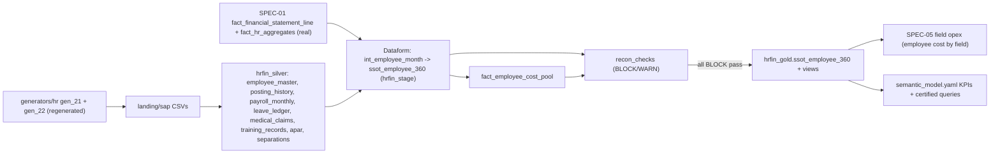

# SPEC-04: Employee-360 Enterprise Table (realistic, reconciled)

**Features:** FEAT-021 · **Bugs closed:** BUG-26, BUG-29, BUG-30, (BUG-07 data side), diag_B defects 4/9/12 · **Phase/steps:** P2H.5 (generator), P2H.6 (Dataform + semantic model), P2H.8 (reconciliation gates) · **Page convention:** "p.N" = PDF page index of the AR (form-feed count of `pdftotext` output); "line" = line in `knowledge/public_sources/grounding_data/text/ONGC_AR_FY2025-26.txt` unless another file is named · **Depends on:** SPEC-01 (`fact_financial_statement_line`, `fact_hr_aggregates`), SPEC-06 (data classes, `dim_app_user`) · **Feeds:** SPEC-05 (employee cost by field), BEH-06 · **Verbatims:** V13, V17, V19, V23 (Decision 7) · **Status:** Draft v3 (23-Oct-2026)

> **BLUF.** Build **one** analysis-ready table, `hrfin_gold.ssot_employee_360`, at the grain **employee × month** (Apr-2016 → current month, ≈ 3.6 M rows; ~175 columns). It holds everything a CMD, Director or officer may ask about one person or a cohort: identity, org, tenure, every pay component, employer benefits, deductions, CTC, leave, training, APAR and lifecycle.
> Pay is computed **bottom-up from real rules** (ONGC E1 scale ₹60,000–1,80,000, DPE 3rd PRC 3 % increments, IDA formula, HRA X/Y/Z 24/16/8 % → 27/18/9 → 30/20/10, cafeteria ≤ 35 % BP, superannuation ≤ 30 % of BP+DA). It is never rescaled per person.
> The table **reconciles exactly** to the real AR every FY: Σ employee cost = AR "Expenditure on Employees" (FY26 ₹10,210.71 cr; Note 35.1). Headcount = AR "Number of Employees" (FY26 23,117). Gender, PwD, age and median pay match BRSR. The only gap-filler is a set of **named, non-individual pools** (actuarial provisions, retiree PRMB, non-regular staff). A gate keeps the residual pool small, and `hrfin_gold.recon_checks` **blocks publish** on any failed check.
> Two views sit on top: `v_employee_360_current` (latest month) and `v_employee_360_fy` (employee × FY). Plus 30 semantic-model KPIs (cost/employee, revenue/employee, overtime %, Delhi-cohort cost, what-if savings).

---

## 1. Purpose & verbatim trace

| Verbatim | Requirement | Where satisfied |
|---|---|---|
| V23 #7 | "one big query table with all the possible type of details … salary breakdown, benefits, hrs, da, health insurance" | §4 column catalogue (families A–N) |
| V23 #7 | "employee count … revenue per employee … all the kind of analysis" | §8 KPI catalogue; BEH-06 |
| V23 #7 | "operating cost per field … should match to the total company level aggregate" | §7 cost destinations → SPEC-05 field opex |
| V23 §4 | "Σ employee cost per FY = AR Employee benefits expense (gross, incl. capitalised); headcount = AR; block publication on mismatch" | §7 calibration + `recon_checks` |
| V13 / V19 | Named roster: name, designation, E-level, tenure, Delhi tenure | Families B–D; `v_employee_360_current` |
| V17 | Own-scope answers for 11 personas | `self` rows via `@self_emp_id` (SPEC-06 §4.2); 11 `dim_app_user` ids are re-seeded after regeneration |
| feedback1 | "Divide this pay into perks, base…", "joining E1 pay" | Families E–G; entry-pay rule §6.4; BUG-26 |

## 2. Current state (evidence)

| Area | What exists today | Evidence | Status |
|---|---|---|---|
| Employee master | `landing/sap/PA0002_PA0001.csv` 42,171 rows (22,798 active) → `hrfin_silver.employee_master` | diag_B_hr_rbac.md:66 | Implemented |
| Postings | `PA0001.csv` 198,880 postings; `v_continuous_stay` (gaps-and-islands) | diag_B_hr_rbac.md:27,67 | Implemented (minor `MAX(grade_id)` defect, :83) |
| Payroll | `PY_CLUSTER_EXP.csv` 1,685,638 payslips (basic, DA, HRA, cafeteria, mining/offshore, OT, PRP, CPF, PRBS, PRMB, TDS, net) | diag_B_hr_rbac.md:28,68 | Partial: no LTC, medical, leave encashment, gratuity accrual, insurance, housing, deductions detail |
| Leave | `PA2001_PA2006.csv` 455,923 rows | diag_B_hr_rbac.md:29 | **Broken** in gold: `UPPER(leave_type)="EL"` vs `Earned_Leave_EL` (BUG-29) |
| Gold SSOT | `ssot_workforce_employee`, built by `yukti/backend/scripts/build_ssot_gold.py`, **not in Dataform** | diag_B_hr_rbac.md:26,176 | Broken lineage |
| Semantic model | One pay metric, `avg_gross_salary_lakh` | diag_B_hr_rbac.md:102 | Missing component metrics |
| Salary handler | Deterministic, but rescales components with a fudge factor; "joining E1 pay" = average of incumbents (19.6 yrs service) | diag_B_hr_rbac.md:105-108 | Broken (BUG-26) |
| Realism | E1 median service 19.6 yrs, age 43; **1,393** distinct names; `age_band` "30-40" covers 30–50; no E0; generic designations; 34 exemptions only | diag_B_hr_rbac.md:79-82,150 | Broken |
| Calibration | Headcount exact FY17–FY26; exec/non-exec, women, SC/ST, PwD within 1–3 % | diag_B_hr_rbac.md:129-139; diag_E_public_data_sources.md:7 | Implemented (keep) |
| Grade scales | `world_bible/reference/grades.yaml`: E1 60,000–1,80,000 (matches ONGC advert); E6 and E7 share 1,20,000–2,80,000; E8 1,30,000–2,80,000 | grades.yaml:14-23, E6–E8 rows | Partial (see Q2) |
| Cost reconciliation | None for employee cost; field manpower cost is **scaled** to corporate totals | diag_A_finance_data.md:17 (`load_and_reconcile_bq.py:204-258`) | Missing |

## 3. Target design

### 3.1 Grain decision

| Option | Rows | Pros | Cons | Verdict |
|---|---|---|---|---|
| **Employee × month (wide)** | ≈ 3.6 M (avg ≈ 28.3k on roll × 126 months, Apr-2016 → Sep-2026, + current months) | Payslip-native. Exact FY sums. Month-level DA/HRA steps, transfers, promotions, separations. Partition pruning keeps cost low | Wide (≈ 175 cols, ≈ 5 GB) | **Chosen** |
| Employee snapshot (1 row/emp) | ≈ 42k | Simple roster | Cannot reconcile per FY; loses history | → view `v_employee_360_current` |
| Employee × FY | ≈ 300k | Good for trends | Loses DA/HRA steps and mid-year moves | → view `v_employee_360_fy` |
| Employee × month × component (long) | ≈ 100 M | Flexible charts | Heavy, joins for every question | → view `v_employee_pay_component_long` (UNPIVOT) |

**Physical layout:** `PARTITION BY month_start` (monthly, 126+ partitions), `CLUSTER BY wc_id, grade_id, function_code, emp_id`. Require a partition filter on the table (views add `fiscal_year` filters). Built in `hrfin_stage`; published to `hrfin_gold` only if every `BLOCK` check passes (§7.4).

### 3.2 Objects

| Object | Type | Grain | Purpose |
|---|---|---|---|
| `hrfin_gold.ssot_employee_360` | table | emp × month | The SSOT (§4) |
| `hrfin_gold.v_employee_360_current` | view | emp (latest closed month, active only) | Roster / "now" questions |
| `hrfin_gold.v_employee_360_fy` | view | emp × FY | Annual pay, cost, CTC, leave, training, attrition |
| `hrfin_gold.v_employee_pay_component_long` | view | emp × month × component | Allowance-mix and stacked charts |
| `hrfin_gold.fact_employee_cost_pool` | table | FY × month × pool_code × note_line | Non-individual cost pools (§7.2) |
| `hrfin_gold.dim_grade_pay_scale` | table | grade × scale_version | Scale min/max, increment, PRP ceiling, source (§5.1) |
| `hrfin_gold.dim_ida_rate` | table | quarter | IDA % series + source/status (§5.2) |
| `hrfin_gold.dim_hra_rate` | table | city_class × IDA band | HRA %, HRR % (§5.3) |
| `hrfin_gold.dim_allowance_rule` | table | allowance × eligibility | Rates and caps (§5.4) |
| `hrfin_gold.dim_payroll_policy_fy` | table | FY | Calibration knobs, documented and bounded (§7.1 step 4) |
| `hrfin_gold.recon_checks` | table | check × FY × level | Shared with SPEC-05 (§7.3) |
| `hrfin_gold.ssot_workforce_employee` | **compat view** | emp | Backward-compatible projection of `v_employee_360_current` (keeps certified queries working) |

## 4. Column catalogue — `ssot_employee_360`

**Sens** (RBAC class tag, mapped to SPEC-06 §4.2): `PUB` = public rule/scale (→ `policy`/`pay_aggregate`); `AGG` = usable by everyone in aggregates (→ `general_hr`); `NAMED` = identifies a person (→ `named`); `PAY` = individual money (→ `pay_individual` at row level, `pay_aggregate` for cohorts with k ≥ 5); `SENS` = APAR, medical, category/PwD at row level, separation reason (→ `apar`/`sensitive`). Every column is visible under `self` for the user's own rows.
**Basis:** `R` = real rule or value (cited); `C` = synthetic, calibrated to a real aggregate; `S` = synthetic, plausible (illustrative); `D` = derived from other columns. Money is INR per month (NUMERIC, 2 dp) unless stated.

### A. Keys, time, provenance
| Column | Type | Description / derivation | Sens | Basis |
|---|---|---|---|---|
| `month_start` | DATE | First day of payroll month; partition key | AGG | D |
| `fiscal_year` | STRING | `FY27` for Apr-2026…Mar-2027 | AGG | D |
| `fy_month_no` | INT64 | 1 = April … 12 = March | AGG | D |
| `emp_id` | STRING | `EMP-nnnnnn` (PERNR) | NAMED | S |
| `roll_status` | STRING | `active` / `joined` / `separated` (in month) | AGG | D |
| `is_month_end_active` | BOOL | On roll on the last day of the month; FY-end headcount = rows with March and TRUE | AGG | C |
| `days_on_roll` | INT64 | Calendar days on roll in the month (FTE basis) | AGG | D |
| `data_label` | STRING | Constant `"Synthetic employee record — calibrated to ONGC AR/BRSR aggregates"` | PUB | — |
| `build_run_id` | STRING | Joins to `recon_checks.run_id` | PUB | — |

### B. Identity & demographics
| Column | Type | Description / derivation | Sens | Basis |
|---|---|---|---|---|
| `full_name` | STRING | First + optional middle initial + surname; surname drawn by `home_state_code` (§6.3) | NAMED | S |
| `first_name`, `last_name` | STRING | Components of `full_name` | NAMED | S |
| `gender` | STRING | `M`/`F`/`O`; women share = BRSR (FY26 1,885 = 8.15 %) | AGG | C |
| `date_of_birth` | DATE | Consistent with entry age + DOJ (§6.2) | NAMED | S |
| `age_years` | NUMERIC(4,1) | At month end | AGG | D |
| `age_band_brsr` | STRING | `<30` / `30-50` / `>50` (fixes BUG-30) | AGG | C |
| `age_band_10y` | STRING | `<25`, `25-34`, `35-44`, `45-54`, `55-60` | AGG | D |
| `social_category` | STRING | `SC`/`ST`/`OBC`/`EWS`/`GEN`; SC 15.02 %, ST 11.35 % (AR26); OBC/EWS assumed | SENS (row) / AGG (cohort) | C |
| `pwd_flag` | BOOL | FY26 total 523 (313 exec + 210 workers, BRSR p.141) | SENS (row) / AGG | C |
| `ex_serviceman_flag` | BOOL | ≈ 1–2 % of workmen | AGG | S |
| `home_state_code` | STRING | ISO-like state code; drives the surname pool | AGG | S |
| `marital_status` | STRING | Age-conditioned | NAMED | S |
| `dependants_count` | INT64 | Dependants covered by the medical scheme (spouse, children, dependent parents) | SENS | S |

### C. Organisation & job
| Column | Type | Description / derivation | Sens | Basis |
|---|---|---|---|---|
| `grade_id` | STRING | `E0`…`E9`, `DIR`, `CMD`, `GRP-B`, `GRP-C`, `GRP-D` | AGG | C |
| `grade_level_order` | INT64 | Sort key (fixes BUG-34 ordering) | AGG | R |
| `cadre` | STRING | `executive` / `non_executive` / `board`; exec 13,781 / non-exec 9,336 (FY26 BRSR p.141) | AGG | C |
| `group_class` | STRING | Group A / B / C / D | AGG | R |
| `grade_designation` | STRING | Generic grade title (e.g. "Chief Manager") | AGG | R |
| `functional_designation` | STRING | e.g. "Chief Manager (HR) – Corporate ER", "Dy. Manager (F&A)" | NAMED | S |
| `discipline_id`, `discipline_name` | STRING | From `dim_discipline` (Drilling, Production, Geology, Geophysics, Reservoir, Mechanical, Electrical, Chemistry, MM, F&A, HR, Legal, IT, Medical, Civil, Marine, HSE, …) | AGG | S |
| `function_code` | STRING | `HR`/`FIN`/`DRL`/`PRD`/`EXP`/`ENG`/`MM`/`IT`/`HSE`/`MED`/`LEG`/`CORP`/`LOG` | AGG | S |
| `department`, `section` | STRING | HQ: Corporate HR, Corporate ER, Corporate Finance, Corp. Planning, Corporate Accounts, Vigilance… | AGG | S |
| `wc_id`, `wc_name`, `wc_type` | STRING | Work centre (46 in `work_centres.yaml`); type office / asset / basin / plant / service / institute | AGG | S |
| `asset_id`, `basin_id` | STRING | Asset/basin of the WC | AGG | S |
| `field_id` | STRING | Primary field for field-attached staff (NULL for HQ/services); see §7.5 | AGG | S |
| `location_type` | STRING | `office` / `onshore_field` / `offshore_installation` / `plant` / `rig` | AGG | S |
| `offshore_rotation_flag` | BOOL | 14-on/14-off rotation staff | AGG | S |
| `hard_station_flag` | BOOL | Posting at a station classified hard (illustrative list) | AGG | S |
| `city_name`, `state_of_posting` | STRING | Of the WC | AGG | S |
| `city_class_hra` | STRING | `X`/`Y`/`Z` (DPE census-2011 classification; Delhi, Mumbai = X; Dehradun, Vadodara, Ahmedabad = Y/X; field towns mostly Z) | PUB | R/S |
| `lca_zone` | STRING | Location-based compensatory allowance zone (`NE`, `AN`, `SPECIAL_A..D`, NULL) | PUB | R |
| `reporting_manager_emp_id` | STRING | Valid active employee of a higher grade in the same WC/function | NAMED | S |
| `direct_reports_count` | INT64 | Span of control | AGG | D |
| `cost_centre_id`, `profit_centre_id` | STRING | From `cost_centres.yaml`; profit centre = field/asset or `PC-HQ` | AGG | S |
| `cost_destination` | STRING | Dominant destination: `production_opex`, `gae`, `exploration`, `dev_drilling_capex`, `capital_jobs`, `recoverable` | AGG | S |
| `union_member_flag` | BOOL | Workmen only | SENS | S |

### D. Dates, tenure, transfers
| Column | Type | Description / derivation | Sens | Basis |
|---|---|---|---|---|
| `doj` | DATE | Date of joining ONGC | NAMED | S |
| `entry_mode` | STRING | `GATE_GT`, `CAMPUS`, `LATERAL`, `PROMOTEE_NONEXEC`, `APPRENTICE_ABSORB`, `COMPASSIONATE`, `NONEXEC_DIRECT` | AGG | S |
| `entry_grade` | STRING | Grade at DOJ | AGG | S |
| `total_service_years` | NUMERIC(4,1) | (month_end − doj)/365.25 | AGG | D |
| `grade_since`, `grade_tenure_years` | DATE / NUMERIC | Date of entering the current grade | AGG | D |
| `last_promotion_date`, `promotions_count` | DATE / INT64 | From `promotion_history` | AGG | S |
| `current_station_since` | DATE | Start of the current continuous island at `wc_id` | AGG | D |
| `station_tenure_continuous_years` | NUMERIC | Continuous stay at the current WC (V19 "Delhi tenure") | AGG | D |
| `station_tenure_cumulative_years` | NUMERIC | Σ of all stays at the current WC | AGG | D |
| `cluster_tenure_cumulative_years` | NUMERIC | Σ stays in the WC cluster (JRTP 4.1, illustrative) | AGG | D |
| `last_transfer_date`, `transfers_count` | DATE / INT64 | From `posting_history` with `transfer_reason` | AGG | S |
| `transfer_due_flag` | BOOL | `station_tenure_continuous_years > 5` AND NOT exempt (**JRTP Rev 4 cl. 3.2 — Illustrative**; real anchor Delhi HC 2018 J-03) | AGG | D |
| `jrtp_exemption_code`, `exemption_valid_until` | STRING / DATE | `PRE_RETIREMENT` (≤ 2 yrs to superannuation, cl. 7.1), `MEDICAL`, `SPOUSE`, `CHILD_X_XII`, `UNION_OFFICE`, `PROJECT_CRITICAL`; 3–5 % of the overdue cohort | SENS | S |
| `superannuation_date` | DATE | Last day of the month of turning **60** | NAMED | R |
| `years_to_superannuation` | NUMERIC | — | AGG | D |
| `retiring_within_1y`, `_3y`, `_5y` | BOOL | — | AGG | D |

### E. Pay scale & pay basis
| Column | Type | Description / derivation | Sens | Basis |
|---|---|---|---|---|
| `pay_scale_version` | STRING | `2007` (to Dec-2016) / `2017` (3rd PRC, from Jan-2017); workmen `WS2007`/`WS2017` | PUB | R |
| `pay_scale_min_inr`, `pay_scale_max_inr` | NUMERIC | From `dim_grade_pay_scale` | PUB | R/S |
| `increments_count` | INT64 | Annual increments since the last fixation | PAY | D |
| `stagnation_increments` | INT64 | ≤ 3, one per 2 yrs at scale max (DPE OM 3-Aug-2017 Annex II) | PAY | R |
| `ida_pct` | NUMERIC | From `dim_ida_rate` for the quarter | PUB | R/S |
| `hra_rate_pct` | NUMERIC | From `dim_hra_rate` (class × IDA band) | PUB | R |
| `accommodation_type` | STRING | `HRA` / `LEASED` / `COMPANY_QUARTERS` / `TOWNSHIP` / `OFFSHORE_CAMP` | AGG | S |

### F. Monthly earnings (cash)
| Column | Type | Description / derivation | Sens | Basis |
|---|---|---|---|---|
| `basic_pay_inr` | NUMERIC | Scale min + increments (3 %) + fitment (§6.4) | PAY | R rule / S path |
| `ida_inr` | NUMERIC | `basic × ida_pct` | PAY | D |
| `hra_inr` | NUMERIC | `basic × hra_rate_pct` if `accommodation_type='HRA'`, else 0 | PAY | D |
| `cafeteria_allowance_inr` | NUMERIC | `basic × 35 % × caf_utilisation` (= Σ `caf_*` sub-items) | PAY | R cap / C |
| `caf_conveyance_inr`, `caf_children_edu_inr`, `caf_professional_dev_inr`, `caf_other_perks_inr` | NUMERIC | Cafeteria sub-items; leased-accommodation perquisite (50 % loaded) included in `caf_other_perks_inr` | PAY | S |
| `hardship_offshore_inr` | NUMERIC | ≤ 12 % BP for days actually at offshore sites (DPE OM 4-Aug-2017; outside the 35 % ceiling) | PAY | R cap / S |
| `field_duty_allowance_inr` | NUMERIC | Onshore field/rig/drill-site duty (ONGC-specific; **illustrative** 4–8 % BP) | PAY | S |
| `location_comp_allowance_inr` | NUMERIC | NE/Ladakh 10 % BP; A&N 10/16/20 %; special areas 3–8 % BP (DPE OM 7-Sep-2017) | PAY | R |
| `hard_station_allowance_inr` | NUMERIC | Illustrative flat amount for hard stations | PAY | S |
| `shift_allowance_inr`, `night_duty_allowance_inr` | NUMERIC | Plant/process and rig shift staff (illustrative rates) | PAY | S |
| `npa_inr` | NUMERIC | Non-practising allowance, medical officers only (DPE OM 7-Sep-2017) | PAY | R |
| `special_allowance_inr` | NUMERIC | Personal pay, officiating, stagnation | PAY | S |
| `overtime_hours` | NUMERIC | Workmen only (executives = 0) | AGG | S |
| `overtime_amount_inr` | NUMERIC | `OT_hours × 2 × (basic + ida) / 208` (illustrative double-rate rule) | PAY | S |
| `prp_accrual_inr` | NUMERIC | Monthly accrual of the expected PRP: `basic × PRP ceiling(grade) × k_fy × apar_factor / 12` (DPE Annex IV; ceilings §5.1) | PAY | R cap / C |
| `prp_paid_inr` | NUMERIC | Lump-sum payment month (FY+1, Sep–Nov) | PAY | C |
| `arrears_inr` | NUMERIC | Pay revision (3rd PRC Jan-2017 → implementation), IDA and promotion arrears | PAY | C |
| `leave_encashment_paid_inr` | NUMERIC | EL encashment (in service, LTC-linked, at separation) | PAY | S |
| `ltc_inr` | NUMERIC | LTC/LLTC reimbursement in the claim month | PAY | S |
| `medical_reimbursement_inr` | NUMERIC | OPD reimbursement paid (from `medical_claims`) | SENS | S |
| `ex_gratia_other_inr` | NUMERIC | Long-service awards, honoraria | PAY | S |
| `gross_earnings_inr` | NUMERIC | Σ of all cash items above except `prp_accrual_inr` | PAY | D |

### G. Employer contributions & benefits (cost, non-cash)
| Column | Type | Description / derivation | Sens | Basis |
|---|---|---|---|---|
| `employer_cpf_inr` | NUMERIC | 12 % × (basic + ida) (EPF Act rate; ONGC CPF Trust, AR26 Note 43) | PAY | R |
| `employer_prbs_inr` | NUMERIC | Defined-contribution pension (PRBS); rate = superannuation headroom (illustrative ≈ 9–10 %) | PAY | S |
| `gratuity_accrual_inr` | NUMERIC | Allocated share of the actuarial gratuity cost (§7.2); ceiling ₹20 L +25 % per 50 % IDA (DPE OM para 12.1) | PAY | C |
| `employer_prmb_inr` | NUMERIC | PRMB contribution, active employees (illustrative 3 % of BP+DA, per `gen_22_hr_sat.py:84`) | PAY | S |
| `csss_contribution_inr` | NUMERIC | Composite Social Security Scheme (AR26 Note 43.1.4); illustrative flat | PAY | S |
| `superannuation_total_inr` | NUMERIC | CPF + PRBS + gratuity + PRMB | PAY | D |
| `superannuation_pct_bp_da` | NUMERIC | `superannuation_total / (basic + ida)` | PAY | D |
| `superannuation_cap_ok` | BOOL | `≤ 30 %` (DPE 3rd PRC para 12) | PUB | R |
| `leave_provision_accrual_inr` | NUMERIC | Allocated actuarial leave cost (§7.2) | PAY | C |
| `medical_scheme_cost_inr` | NUMERIC | In-patient + empanelled hospital + company-hospital per-capita cost for the employee and dependants (ONGC is self-insured; there is no commercial premium) | SENS | S |
| `group_insurance_premium_inr` | NUMERIC | GTLI/EDLI-type life cover | PAY | S |
| `accident_insurance_premium_inr` | NUMERIC | Offshore/field personal-accident cover | PAY | S |
| `housing_cost_inr` | NUMERIC | Company lease rent paid or quarters maintenance cost | PAY | S |
| `canteen_subsidy_inr`, `transport_subsidy_inr` | NUMERIC | Per-capita subsidy at the WC | PAY | S |
| `staff_welfare_alloc_inr` | NUMERIC | Allocated share of Note 35.1(f) staff welfare | PAY | C |
| `training_cost_inr` | NUMERIC | Course fees + travel for training this month | PAY | S |
| `employer_cost_noncash_inr` | NUMERIC | Σ of family G money columns | PAY | D |

### H. Deductions & net pay
| Column | Type | Description / derivation | Sens | Basis |
|---|---|---|---|---|
| `employee_pf_inr` | NUMERIC | 12 % × (basic + ida) | PAY | R |
| `vpf_inr` | NUMERIC | Voluntary PF (≈ 20 % of employees) | PAY | S |
| `tds_inr` | NUMERIC | Income-tax TDS (new/old regime by employee choice; simplified slab engine) | PAY | S |
| `professional_tax_inr` | NUMERIC | State-specific (Delhi 0; Maharashtra ₹200/₹300 Feb; Gujarat ₹200; Assam ₹208) | PAY | R |
| `hrr_recovery_inr` | NUMERIC | House-rent recovery for leased/company accommodation: X 7.5 / Y 5 / Z 2.5 % BP (DPE OM 4-Aug-2017) | PAY | R |
| `loan_recoveries_inr`, `other_recoveries_inr` | NUMERIC | HBA, vehicle advance, society, LIC | PAY | S |
| `total_deductions_inr` | NUMERIC | Σ family H | PAY | D |
| `net_pay_inr` | NUMERIC | `gross_earnings − total_deductions` (row identity, check EMP-R28) | PAY | D |

### I. CTC, accounting cost, capitalisation
| Column | Type | Description / derivation | Sens | Basis |
|---|---|---|---|---|
| `ctc_monthly_inr` | NUMERIC | `gross_earnings − arrears − leave_encashment_paid + prp_accrual − prp_paid + employer_cost_noncash` (run-rate CTC) | PAY | D |
| `ctc_annualised_inr` | NUMERIC | `ctc_monthly × 12` (shown with the label "run-rate") | PAY | D |
| `cost_note35_a_inr` | NUMERIC | → AR Note 35.1(a) "Salaries, Wages, Ex-gratia etc." = gross cash pay items | PAY | D |
| `cost_note35_b_inr` | NUMERIC | → 35.1(b) "Contribution to Provident and other funds" = CPF + PRBS + CSSS | PAY | D |
| `cost_note35_c_inr` | NUMERIC | → 35.1(c) gratuity = `gratuity_accrual` | PAY | D |
| `cost_note35_d_inr` | NUMERIC | → 35.1(d) leave = `leave_provision_accrual` (encashment paid is settled against the provision) | PAY | D |
| `cost_note35_e_inr` | NUMERIC | → 35.1(e) PRMB & terminal benefits (active share) | PAY | D |
| `cost_note35_f_inr` | NUMERIC | → 35.1(f) staff welfare = medical scheme + canteen + transport + welfare alloc + insurance | PAY | D |
| `cost_total_inr` | NUMERIC | Σ `cost_note35_*`: the accounting employee cost that reconciles to AR | PAY | D |
| `capitalised_share` | NUMERIC(5,4) | Share of the cost allocated to exploration/drilling/capital jobs (by function × WC key, §7.5) | AGG | S |
| `cost_capitalised_inr`, `cost_expensed_inr` | NUMERIC | Split of `cost_total_inr` | PAY | D |
| `cost_expensed_production_inr`, `cost_expensed_gae_inr`, `cost_expensed_exploration_inr` | NUMERIC | Expensed destinations; Σ production = AR Note 35 "Staff Expenditure" (check EMP-R29) | PAY | C |

### J. Leave & attendance
| Column | Type | Description / derivation | Sens | Basis |
|---|---|---|---|---|
| `el_balance_days`, `hpl_balance_days` | NUMERIC | Month-end balance (fixes BUG-29 mapping `Earned_Leave_EL`, `Half_Pay_Leave_HPL`) | AGG | S |
| `cl_balance_days` | NUMERIC | Calendar-year CL (12 days; Leave Rules cl. 2A.0) | AGG | R/S |
| `el_availed_days`, `hpl_availed_days`, `cl_availed_days`, `other_leave_days` | NUMERIC | In the month (maternity, paternity, study, special casual) | AGG | S |
| `el_encashable_days` | NUMERIC | Accumulation cap 300 days (illustrative) | AGG | S |
| `working_days`, `days_present`, `unauthorised_absence_days` | INT64 | Attendance | AGG | S |
| `scheduled_hours`, `offshore_days` | NUMERIC | 8 h/day office; 12 h/day × 14 days offshore | AGG | S |

### K. Training & development
| Column | Type | Description / derivation | Sens | Basis |
|---|---|---|---|---|
| `training_hours`, `training_hours_fytd` | NUMERIC | FY26 average = **12.12 h** per employee (AR26 p.76, line 4314) | AGG | C |
| `mandatory_training_done` | BOOL | HSE/vigilance/POSH modules | AGG | S |

### L. Performance & career (sensitive)
| Column | Type | Description / derivation | Sens | Basis |
|---|---|---|---|---|
| `apar_fy`, `apar_grade`, `apar_score` | STRING / STRING / NUMERIC | Latest APAR (Outstanding/Very Good/Good/Average; Excellent ≤ 15 % per DPE PRP note) | SENS | S |
| `dpc_eligible_flag`, `dpc_due_date` | BOOL / DATE | Residency met (§6.1) | AGG | D |
| `promoted_in_month_flag`, `promotion_from_grade` | BOOL / STRING | — | AGG | S |
| `succession_pool_flag` | BOOL | E7+ succession list | SENS | S |

### M. Lifecycle (recruitment & separation)
| Column | Type | Description / derivation | Sens | Basis |
|---|---|---|---|---|
| `joined_in_month_flag`, `recruitment_fy`, `recruitment_channel` | BOOL / STRING / STRING | FY26 hires = **167** (86.23 % < 30; 16.77 % women; AR26 p.76, lines 4300-4301) | AGG | C |
| `separated_in_month_flag`, `separation_date` | BOOL / DATE | — | AGG | C |
| `separation_type` | STRING | `SUPERANNUATION`, `VRS`, `RESIGNATION`, `DEATH`, `TERMINATION`, `DISMISSAL` (BRSR definition) | AGG | C |
| `separation_reason_detail` | STRING | Free-text category (better offer, family, health, disciplinary…) | SENS | S |
| `is_attrition` | BOOL | Separation other than superannuation and death | AGG | D |

### N. Analytic flags
| Column | Type | Description / derivation | Sens | Basis |
|---|---|---|---|---|
| `delhi_overdue_flag` | BOOL | `wc_id='WC-DEL'` AND `station_tenure_continuous_years > 5` (definition D-V19; executives filter applied in queries) | AGG | D |
| `is_persona_identity` | STRING | `persona_id` if the row is one of the 11 `dim_app_user` identities | NAMED | S |
| `dq_flags` | ARRAY<STRING> | Row-level warnings (e.g. `scale_max_reached`) | PUB | D |

## 5. Reference tables (real where cited; otherwise **Illustrative**)

### 5.1 `dim_grade_pay_scale` (scale 2017; INR basic/month)
| Grade | Min | Max | PRP ceiling % BP | Source / status |
|---|---|---|---|---|
| E0 | 50,000 | 1,60,000 | 40 | Illustrative (ONGC = DPE ladder shifted +2; Q2) |
| **E1** | **60,000** | **1,80,000** | 40 | **Real:** ONGC recruitment adverts 2018/2024/2025 (`policies/text/ongc_recruitment_advt_1_2024_GT.txt:18`; "CTC ≈ ₹24 L at E1", :10) |
| E2 | 70,000 | 2,00,000 | 40 | `grades.yaml`; DPE ladder (OM 3-Aug-2017 Annex I) — verify |
| E3 | 80,000 | 2,20,000 | 50 | as above |
| E4 | 90,000 | 2,40,000 | 50 | as above |
| E5 | 1,00,000 | 2,60,000 | 60 | as above |
| E6 | 1,20,000 | 2,80,000 | 70 | as above |
| E7 | 1,20,000 | 2,80,000 | 80 | `grades.yaml` (duplicate of E6 — Q2) |
| E8 | 1,30,000 | 2,80,000 | 90 | `grades.yaml` (not a DPE scale — Q2) |
| E9 | 1,50,000 | 3,00,000 | 90 | DPE E9 |
| DIR | 1,80,000 | 3,40,000 | 125 | Real: DPE Director (Sch-A) |
| CMD | 2,00,000 | 3,70,000 | 150 | Real: DPE CMD(A) |
| GRP-B / C / D | 29,000–98,000 / 24,000–87,500 / 22,000–78,000 | — | Illustrative (ONGC non-executive wage settlement not local) |

Rules (real, DPE OM 3-Aug-2017, `dpe_om_03aug2017_3rd_prc_pay_revision_executives.txt`): annual increment **3 % of BP** (:97); fitment on 1-Jan-2017 = (BP + IDA as on 1-Jan-2017) × **1.15**, rounded up to the next ₹10 and floored at the new minimum (:77-83); PRP ceilings (:441-460); 2007 scales for Apr–Dec 2016 (Annex I "Existing" column, :235-252).

### 5.2 `dim_ida_rate` (quarterly; 2017 scales)
Formula (real, DPE OM 3-Oct-2018): `IDA % = (avg AICPI-IW(2001=100) of the quarter's reference months − 277.33) / 277.33 × 100`. After the CPI-IW base change to 2016=100 (Sep-2020), apply linking factor 2.88 (verify).

| Effective | IDA % | Status | Source |
|---|---|---|---|
| 01-Jan-2017 | 0.0 | **Real** | OM 3-Aug-2017 Annex III(B) (:352-362) |
| 01-Apr-2017 | −1.1 | **Real** | same |
| 01-Jul-2017 | −0.2 | **Real** | same |
| 01-Oct-2018 | 7.3 | **Real** | OM 3-Oct-2018 (`dpe_om_03oct2018_ida_revised_rates_2017_scales.txt`) |
| Oct-2017 → Jul-2018 | 0.4, 2.0, 3.4, 5.2 | Illustrative | to fetch from dpe.gov.in (reachable, diag_E §3) |
| Jan-2019 → Jul-2021 | 8.6, 9.4, 10.7, 12.8, 15.6, 17.2, then 17.2 held to Jun-2021, 26.6 (Jul-2021) | Illustrative | as above (the 2020–21 freeze is an assumption) |
| Oct-2021 → Oct-2026 | 29.0, 31.5, 32.7, 34.9, 36.6, 37.2, 38.0, 39.6, 42.1, 43.9, 44.4, 45.0, 47.6, 49.3, 49.0, 50.1, 52.0, 53.2, 53.6, 54.8, 56.3 | Illustrative | as above |
| Apr–Dec 2016 (2007 scales) | 112.5 / 116.4 / 119.5 | Illustrative | as above |

P2H.5 must try to replace every illustrative row with the DPE OM value (`status='real'`, `source_doc`, `source_url`). Anything left stays labelled "Illustrative IDA" in answers.

### 5.3 `dim_hra_rate` (real, DPE OM 4-Aug-2017, compendium printed p.352, `dpe_guidelines_compendium_admin_ministries_cpses.txt:18977-19010`)
| City class | IDA < 25 % | 25 % ≤ IDA < 50 % | IDA ≥ 50 % | HRR (leased/company) |
|---|---|---|---|---|
| X (≥ 50 lakh) | 24 % BP | 27 % | 30 % | 7.5 % BP |
| Y (5–50 lakh) | 16 % | 18 % | 20 % | 5 % |
| Z (< 5 lakh) | 8 % | 9 % | 10 % | 2.5 % |
With the illustrative IDA series, the 27/18/9 step falls in Jul-2021 and the 30/20/10 step in Jul-2025. Both dates move automatically when `dim_ida_rate` is corrected.

### 5.4 `dim_allowance_rule`
| Allowance | Rule | Status |
|---|---|---|
| Cafeteria perks | ≤ 35 % BP; infrastructure (hospitals, schools) outside; 50 % of the company-accommodation perquisite loaded inside | Real (OM 3-Aug-2017 para 9, :113-122) |
| Offshore hardship | ≤ 12 % BP for days at an offshore site; outside the 35 % ceiling | Real (OM 4-Aug-2017) |
| Location comp. | NE/Ladakh 10 %; A&N 10/16/20 %; special areas 8/6/4/3 % BP; higher one only | Real (OM 7-Sep-2017, compendium p.353) |
| Superannuation | CPF + gratuity + PRBS + PRMB ≤ 30 % of BP+DA | Real (OM 3-Aug-2017 para 12; compendium :17200) |
| Gratuity ceiling | ₹20 L from 1-Jan-2017, +25 % each time IDA rises 50 % | Real (OM para 12.1) |
| PRP pool | ≤ 5 % of the year's profit, 65:35 year:incremental; MoU 50 % / team 30 % / individual 20 % | Real (OM Annex IV, :366-430) |
| OT, shift, night, field-duty, hard-station, NPA amounts | Rates per company rules | Illustrative |

## 6. Generation rules (realism)

### 6.1 Career pyramid (executives; direct entrants)
| Grade | Service band (yrs) | Residency to next | Notes |
|---|---|---|---|
| E1 | 0–4 | 3 (time-bound) | Entry age 22–28 (median 25) |
| E2 | 3–8 | 4 | |
| E3 | 6–12 | 4 | |
| E4 | 9–16 | 4–5 | Benchmarked DPC |
| E5 | 13–20 | 5 | Merit DPC |
| E6 | 16–24 | 5 | |
| E7 | 20–28 | merit | |
| E8 | 24–32 | merit | |
| E9 | 27–36 | merit | ≈ 50 posts |
Promotees from non-executive cadres enter E0/E1 after 12–20 yrs of service, so they are older (age 40–55) in low grades. They are realistic outliers and must be ≤ 12 % of E0–E2. Grade counts are **outputs** of recruitment history × residency, constrained by exec 13,781 / non-exec 9,336 (FY26) and the yearly AR headcount. Laterals ≤ 3 %.

### 6.2 Age consistency
`age_at_doj ∈ [21, 30]` for GATE/campus; `[18, 30]` for non-executive direct; `[25, 45]` for lateral. `age < 60` while active. Target: FY26 BRSR shares `<30` 9.59 %, `30-50` 65.99 %, `>50` 24.42 % (`ONGC_AR_FY2025-26.txt:4466-4475`, permanent + non-permanent base 23,993). Average age ≈ 43 (IP25).

### 6.3 Names
≥ 15,000 distinct full names across all ≈ 42k employees. Surname pools of ≥ 20 names for each of ≥ 25 states, weighted by `home_state_code`. Home state is weighted by WC region (Assam 3,561 anchor, LS AU2067). Gender-coded first-name pools of ≥ 400 each. 30 % carry a middle initial. In any one WC, the same full name may occur at most 3 times. Replace the placeholders EMP-000001..3 with realistic names. Keep EMP-102451 = "Pooja Verma" (SPEC-06 continuity).

### 6.4 Pay path (per employee, deterministic given the seed)
1. Fix BP at the entry month: `scale_min(entry_grade, scale_version)`.
2. Each July: `BP ← roundup_10(BP × 1.03)` (the anniversary-month option is not modelled), capped at max + stagnation increments.
3. On promotion: notional increment, then `BP ← max(BP × 1.03, new_scale_min)`.
4. On 1-Jan-2017: apply the 3rd PRC fitment (§5.1). Pay arrears Jan-2017 → implementation month (assumed Mar-2018, Illustrative) as `arrears_inr` in FY18/FY19.
5. Monthly: IDA, HRA, cafeteria, location/hardship from §5. Hardship applies only to `offshore_days > 0`.
6. **Entry pay answer (fixes BUG-26):** "joining E1 salary now" = the rule above with `increments_count = 0` at the current IDA/HRA, **not** the incumbent average. Worked example (current illustrative IDA 56.3 %, Delhi X 30 %, cafeteria 100 %): BP 60,000 + IDA 33,780 + HRA 18,000 + cafeteria 21,000 = **₹1,32,780/month gross**. Run-rate CTC ≈ ₹21–23 L once PRP (40 % × k), CPF 12 %, PRBS, gratuity, PRMB and medical are added. Compare with the ad's "≈ ₹24–25 L" (check EMP-R21).

### 6.5 Other behaviours
- **Overtime:** workmen in production/plant/drilling/logistics only. Monthly hours ~ zero-inflated gamma (P(0) ≈ 0.55, mean of positives ≈ 18 h, p99 ≤ 75 h). Offshore workmen have a higher mean.
- **Leave:** EL accrues 30 days/yr, HPL 20 days/yr, CL 12 days/calendar year. Availment is seasonal (peaks Oct–Nov, May–Jun).
- **Medical:** the claims frequency engine in `gen_22_hr_sat.py` is kept and extended to dependants. `medical_scheme_cost_inr` = claims + company-hospital per-capita.
- **Separations:** superannuation is deterministic at 60. Other separations follow BRSR turnover by gender and cadre. Hires per FY = Δheadcount + separations. FY26 hires are fixed at 167.
- **Transfers:** rotation, request, administrative, promotion, hard-station. Exemptions are 3–5 % of the overdue cohort (diag_B_hr_rbac.md:150).
- **Delhi HQ:** 943 ± 5 % active. Mostly HR, F&A, Corporate Planning, MM, Legal, IT and Vigilance. Grade mix is skewed upward (E5+ ≥ 30 % of executives). No offshore or field allowances.

## 7. Calibration & reconciliation (hard gates)

### 7.1 Algorithm (per FY, FY17 → current)
1. **Load real targets** (SPEC-01): `Expenditure on Employees` (10-yr table, = Note 35.1 subtotal), Note 35.1 lines (a)–(f) where available, Note 35 "Staff Expenditure", `Number of Employees`, and BRSR marginals. **The latest AR wins.** Restatements are recorded, e.g. FY25 = 107,205 ₹ mn / 24,368 per AR26 vs 107,130 / 24,378 in AR25 (`ONGC_AR_FY2024-25.txt:1012-1013`).
2. **Generate the population** (§6) so that every headcount and BRSR marginal check passes. **Iterative proportional fitting** runs over the joint distribution (gender × cadre × category × age band).
3. **Compute pay bottom-up** (§5–6). No per-person scaling, ever.
4. **Fit FY policy knobs** in `dim_payroll_policy_fy`. These are bounded, uniform across employees and documented: PRP kitty factor `k_fy ∈ [0.30, 1.00]`, cafeteria utilisation `u_fy ∈ [0.85, 1.00]`, OT intensity `ot_fy ∈ [0.7, 1.3]`, arrears month. Objective: minimise |Σ `cost_note35_a` − AR(a)|, then |Σ b − AR(b)|.
5. **Allocate actuarial and other lines** (c) gratuity, (d) leave, (e) PRMB & terminal, (f) staff welfare at the AR value. Active-employee shares are allocated by key (gratuity ∝ (BP+DA) × service; leave ∝ EL balance × daily rate; PRMB ∝ headcount × age weight; welfare ∝ headcount at WC). Non-employee shares go to pools (§7.2).
6. **Residual pool:** for each Note 35.1 line, `pool = AR line − Σ individual allocations`. It is stored as `POOL_RESIDUAL_<line>` in `fact_employee_cost_pool`. Σ employee rows + Σ pools = AR **exactly** (₹0.01 cr). Gates EMP-R08/R09 keep the residual small, so equality is never achieved by a hidden plug.
7. **Cost destinations:** set function × WC destination keys. Scale only the production-share keys so that Σ `cost_expensed_production_inr` = Note 35 "Staff Expenditure" (FY26 26,521.21 ₹ mn, AR26 Note 35 p.353, line 24210). This rescales the allocation, not anyone's pay. The remainder goes to GAE / exploration / capitalised (modelled, labelled).
8. **Write `recon_checks`**; publish only if all `BLOCK` rows pass.

FY17–FY20 have no nature-wise Note 35.1 locally (only the 10-yr total). Until ARs FY17–FY20 are acquired (Decision 2), only EMP-R01 and EMP-R10 apply. The line mix follows the FY21 ratios, with `status='NOT_AVAILABLE'` for line checks. **Update 23-Oct:** AR texts FY2015-16 … FY2018-19 have since landed in `grounding_data/text/` (P1 acquisition). Once P1 extracts their Note "Employee Benefit Expenses" into `fact_financial_statement_line`, EMP-R02…R07 become BLOCK for FY17–FY19 automatically; FY20 still needs the image-only AR FY21 comparatives.

### 7.2 `fact_employee_cost_pool`
| Column | Type | Notes |
|---|---|---|
| `fiscal_year`, `month_start` | STRING, DATE | |
| `pool_code` | STRING | `POOL_RETIREE_PRMB` (retirees' medical/terminal), `POOL_NON_REGULAR` (term-based/contingent staff; FY26 876 people = 282 + 594, BRSR p.141), `POOL_ACTUARIAL_TRUEUP` (gratuity/leave re-measurement in P&L, e.g. labour-code impact ₹334.53 mn FY26, Note 43.6.5), `POOL_WELFARE_INFRA` (hospitals, schools, townships), `POOL_VRS_ONE_OFF`, `POOL_RESIDUAL_A..F` |
| `note35_line` | STRING | `a`…`f` |
| `amount_inr` | NUMERIC | |
| `allocation_basis` | STRING | Text, e.g. "AR line (e) × retiree share 62 % (modelled)" |
| `cost_destination`, `segment` | STRING | For SPEC-05 (pools go to the HQ cost object unless a key says otherwise) |
| `basis` | STRING | `real_total_modelled_split` / `residual` |

### 7.3 `hrfin_gold.recon_checks` (shared with SPEC-05)
| Column | Type | Notes |
|---|---|---|
| `run_id`, `run_ts` | STRING, TIMESTAMP | One run per build |
| `check_id` | STRING | `EMP-Rnn` / `FLD-Rnn` |
| `spec` | STRING | `SPEC-04` / `SPEC-05` |
| `fiscal_year`, `period` | STRING | FY, or `YYYY-MM` for monthly checks |
| `level` | STRING | `company` / `segment` / `field` / `grade` / `row` |
| `dimension_key` | STRING | e.g. `segment=Offshore`, `grade=E1` |
| `metric` | STRING | e.g. `employee_cost_total_inr_mn` |
| `ssot_value`, `reference_value` | NUMERIC | |
| `unit` | STRING | `INR_mn`, `count`, `pct`, `MMT` … |
| `reference_source_doc`, `reference_page`, `reference_text_line`, `reference_line_code` | STRING, INT64, INT64, STRING | From `fact_financial_statement_line` lineage |
| `delta`, `delta_pct` | NUMERIC | `ssot − reference` |
| `tolerance_abs`, `tolerance_pct` | NUMERIC | |
| `severity` | STRING | `BLOCK` / `WARN` |
| `status` | STRING | `PASS` / `FAIL` / `NOT_AVAILABLE` |
| `notes` | STRING | |

### 7.4 Check register (SPEC-04)
| ID | Metric (per FY unless stated) | Reference (FY26 value) | Tolerance | Sev |
|---|---|---|---|---|
| EMP-R01 | Σ `cost_total_inr` + Σ pools = Expenditure on Employees | AR26 10-yr p.24 line 1050 / Note 35.1 p.354 line 24245: **102,107.09 ₹ mn** | ₹0.1 mn | BLOCK |
| EMP-R02–R07 | Same, line by line (a)…(f) (FY21+) | (a) 76,055.07 (b) 10,336.60 (c) 2,592.61 (d) 1,550.35 (e) 8,741.23 (f) 2,831.23 | ₹0.1 mn | BLOCK |
| EMP-R08 | `|Σ POOL_RESIDUAL_*| / AR total` | — | ≤ 3.0 % | BLOCK |
| EMP-R09 | Modelled individual (a) vs AR (a) before residual | 76,055.07 | ± 4 % | BLOCK |
| EMP-R10 | FY-end headcount (March, `is_month_end_active`) | **23,117** (AR26 p.24 line 1051) | 0 | BLOCK |
| EMP-R11 | Executives / non-executives | 13,781 / 9,336 (BRSR p.141, lines 9156-9165) | 0 | BLOCK |
| EMP-R12 | Women | 1,885 (1,377 + 508; BRSR p.141) | ± 1 % | BLOCK |
| EMP-R13 | PwD | 523 | ± 2 % | BLOCK |
| EMP-R14 | SC / ST share | 15.02 % / 11.35 % | ± 0.5 pp | BLOCK |
| EMP-R15 | Age-band shares | 9.59 / 65.99 / 24.42 % | ± 1.5 pp | BLOCK |
| EMP-R16 | Median annual remuneration (gross incl. PRP), exec M / exec F / worker M / worker F | ₹43,30,341 / 37,54,822 / 21,96,587 / 19,01,919 (BRSR p.181, lines 11590-11591) | ± 10 % | BLOCK |
| EMP-R17 | Separations = HC(open) + hires − HC(close); BRSR turnover | emp 7.4 %, workers 3.1 % (BRSR p.142, line 9210) | identity exact; rate ± 1.5 pp | BLOCK / WARN |
| EMP-R18 | Hires; < 30 share; women share | 167; 86.23 %; 16.77 % | 0; ± 3 pp; ± 3 pp | BLOCK / WARN |
| EMP-R19 | Avg training hours | 12.12 | ± 0.5 h | WARN |
| EMP-R20 | Women's share of the gross wage bill | 7.73 % (AR26 p.79, line 4493) | ± 0.5 pp | WARN |
| EMP-R21 | E1 entry run-rate CTC (FY25 joiner) | ≈ ₹24 L (advert 2024) / ₹25 L (2025) | ± 12 % | WARN |
| EMP-R22 | Superannuation ≤ 30 % of BP+DA (every row) | DPE | 0 violations | BLOCK |
| EMP-R23 | Cafeteria ≤ 35 % BP; HRA = class × IDA band; BP within [min, max + 3 stagnation] (every row) | DPE | 0 violations | BLOCK |
| EMP-R24 | Pyramid: share of direct-entry executives inside the service band; E1 median service | §6.1 | ≥ 95 %; ≤ 4 yrs | BLOCK |
| EMP-R25 | Age at DOJ in range; age < 60 while active | §6.2 | 0 violations | BLOCK |
| EMP-R26 | Distinct full names; max namesakes per WC | ≥ 15,000; ≤ 3 | — | BLOCK |
| EMP-R27 | Delhi active | 943 | ± 5 % | WARN |
| EMP-R28 | Row identities: net = gross − deductions; ctc and cost sums | — | ₹0.01 | BLOCK |
| EMP-R29 | Σ production-expensed cost = Note 35 Staff Expenditure (FY21+) | 26,521.21 ₹ mn | ₹0.1 mn | BLOCK |
| EMP-R30 | Average age | ≈ 43 (IP25) | ± 1.0 | WARN |

**Publish rule:** a Dataform assertion `assert_recon_block_pass` fails the run if any `BLOCK` row has `status='FAIL'` for a closed FY. `NOT_AVAILABLE` is allowed only where the register says so (FY17–FY20 line checks; BRSR checks before FY22). Answers for those FYs carry the label "reconciled to total only".

### 7.5 Field linkage (input to SPEC-05)
Field-attached staff (`location_type ∈ {onshore_field, offshore_installation, rig}`) carry `field_id`. Asset-level staff with no field get field shares by the asset's production-boe and well-count key (`dim_wc_field_key`). Services WCs (drilling, well services, logistics, geophysics) are cost objects that SPEC-05 re-allocates. HQ/office → `CO-HQ`.

## 8. KPI catalogue (semantic model additions)
`D` = deterministic SQL metric; `W` = what-if engine (deterministic formula with user parameters, labelled "scenario"). Label = provenance shown to the user.

| KPI | Formula | Type | Label |
|---|---|---|---|
| `headcount_fy_end` | count rows with March and `is_month_end_active` | D | Real (company), Synthetic (below company) |
| `avg_headcount` | (HC open + HC close)/2 (AR basis); monthly-average variant | D | Real |
| `fte` | Σ `days_on_roll` / days in period | D | Synthetic |
| `employee_cost_cr` | Σ cost + pools / 1e7 | D | Real (company) |
| `cost_per_employee_lakh` | employee cost / avg HC | D | Derived from AR (FY26 ₹43.01 L) |
| `ctc_per_grade_avg_lakh` | avg `ctc_annualised` by grade (month-end active) | D | Synthetic |
| `revenue_per_employee_cr` | AR revenue from operations / avg HC (avg of opening and closing headcount) | D | Derived from AR (FY26 ₹5.581 cr = 1,32,508.14 ÷ avg(24,368, 23,117) = 1,32,508.14 ÷ 23,742.5) |
| `pat_per_employee_cr` | AR PAT / avg HC | D | Derived from AR (FY26 ₹1.39 cr) |
| `employee_cost_pct_revenue` | employee cost / revenue from operations | D | Derived from AR (FY26 7.71 %) |
| `overtime_pct_of_pay` | Σ OT amount / Σ gross (workmen) | D | Synthetic |
| `overtime_hours_per_workman` | Σ OT hours / workmen FTE | D | Synthetic |
| `allowance_mix_pct` | component / gross, by component | D | Synthetic |
| `benefits_cost_per_employee_lakh` | Σ family G / avg HC | D | Synthetic |
| `medical_cost_per_employee` | Σ (`medical_scheme_cost` + `medical_reimbursement`) / avg HC (and per covered life) | D | Synthetic |
| `pay_compression_ratio` | median CTC E9 / median CTC E1; adjacent-grade ratios | D | Synthetic |
| `span_of_control` | avg `direct_reports_count` where > 0 | D | Synthetic |
| `attrition_pct` | Σ `is_attrition` / avg HC | D | Synthetic (calibrated) |
| `turnover_pct_brsr` | all separations / avg HC | D | Calibrated to BRSR |
| `retirements_next_n` | count with `retiring_within_{1,3,5}y` | D | Synthetic |
| `transfer_overdue_cohort` | count `transfer_due_flag` | D | Synthetic + Illustrative policy |
| `delhi_overdue_cohort_cost_cr` | Σ `ctc_annualised` where `delhi_overdue_flag` (exec filter optional) | D | Synthetic |
| `capitalised_share_pct` | Σ capitalised / Σ cost | D | Modelled |
| `entry_pay_monthly` | rule §6.4 for grade × city class × current IDA | D | Rule-based (Real scale) |
| `employee_cost_per_boe` | expensed production staff cost / boe (SPEC-05) | D | Modelled |
| `what_if_ot_cap` | Σ max(0, OT_h − cap) × rate, by WC | W | Scenario |
| `what_if_cafeteria_cap` | Σ max(0, caf − basic × p) | W | Scenario |
| `what_if_offshore_rotation` | Δ hardship allowance + Δ crew headcount × CTC for 14/14 → 14/21 | W | Scenario |
| `what_if_delhi_rotation` | Δ HRA (X → Y/Z rates) − transfer grant (TA Regs 2016) for the cohort | W | Scenario |
| `what_if_hiring_freeze` | cost avoided = vacancies not refilled × entry CTC | W | Scenario |
| `what_if_prp_kitty` | Δ PRP at kitty factor k | W | Scenario |

**Certified queries to add** (replace the hard-coded `EMP-102451` SQL, BUG-07): `self_payslip`, `self_leave`, `self_posting`, `entry_pay_by_grade`, `ctc_by_grade`, `pay_component_mix_by_grade`, `cost_per_employee_trend`, `revenue_per_employee_trend`, `overtime_by_wc`, `medical_cost_trend`, `delhi_overdue_cohort_cost`, `employee_cost_recon_fy` (shows the `recon_checks` rows).

## 9. Views
- `v_employee_360_current`: latest closed `month_start`, `is_month_end_active`; all columns plus `ctc_annualised_inr`, `fytd_*` sums.
- `v_employee_360_fy`: `GROUP BY emp_id, fiscal_year`. Sums for money (`gross_fy`, `ctc_fy`, `cost_total_fy`, `ot_hours_fy`), last values for attributes, `months_on_roll`, `separated_in_fy`, `joined_in_fy`.
- `v_employee_pay_component_long`: `UNPIVOT` of families F–H to (`component_code`, `component_group` ∈ {basic, da, hra, perks, allowances, variable, employer_benefits, deductions}, `amount_inr`).

## 10. Migration plan
| Step | Change | Owner packet |
|---|---|---|
| 1 | Regenerate `gen_21_hr_core.py` (pyramid, names, functional designations, transfers/exemptions, age bands, E0) and `gen_22_hr_sat.py` (pay engine §5–6, new components, leave fix, cost destinations). Add reference YAMLs `ida_rates.yaml`, `hra_rates.yaml`, `allowance_rules.yaml`, `payroll_policy_fy.yaml` | P2H.5 |
| 2 | Dataform: silver column additions go through `world_bible/schema_silver.yaml` + `bronze_tables.yaml`, because silver/gold `.sqlx` are **generated** by `medallion/generate_dataform_project.py` on every `run_dataform.sh`. New hand-authored actions live in `definitions/v3/` (`int_employee_month`, `ssot_employee_360`, views, `fact_employee_cost_pool`, publish op). Dims come from `load_reference_dims.py`. Retire `build_ssot_gold.py` behind a compat view | P2H.6 |
| 3 | `semantic_model.yaml` KPIs (§8), `certified/library.yaml` queries, remove the salary fudge factor (`turn_runner.py:1881-1900`), entry-pay branch | P2H.6 (data) + P2F/P5 code step |
| 4 | `recon_checks` + assertions + offline pytest recon | P2H.8 |
| 5 | Re-seed `dim_app_user` (SPEC-06 completeness gate) after regeneration | P2H.1 rerun |

## 11. Acceptance criteria (numeric)
- [ ] All `BLOCK` checks in §7.4 PASS for FY21–FY26. EMP-R01 and EMP-R10 PASS for FY17–FY26.
- [ ] Row count within ± 3 % of Σ monthly headcount (≈ 3.6 M); 0 duplicate (`emp_id`, `month_start`).
- [ ] Every column in §4 exists with the stated type; ≤ 0.5 % NULLs in non-nullable families (A–I).
- [ ] "Joining E1 salary in Delhi" returns BP ₹60,000 and the §6.4 components (not the incumbent average).
- [ ] FY26 golden KPIs: cost/employee ₹43.01 L, revenue/employee ₹5.581 cr, employee cost % revenue 7.71 % (± 0.01).
- [ ] Partition-pruned `v_employee_360_current` query ≤ 200 MB scanned.

## 12. Test plan
| Test | Where | What |
|---|---|---|
| Generator unit tests | `data_bank/tests/test_21_hr_core.py`, `test_22_hr_sat.py` (extend) | Pyramid, names, age/DOJ, pay rules, caps, determinism (same seed → same hash) |
| Offline recon | `data_bank/tests/test_60_employee360_recon.py` (new) | Recompute EMP-R01…R30 from landing CSVs + a frozen `real_targets_fy.csv` extracted by SPEC-01 |
| Dataform assertions | `definitions/assertions/recon_employee360.sqlx` | Writes `recon_checks`; fails on BLOCK |
| Golden numeric eval | `yukti/backend/eval/golden_employee360.yaml` | BEH-06 numbers |

## 13. Open questions
1. **Q1 (data):** BRSR "median remuneration" basis (gross incl. PRP? CTC?) is not stated. Proposed: annual gross incl. PRP paid; tolerance ± 10 %.
2. **Q2 (data):** ONGC grade scales above E1 are not in local sources. `grades.yaml` has E6 = E7 and a non-DPE E8. Proposed: keep `grades.yaml` (label "Illustrative" except E1/DIR/CMD) unless the sponsor supplies the ONGC pay circular.
3. **Q3:** Real IDA series: OK to fetch the DPE IDA OMs (2017–2026) from dpe.gov.in under Decision 2?
4. **Q4:** E0 grade: generate a small promotee-entry E0 cadre (≈ 300), or drop E0? Proposed: generate it.
5. **Q5:** Capitalised employee cost is not disclosed separately. The modelled split is labelled. Is that acceptable for the CMD demo?

## 14. Status matrix
| Item | Status |
|---|---|
| Headcount/diversity calibration | Implemented (keep) |
| Employee × month payroll | Partial (components missing) |
| Pay rules from DPE/ONGC scales | Missing (current pay not scale-anchored) |
| Pyramid / names / age bands / leave mapping | Broken |
| Employee cost = AR reconciliation | Missing |
| Single Dataform-built SSOT + views | Missing |
| KPI/semantic metrics, certified queries | Missing |
| `recon_checks` publish gate | Missing |
