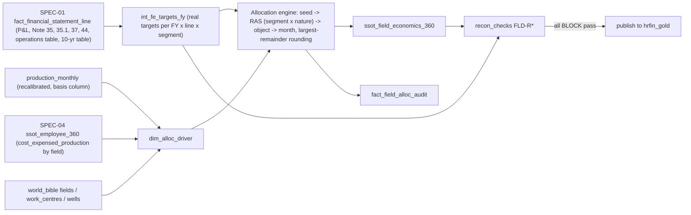

# SPEC-05: Field Economics-360 & Reconciliation to Company AR

**Features:** FEAT-022 · **Bugs closed:** diag_E bug 3 (mixed production definitions), diag_A bug "field P&L scaled to wrong corporate totals" (`load_and_reconcile_bq.py:204-258`) · **Phase/steps:** P2H.7 (allocation engine + Dataform), P2H.8 (reconciliation gates) · **Depends on:** SPEC-01 (`fact_financial_statement_line`, `fact_segment`, `fact_production_annual`), SPEC-04 (employee cost by field) · **Verbatims:** V18, V23 (Decision 7) · **Status:** Draft v3 (23-Oct-2026)
**Page convention:** "p.N" = PDF page index of `ONGC_AR_FY2025-26.pdf` (form-feed count); "line" = line in `knowledge/public_sources/grounding_data/text/ONGC_AR_FY2025-26.txt`. All ₹ figures are **₹ million** as reported unless marked ₹ cr.

> **BLUF.** Build `hrfin_gold.ssot_field_economics_360` at **cost-object × month**, plus a `v_field_economics_fy` rollup. Cost objects are 53 nomination fields, JV shares, VAP plants, basin exploration objects and one explicit `CO-HQ`. Each row carries production (with a **basis** column), realised price, revenue, levies, opex by nature, exploration, DD&A, EBITDA, segment-result contribution, capex and headcount.
> **Every FY reconciles exactly (to ₹0.01 mn) to the real standalone AR.** Σ objects = Revenue from operations, each Note 35 cost line, exploration write-offs, DD&A and PBT. Σ offshore and Σ onshore objects = AR segment revenue and segment profit (Note 44). Σ production = AR production by basis. Example FY26: ₹1,325,081.36 mn = Offshore 924,063.07 + Onshore 401,018.29; PBT 424,148.89.
> **Field splits are modelled**, from physical drivers (production, wells, water, installations) and the SPEC-04 employee cost. They are fitted to the real totals by **biproportional (RAS) fitting**: real company totals per nature and real segment totals. They are labelled "Modelled", never "Audited".
> Real targets come **only** from SPEC-01's `fact_financial_statement_line` (`verified=TRUE`), **never** from `financial_build/*.json` (wrong components, diag_A §1).

---

## 1. Purpose & verbatim trace

| Verbatim | Requirement | Where satisfied |
|---|---|---|
| V23 #7 | "operating cost per field when one goes on a field level detail and they should match to the total company level aggregate" | §4 schema; §6 allocation; §7 FLD-R01…R12 exact gates |
| V23 §4 | "Σ field opex per FY = AR P&L cost lines … automated and block publication on mismatch" | §7 + shared `recon_checks` (SPEC-04 §7.3) |
| V18 | Data lake → money, zero error, asset-level detail flowing to company numbers | Basis column, page lineage on every reference value |
| V23 #7 | "revenue per employee … operating cost" | §8 KPIs (revenue/employee by field, opex/boe, employee cost/boe) |

## 2. Current state (evidence)

| Area | Today | Evidence | Status |
|---|---|---|---|
| Field P&L | `landing/sap/CO_PA.csv` 590 rows (530 field, 30 plant_vap, 10 each exploration_writeoff, unallocated_corporate, reconciliation), FY17–FY26 → `field_pnl_annual` → `mart_field_economics`, `v_field_pnl` | `definitions/silver/field_pnl_annual.sqlx`, `gold/mart_field_economics.sqlx` | Partial |
| Company tie-out | Field revenue **scaled** to corporate totals from `financial_build` JSON (itself wrong on components) | diag_A_finance_data.md:17; `financial_build/scripts/load_and_reconcile_bq.py:204-258` | Broken |
| Revenue totals | Σ CO_PA `gross_revenue_inr_cr` matches AR revenue from operations **only for FY26** (132,508 cr). FY25 142,991 vs AR 137,846; FY24 140,697 vs 138,402; FY17 76,286 vs 77,908 (offline sum, 23-Oct) | `CO_PA.csv`; AR26 10-yr p.23 | Broken (9/10 FYs) |
| Production | `production_monthly.csv` 6,678 rows: FY17 Σ oil 24.38 MMT vs JSON 22.25; FY26 19.52 vs AR 19.332 (ONGC) / 20.501 (incl. JV). No basis column | diag_E_public_data_sources.md:7,54,115 | Broken |
| Segment check | None (no Offshore/Onshore reconciliation) | — | Missing |
| Opex by nature | CO_PA has 7 synthetic opex buckets; they do not map to AR Note 35 lines | CO_PA header | Partial |
| Employee cost on field | `allocated_manpower_cost_inr_cr` synthetic; `mart_field_economics` joins `payroll_monthly` by WC (not field) | `mart_field_economics.sqlx` (py join) | Partial |
| Cost ledger | `COSP_COSS.csv` posts "Direct Operating Cost - Offshore Platforms" to `WC-DEL` | `COSP_COSS.csv` row 1 | Broken (realism) |
| Lifting cost | `v_lifting_cost` = total_opex / boe (definition undocumented) | `gold/v_lifting_cost.sqlx:17` | Partial |

## 3. Target design

### 3.1 Grain & objects
| Object | Type | Grain | Rows (est.) |
|---|---|---|---|
| `hrfin_gold.ssot_field_economics_360` | table, `PARTITION BY month_start`, `CLUSTER BY segment, object_type, object_id` | cost object × month (Apr-2016 → last closed month) | ≈ 75 objects × 126 ≈ 9.5k |
| `hrfin_gold.v_field_economics_fy` | view | object × FY (sums; KPIs recomputed from sums, never averaged) | ≈ 750 |
| `hrfin_gold.v_field_economics_company_bridge` | view | FY × line: Σ objects vs AR reference vs delta | 10 FY × ~45 lines |
| `hrfin_gold.dim_cost_object` | table | object | ≈ 75 |
| `hrfin_gold.fact_field_alloc_audit` | table | FY × segment × nature: seed, RAS factor, final | ≈ 10 × 3 × 40 |
| `hrfin_gold.dim_alloc_driver` | table | FY × object × driver | drivers in §6.3 |
| `hrfin_gold.recon_checks` | table | shared with SPEC-04 | — |

**Cost objects (`dim_cost_object.object_type`):**
| Type | Members | Segment |
|---|---|---|
| `field` | 53 nomination fields from `world_bible/reference/fields.yaml` (e.g. FLD-MHN, FLD-MHS, FLD-BAS, FLD-HEE, FLD-KG982, FLD-GEL, FLD-ANK, FLD-KAL…) | from `onshore_offshore` |
| `jv_share` | ONGC participating-interest share of JV/PSC blocks: `JV-RJ-ON-90/1` (onshore), `JV-RAVVA`, `JV-CB-OS/2`, `JV-OTHER` (offshore). Names are public; shares are modelled | per block |
| `plant` | VAP plants: Uran (`WC-URN`), Hazira (`WC-HAZ`), Dahej C2-C3 (`WC-DAH`). VAP revenue and plant costs stay here (feed-linked to fields in the KPI view, §8) | Offshore (Uran, Hazira), Onshore (Dahej, Ankleshwar fractionation: modelled assumption, Q4) |
| `exploration` | Basin exploration objects (`EXP-WOB`, `EXP-KGB`, `EXP-MBA`, `EXP-CAB`, `EXP-AAB`, `EXP-RAJ`, `EXP-CAU`, `EXP-ANDAMAN`, `EXP-OTHER`) carrying survey and exploratory-well write-offs | by basin |
| `hq` | `CO-HQ`: unallocated corporate expense (net) as reported in the segment note | Unallocated |
| `company_nonop` | `CO-FIN` (finance cost), `CO-TREASURY` (interest/dividend income): recon-only rows | Unallocated |

### 3.2 Lineage

## 4. Schema — `ssot_field_economics_360`

**Basis tags:** `R` = real value (AR line); `RT` = real total with modelled split; `M` = modelled; `D` = derived. RBAC class (SPEC-06): `fin_internal` for all object-level rows. Company totals and segment rows = `general_fin`.

### A. Keys & provenance
| Column | Type | Description | Basis |
|---|---|---|---|
| `month_start` | DATE | Partition | — |
| `fiscal_year` | STRING | FY17…FY27 | — |
| `object_id`, `object_name`, `object_type` | STRING | §3.1 | — |
| `asset_wc_id`, `basin`, `state` | STRING | From `fields.yaml` / `work_centres.yaml` | M |
| `segment` | STRING | `Offshore` / `Onshore` / `Unallocated` (AR Note 44.1) | R |
| `operatorship`, `pi_share` | STRING / NUMERIC | Operated / non-operated; ONGC participating interest (1.0 nomination) | M |
| `maturity`, `hydrocarbon` | STRING | mature / developing; oil / gas / oil+gas | M |
| `data_label` | STRING | `"Modelled field split — totals reconcile to ONGC AR FYxx (standalone)"` | — |
| `build_run_id` | STRING | → `recon_checks.run_id` | — |

### B. Production & volumes
| Column | Type | Description | Basis |
|---|---|---|---|
| `oil_prod_mt` | NUMERIC | Crude oil production (tonnes) on this object's basis | RT |
| `condensate_prod_mt` | NUMERIC | Condensate (tonnes), reported inside crude per AR convention (Q1) | RT |
| `gas_prod_mmscm` | NUMERIC | Natural gas production | RT |
| `prod_basis` | STRING | `ONGC` (standalone, nomination + operated) / `JV_SHARE` | R |
| `oil_sales_mt`, `gas_sales_mmscm`, `vap_sales_kt` | NUMERIC | Quantity sold (AR 10-yr "Quantity Sold") | RT |
| `gas_internal_use_mmscm`, `gas_flared_mmscm` | NUMERIC | Volume bridge production → sales | M |
| `water_produced_m3`, `water_injected_m3`, `water_cut_pct` | NUMERIC | Drivers | M |
| `active_producers`, `active_injectors`, `installations_count`, `wells_drilled_dev` | INT64 | Drivers | M |
| `prod_boe` | NUMERIC | `(oil_t + condensate_t + gas_mmscm × 1,000) × 7.33`, i.e. 1,000 SCM gas = 1 TOE and 1 t = 7.33 bbl, from `dim_unit_conversion` (**convention, verify**, Q2) | D |

### C. Price & revenue
| Column | Type | Description | Basis |
|---|---|---|---|
| `realised_price_crude_inr_t` | NUMERIC | AR crude revenue / AR crude qty sold (FY26: 838,102 / 18.79 MMT = ₹44,604/t), × segment/field price factor (§6.2) | RT |
| `realised_price_gas_inr_scm` | NUMERIC | FY26: 363,299 / 15.491 BCM = ₹23.45/SCM, × factor (APM vs HPHT/NE) | RT |
| `realised_price_crude_usd_bbl` | NUMERIC | ÷ 7.33 ÷ FX (RBI FY average, SPEC-02 market data) | D |
| `rev_crude`, `rev_gas`, `rev_vap`, `rev_other_operating` | NUMERIC (₹ mn) | Σ = AR "Sale of product" lines + "Other operating revenue" | RT |
| `revenue_from_operations` | NUMERIC | Σ above. Σ objects = AR P&L line I (FY26 1,325,081.36) | RT |
| `other_income_segment` | NUMERIC | Other income excluding interest/dividend, allocated to segments/objects (FY26 103,557.62 − 88,576.32 = 14,981.30 to split) | RT |

### D. Statutory levies (Note 35)
| Column | Type | Description | Basis |
|---|---|---|---|
| `royalty` | NUMERIC | Seed = statutory rate × wellhead value (crude: onshore 20 %, offshore 10 %; gas 10 %; **public statutory rates, verify**), then fitted to the AR total | RT |
| `oidb_cess` | NUMERIC | Seed = 20 % ad valorem on nomination crude (verify); fitted to AR | RT |
| `nccd` | NUMERIC | ∝ crude tonnes | RT |
| `excise_saed` | NUMERIC | Special additional excise duty (windfall) Jul-2022 → Dec-2024, ∝ crude tonnes in force months | RT |
| `port_trust`, `other_levies` | NUMERIC | ∝ offshore crude / volumes | RT |
| `levies_total` | NUMERIC | Σ D | D |

### E. Operating expenditure by nature (Note 35 lines; FY26 AR values in brackets)
| Column | Opex bucket (V23 vocabulary) | Driver (seed) | Basis |
|---|---|---|---|
| `staff_expenditure` (26,521.21) | **Employee cost** | Σ SPEC-04 `cost_expensed_production_inr` by `field_id` + services re-allocation | RT (exact) |
| `workover_ops` (21,909.13) | Contract services | active wells × workover intensity (offshore × 3) | RT |
| `water_injection_desalting` (17,185.08) | Other production | water handled | RT |
| `consumption_stores_spares` (40,997.11) | Consumables | boe + wells × maturity factor | RT |
| `pollution_control` (4,635.35) | Other production | water produced + gas flared | RT |
| `transport_expenditure` (10,633.45) | Logistics/marine & aviation | installations × distance factor (offshore ≫ onshore) | RT |
| `insurance` (1,615.73) | Insurance | gross block proxy (installations × age) | RT |
| `power_fuel` (7,507.53) | Power & fuel | liquids handled (oil + water) | RT |
| `repairs_maintenance` (30,255.51) | R&M | installations/facilities × age | RT |
| `contractual_hire` (27,553.92) | Contract services | rig-days / hired-equipment days | RT |
| `other_production_exp` (14,847.16) | Other | boe | RT |
| `transport_freight_products` (17,159.59) | Logistics | sales volume × pipeline distance | RT |
| `r_and_d` (6,599.59) | Other (corporate) | → `CO-HQ` + allocated overhead (§6.4) | RT |
| `gae` (39,650.57) | Other (corporate) | → `CO-HQ` + allocated overhead | RT |
| `csr` (9,489.19) | Other (corporate) | → `CO-HQ` + allocated overhead | RT |
| `exchange_loss` (26,988.77) | Other (corporate) | by USD revenue share | RT |
| `misc_exp` (4,043.99), `fv_loss` (1,482.11) | Other (corporate) | → `CO-HQ` + allocated overhead | RT |
| `opex_total` | — | Σ E. With levies, Σ objects = Note 35 total (FY26 570,550.50) | D |
| `opex_operating` | — | `opex_total − exchange_loss` (= AR 10-yr "Operating Expenses", FY26 282,085 ± ₹1 mn rounding) | D |

Each Note 35 line is also tagged with its 8 V23 buckets (employee, contract services, R&M, power & fuel, consumables, logistics/marine, insurance, other) in `dim_opex_nature`, which feeds the bucket views.

### F. Exploration, DD&A, provisions, other
| Column | Type | Description (FY26 AR) | Basis |
|---|---|---|---|
| `expl_survey_wo` (14,927.97), `expl_wells_wo` (82,359.81) | NUMERIC | Only on `exploration` objects | RT |
| `depletion`, `depreciation`, `amortisation` | NUMERIC | Segment totals real (Note 44.4: Offshore 188,296.12; Onshore 63,674.27; Unallocated 2,247.53); to objects ∝ boe × depletion-rate factor / facilities | RT |
| `impairment_net` | NUMERIC | Note 37/44.5 (FY26 net reversal −2,879.69) | RT |
| `provisions_writeoffs` | NUMERIC | Note 44.4 (Offshore 27,566.33; Onshore 11,734.57; Unallocated 175.50) | RT |
| `inventory_change` | NUMERIC | P&L (FY26 544.57) ∝ crude stock | RT |

### G. Results
| Column | Formula | Basis |
|---|---|---|
| `ebitdax` | revenue + other_income_segment − levies − opex_total | D |
| `ebitda` | ebitdax − exploration write-offs | D |
| `segment_result_contrib` | ebitda − DD&A − impairment − provisions − inventory_change. Σ Offshore = 343,846.53; Σ Onshore = 62,456.98; `CO-HQ` = −25,438.33 | D (exact) |
| `pbt_contrib` | `segment_result_contrib` for objects; `CO-FIN` = −45,292.61; `CO-TREASURY` = +88,576.32; Σ all = PBT 424,148.89 | D (exact) |
| `field_pbt_margin_pct` | pbt_contrib / revenue | D |

### H. Capex, people
| Column | Type | Description | Basis |
|---|---|---|---|
| `capex_dev`, `capex_facilities`, `capex_exploration` | NUMERIC | Σ = AR 10-yr "Capex" (FY26 358,784) | RT |
| `headcount_direct` | NUMERIC | Month-end active SPEC-04 rows with `field_id = object_id` | M |
| `headcount_allocated_fte` | NUMERIC | Services/asset staff allocated by driver | M |
| `employee_cost_total` | NUMERIC | Staff cost incl. capitalised share on this object (for "employee cost per field" questions) | RT |
| `contractor_headcount` | NUMERIC | From `contract_workforce` | M |

## 5. Real targets (from SPEC-01; never from `financial_build`)

| Target line (line_code proposal) | FY26 value (₹ mn) | Source (AR26) | FY availability (local) |
|---|---|---|---|
| `PL.REV_OPS` Revenue from operations | 1,325,081.36 | P&L p.297 | FY17–FY26 (10-yr ₹ mn rounded FY17–FY20) |
| `REV.CRUDE` / `REV.GAS` / `REV.VAP` / `REV.OTHER_OP` | 838,102 / 363,299 / 118,785 / 4,895 | 10-yr p.23 | FY17–FY26 |
| `QTY.CRUDE_SOLD` / `QTY.GAS_SOLD` / `QTY.VAP_SOLD` | 18.79 MMT / 15.491 BCM / 2,468 kT | 10-yr p.23 | FY17–FY26 |
| `PROD.CRUDE_ONGC` / `PROD.CRUDE_JV` | 19.332 / 1.170 MMT (total 20.501) | Operations table p.55 line 3096 | FY24–FY26 (AR26); earlier from older ARs |
| `PROD.GAS_ONGC` / `PROD.GAS_JV` | 19.533 / 0.434 BCM (total 19.966) | p.55 line 3098 | as above |
| `N35.*` Note 35 lines (17 opex + 6 levies) | §4 D–E | Note 35 p.353 | FY21–FY26 (AR22–AR26 incl. comparatives) |
| `N351.EMP_TOTAL` | 102,107.09 | Note 35.1 p.354 | FY21–FY26; total FY17–FY26 (10-yr) |
| `PL.EXPL_SURVEY`, `PL.EXPL_WELLS` | 14,927.97 / 82,359.81 | P&L p.297 | FY17–FY26 |
| `PL.DDA`, `N37.IMPAIRMENT_NET` | 251,338.23 / −2,879.69 | P&L, Note 37 p.356 | FY17–FY26 / FY21+ |
| `PL.PROVISIONS` | 39,476.40 | P&L | FY17–FY26 |
| `PL.FIN_COST`, `PL.OTHER_INCOME`, `PL.PBT` | 45,292.61 / 103,557.62 / 424,148.89 | P&L | FY17–FY26 |
| `SEG.REV.OFF` / `SEG.REV.ON` | 924,063.07 / 401,018.29 | Note 44.2 p.368 | FY21–FY26 (FY17–FY20 after AR download) |
| `SEG.RES.OFF` / `SEG.RES.ON` / `SEG.UNALLOC` / `SEG.INT_DIV` | 343,846.53 / 62,456.98 / −25,438.33 / 88,576.32 | Note 44.2 p.368 | as above |
| `SEG.DDA.*`, `SEG.WO.*`, `SEG.IMP.*` | §4 F | Notes 44.4–44.5 p.369 | as above |
| `CAPEX.TOTAL` | 358,784 | 10-yr p.24 | FY17–FY26 |

**Identity used (FY26, verified by the SPEC author):** total income 1,428,638.98 − expenses 1,004,490.09 = PBT 424,148.89. Segment: 343,846.53 + 62,456.98 − 25,438.33 − 45,292.61 + 88,576.32 = 424,148.89. Note 35 non-levy lines sum to 282,086.22 (10-yr shows 282,085: ₹ mn rounding).

## 6. Allocation algorithm (deterministic, seeded)

### 6.1 Production
1. Start from the synthetic field-month shares in `production_monthly` (decline curves kept).
2. Per FY and basis, scale field volumes so that Σ `ONGC` basis = `PROD.*_ONGC` and Σ `JV_SHARE` = `PROD.*_JV`. Use largest-remainder rounding to 0.001 t / 0.0001 MMSCM.
3. If AR/PPAC give an offshore/onshore production split (P1 acquisition, diag_E row 12–13), add the segment constraint first (two-way RAS).
4. Sales bridge: `sales = production − internal use − flare − losses − VAP feed shrinkage`. Fit so that Σ sales = `QTY.*_SOLD` exactly. VAP kt are attributed to plants.

**Public anchors:** none of the field-level shares are in local sources. The grep of AR26/IP/PR text found no field shares. Until PPAC/MoPNG *Indian PNG Statistics* (offshore/onshore, state) are acquired, field shares are **modelled with priors**: Mumbai High (MHN + MHS) ≈ 40 % of ONGC crude; Western Offshore (MH + NEH + Bassein) ≈ 70–75 % of crude; KG-98/2 ramping from FY24 (Illustrative). Every answer that names a field share carries the label "Modelled".

### 6.2 Revenue (biproportional, exact)
Build the matrix `segment × product` with seed `q(s,k) × P_k × f(s,k)`. `P_k` = AR revenue_k / AR qty_k. Prior factors `f`: onshore gas 0.90 (APM/NE), offshore gas 1.05 (HPHT/deepwater premium), crude 1.0 (Illustrative). Fit rows to `SEG.REV.*` and columns to `REV.*` (RAS, tolerance 1e-9, ≤ 200 iterations). Within each cell, allocate to objects ∝ volume × field price factor, then phase monthly ∝ sales. FYs without segment data: column constraints only (rows `NOT_AVAILABLE`).

### 6.3 Costs (biproportional, exact)
1. **Seed:** for each Note 35 nature `n` and object `o`, `seed(o,n) = driver(o,n) × unit_cost_prior(n, segment, maturity)` (`dim_alloc_driver`; drivers per §4 E). Staff expenditure seed = SPEC-04 actual production-expensed employee cost by field (already equal to the AR total by EMP-R29), so its RAS factor must be 1.000.
2. **Segment cost totals (real):** `SegCost_s = SegRev_s + OI_s − SegResult_s`, where `OI_s` = modelled split of segment other income. Σ_s SegCost_s + unallocated = company expenses excl. finance cost (FY26 959,197.48).
3. **RAS** on the `segment × nature` matrix (rows = SegCost_s including the DD&A/write-off/impairment totals pinned by Note 44.4–44.5; columns = AR nature totals). Pinned cells (Note 44.4 DD&A by segment, write-offs by segment, staff expenditure) are held fixed; the rest are scaled.
4. **Down-allocate** each (segment, nature) cell to objects ∝ seed. **Phase monthly:** volume-linked natures ∝ monthly boe; fixed natures ∝ days; staff = actual SPEC-04 months; levies ∝ monthly sales value.
5. **Rounding:** largest-remainder at ₹0.01 mn at every level (month → FY → segment → company), so every sum is exact.
6. **Audit:** write seed, RAS factor and final value for each (FY, segment, nature) to `fact_field_alloc_audit`. Gate FLD-R10 keeps factors in [0.5, 2.0], which flags bad priors rather than hiding them.

### 6.4 Corporate lines & `CO-HQ`
The unallocated corporate expense (net) is real (FY26 −25,438.33) and sits **entirely** on `CO-HQ`. It is composed of the corporate natures (GAE, R&D, CSR, misc, FV loss, unallocated DD&A 2,247.53 and write-offs 175.50) **net of** unallocated other income. The rest of each corporate nature is allocated to segments by RAS (it is inside the real segment results), then to objects by revenue share. These show as `allocated_corporate_overhead` in the bucket view.

### 6.5 Exploration
Survey and exploratory-well write-offs go only to `exploration` objects. The basin split is modelled from wells drilled (`wells_drilled.csv`) and seismic LKM/SKM. The segment split is inside the RAS (pinned by segment cost totals).

### 6.6 FY17–FY20 (until ARs FY16–FY19 are downloaded, Decision 2)
Constraints = 10-yr table lines (levies by type, operating expenses total, exploration, provisions, exchange loss, DD&A, finance cost, PBT, revenue by product, quantity sold). The nature mix inside "Operating Expenses" uses the FY21 Note 35 shares, labelled "nature split modelled (FY21 mix)". Segment checks = `NOT_AVAILABLE`. Tolerance ± ₹1 mn (10-yr table is in whole ₹ mn). **Update 23-Oct:** AR texts FY2015-16 … FY2018-19 are now in `grounding_data/text/`. When P1 extracts their Notes 35 / segment notes, FY17–FY19 move to the full Note-level and segment gates (no spec change needed: availability is read from `fact_financial_statement_line`).

## 7. Reconciliation gates (`recon_checks`, BLOCK unless stated)

| ID | Check (per FY) | Reference (FY26) | Tol. |
|---|---|---|---|
| FLD-R01 | Σ objects `revenue_from_operations` = `PL.REV_OPS` | 1,325,081.36 | ₹0.01 mn (FY21+), ₹1 mn (FY17–20) |
| FLD-R02 | Σ objects by product revenue = `REV.*` | 838,102 / 363,299 / 118,785 / 4,895 | ₹1 mn |
| FLD-R03 | Σ Offshore objects revenue = `SEG.REV.OFF`; Onshore = `SEG.REV.ON` | 924,063.07 / 401,018.29 | ₹0.01 mn |
| FLD-R04 | Σ objects for each Note 35 line (23 lines) = AR | §4 D–E | ₹0.01 mn |
| FLD-R05 | Σ `staff_expenditure` = Note 35 Staff Expenditure **and** = SPEC-04 Σ `cost_expensed_production_inr` | 26,521.21 | ₹0.01 mn |
| FLD-R06 | Exploration write-offs (survey, wells), DD&A, impairment, provisions = AR | 14,927.97 / 82,359.81 / 251,338.23 / 39,476.40 | ₹0.01 mn |
| FLD-R07 | Segment DD&A and write-offs = Note 44.4 by segment | 188,296.12 / 63,674.27 / 2,247.53; 27,566.33 / 11,734.57 / 175.50 | ₹0.01 mn |
| FLD-R08 | Σ Offshore `segment_result_contrib` = `SEG.RES.OFF`; Onshore; `CO-HQ` = `SEG.UNALLOC` | 343,846.53 / 62,456.98 / −25,438.33 | ₹0.01 mn |
| FLD-R09 | Σ all `pbt_contrib` = `PL.PBT` | 424,148.89 | ₹0.01 mn |
| FLD-R10 | RAS factors in [0.5, 2.0]; staff factor = 1.000 | audit table | — (BLOCK if outside [0.33, 3.0]; WARN outside [0.5, 2.0]) |
| FLD-R11 | Σ production by basis = AR | crude 19.332 + 1.170 MMT; gas 19.533 + 0.434 BCM | 0.001 MMT / 0.001 BCM |
| FLD-R12 | Σ sales qty = AR quantity sold | 18.79 MMT / 15.491 BCM / 2,468 kT | 0.01 MMT / 0.001 BCM / 1 kT |
| FLD-R13 | Σ capex = AR capex | 358,784 | ₹1 mn |
| FLD-R14 | Month-sum = FY value for every object × column | — | ₹0.01 mn |
| FLD-R15 | No object has negative production, revenue or opex (except `CO-TREASURY`, impairment reversals) | — | 0 violations |
| FLD-R16 (WARN) | Field realised crude price within ± 10 % of the company price; FY realised price vs press-release realisation | PR Q4FY26 | ± 3 % |
| FLD-R17 (WARN) | Opex/boe ranking stable: Spearman ρ between consecutive FYs ≥ 0.7 | — | — |

The publish rule is the same as SPEC-04 §7.4. Answers about FYs whose segment checks are `NOT_AVAILABLE` carry the label "Field split reconciled to company totals; segment split not yet verified".

## 8. KPIs (semantic model) — all deterministic SQL on `v_field_economics_fy` (sums first, then ratios)

| KPI | Formula | Label |
|---|---|---|
| `field_revenue_cr` | Σ revenue_from_operations / 10 | Modelled (company total Real) |
| `opex_per_boe_inr`, `opex_per_boe_usd` | `opex_operating_excl_corporate / prod_boe` (÷ FX) | Modelled |
| `lifting_cost_per_boe_usd` | (staff + workover + water injection + consumables + pollution + transport + insurance + power & fuel + R&M + contractual + other production) / boe ÷ FX. Excludes levies, freight of products, corporate natures, DD&A | Modelled; definition shown |
| `employee_cost_per_boe` | staff_expenditure / boe | Modelled (total Real) |
| `field_ebitda_cr`, `field_ebitda_margin_pct` | §4 G | Modelled |
| `field_pbt_cr` | `pbt_contrib` | Modelled |
| `levies_pct_revenue` | levies_total / revenue | Modelled (total Real) |
| `revenue_per_employee_field_cr` | revenue / (avg `headcount_direct` + `headcount_allocated_fte`) | Modelled |
| `boe_per_employee` | boe / avg headcount | Modelled |
| `breakeven_crude_usd_bbl` | price at which `pbt_contrib` = 0, holding volumes and costs (linear solve) | Modelled |
| `capex_intensity_usd_boe` | capex / boe | Modelled |
| `offshore_vs_onshore_*` | segment rows (Real FY21+) | Real |
| `company_bridge` | `v_field_economics_company_bridge` (Σ objects vs AR, delta, check status) | Real vs Modelled |

**What-if (scenario engine, labelled "Scenario"):** opex reduction x % on nature n for fields in a set; production uplift; price deck change; employee cost change from SPEC-04 scenarios (e.g. OT cap) flowing into `staff_expenditure` by field.

## 9. Migration plan
| Step | Change | Packet |
|---|---|---|
| 1 | Recalibrate `gen_23_ops.py` production with a basis column and the AR volume targets; add JV-share objects and plant attribution | P2H.7 |
| 2 | Replace `gen_24_fin.py` CO_PA generation with the allocation engine `data_bank/generators/finance/alloc_field_economics.py` (reads frozen real targets, drivers, SPEC-04 field staff cost) → `landing/sap/CO_PA_v3.csv` (object × month × nature, long) | P2H.7 |
| 3 | Dataform: `silver/field_econ_alloc.sqlx`, `gold/ssot_field_economics_360.sqlx`, `v_field_economics_fy`, `v_field_economics_company_bridge`, dims; keep `mart_field_economics` / `v_field_pnl` / `v_lifting_cost` as compat views over the new table | P2H.7 |
| 4 | Retire `financial_build/scripts/load_and_reconcile_bq.py` field scaling (`:145-258`) | P2H.7 |
| 5 | Recon assertions + offline pytest | P2H.8 |
| 6 | **Re-baseline v2 field answers:** the reallocation changes the D-32 parity anchor (C7 `capex_vs_reserves`: Eastern Offshore ₹48,955 cr / 32.1 %). Recompute the C7 expected values from the new SSOT, update the named template's parity test and the answer key, and note the change in the P2H.7 review | P2H.7 |

## 10. Acceptance criteria
- [ ] FLD-R01…R15 PASS for FY21–FY26. FLD-R01/R02/R04 (10-yr level), R06, R09, R11–R14 PASS for FY17–FY20.
- [ ] `v_field_economics_company_bridge` shows delta = 0.00 on every line, every FY with data.
- [ ] Every object row has `data_label`. No field-level number is labelled "Audited"/"Verified".
- [ ] 53 fields + JV + plant + exploration + HQ objects present every month; ≤ 9,600 rows per 126 months.
- [ ] BEH-06.18–.24 golden answers reproduce.

## 11. Test plan
| Test | Where | What |
|---|---|---|
| Unit | `data_bank/tests/test_61_field_alloc.py` (new) | RAS convergence; pinned cells untouched; largest-remainder exactness; determinism (seed) |
| Offline recon | same | FLD-R01…R17 against frozen `real_targets_fy.csv` |
| Dataform | `definitions/assertions/recon_field_economics.sqlx` | Writes `recon_checks`; fails on BLOCK |
| Golden eval | `yukti/backend/eval/golden_field_econ.yaml` | Company totals by FY (exact); field answers carry the "Modelled" label |

## 12. Open questions
1. **Q1:** Does AR "Crude Oil Production" include condensate, and is "Quantity Sold" on the ONGC + JV basis? Proposed: production incl. condensate; sales = all standalone sales incl. JV share. P1 extraction confirms from the AR operations notes.
2. **Q2:** boe conversion: use 1 t crude = 7.33 bbl and 1,000 SCM gas = 1 TOE (ONGC O+OEG convention)? Need confirmation from the AR glossary (not found locally).
3. **Q3:** Field-share anchors: OK to download PPAC monthly production and MoPNG *Indian PNG Statistics* (Decision 2 covers ARs/XBRL; these are additional public files)?
4. **Q4:** Segment of VAP plants (Uran/Hazira offshore-fed; Dahej/Ankleshwar onshore-fed) is an assumption; the AR segment note does not list plants.
5. **Q5:** SPEC-01 must extract Note 35 (all lines), Note 35.1, Note 37, Notes 44.2–44.5 and the operations production table for FY21–FY26 into `fact_financial_statement_line` with the line codes in §5. **Coordination with the SPEC-01 author.**

## 13. Status matrix
| Item | Status |
|---|---|
| Field P&L table exists | Partial (annual, synthetic, wrong totals) |
| Production calibrated with basis | Broken |
| Revenue = AR, all FYs | Broken (FY26 only) |
| Opex by AR nature lines | Missing |
| Segment reconciliation | Missing |
| Employee cost from Employee-360 | Missing |
| RAS allocation + audit | Missing |
| `recon_checks` publish gate | Missing |
