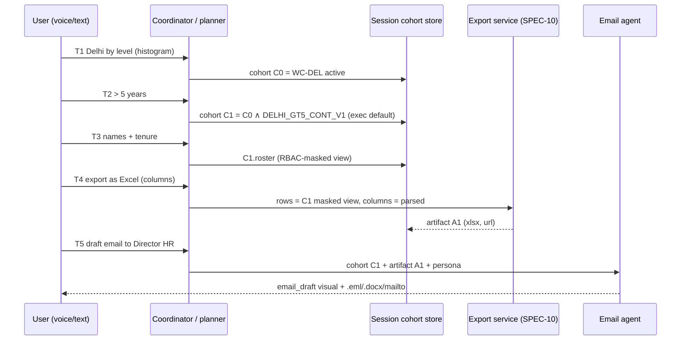

# SPEC-07: V19 Transfer Workflow, Excel Export & Email Agent

**Feature:** FEAT-023 (also uses FEAT-017 RBAC, FEAT-027 export) · **Bugs closed:** BUG-10, BUG-11, BUG-12 (transfer-proposal literals), BUG-34 (grade order) · **Steps:** P2H.3 (turns 1–3), P2H.4 (turns 4–5) · **Verbatim:** V19 (+ V13) · **Status:** Draft v3 (23-Oct-2026)

> **BLUF.** The five-turn V19 chain becomes one deterministic workflow over a **session cohort**: (1) Delhi headcount by level as an **ordered E1→E9 column chart**, (2) the **one canonical ">5 years" rule** (continuous stay at the current station, strictly > 5.0 years, executives by default with an "all cadres" toggle), (3) a named roster with 9 fixed columns, (4) an **export intent that understands natural English/Hindi phrasing** and honours requested columns, returning a formatted xlsx download link, and (5) an **email agent** that drafts To/CC/Subject/body from the cohort, cites JRTP clause 3.2 (Illustrative) and the real Delhi HC 2018 judgment (J-03), and attaches the step-4 xlsx. Canned transfer-proposal numbers are deleted. Juniors get aggregates at step 3 and an aggregate-only email.

---

## 1. Purpose & verbatim trace

| V19 turn (verbatim) | Expected result | Section |
|---|---|---|
| T1 "how many employees are there in the Delhi office across levels? … kind of a histogram" | Column chart, x = E1…E9 (+ optional non-exec cadres), ordered by level | §4.1 |
| T2 "how many of these employees are here in Delhi for more than five years? … should have been transferred" | Headline count, by-level split, rule stated, toggle executives/all cadres | §4.2 |
| T3 "give me the name of those employees and their tenure in Delhi" | Named roster (CMD/DIR_HR), aggregate for juniors | §4.3 |
| T4 "export this as an Excel file? Their names, designations, ranks E1… and tenure in Delhi" | xlsx with exactly the requested columns, download link in the answer | §4.4 |
| T5 "draft an email to the Director HR highlighting the cohort … requesting review/action" | Editable email draft + .eml/.docx/mailto, xlsx attached | §4.5 |

## 2. Current state (evidence)

| Turn | Status | Evidence (diag_B §3, diag_D) |
|---|---|---|
| T1 | Partial | Planner compiles `GROUP BY current_grade_id … ORDER BY headcount DESC` (orders by count, BUG-34); legacy path maps "histogram" to an **age** histogram (`turn_runner.py:945-1075`) |
| T2 | Partial | Planner patch `continuous_stay_years > 5.0` → 645 all cadres; certified C1 = executives, `>= 60 months` → 419; B3 gate follow-up strict 46.7% (`eval/gates/B3.json`) |
| T3 | Implemented in code (unverified live) | Roster SQL cols emp_id, name, `grade_designation`, grade, discipline, WC, ongc/station tenure, years_to_retirement, exemption; cap 2,000 (`presenter.py:128`); designation generic |
| T4 | **Broken** | `ui_control.py:291` matches only 4 literal phrases; `uiCommands.ts:251` same; phrase falls to the planner. Roster Export button works (`RosterTable.tsx:338/567` → `/api/export`) |
| T5 | **Missing** | No "email" anywhere; `_DOC_RE` lacks it (`pipeline.py:36`); legacy `draft_triggers` → `transfer_proposal` canned template with "401 net recommendations" vs "Total relocations 146" (`draft_document.py:105-131`); `turn_runner.py:1183-1187` routes any "transfer" draft there |
| Policy anchor | Partial | Real JRTP not public (`policies/MANIFEST.md:142`); synthetic JRTP Rev 4 clause 3.2 "rotation after 3–5 yrs" (`data_bank/landing/documents/rulebooks_clause_index.csv`); real anchor J-03 Delhi HC 2018 ONGC v. B.V. Srihari Rao; AR FY26 p.101 mentions JRTP automation |
| Data | Good | 943 active in WC-DEL; continuous > 5 yrs: 645 (419 executives) on landing CSVs as of 19-Oct-2026. **Counts will change after SPEC-04 regeneration**; tests compare against the reference SQL, not literals |

## 3. Target design



All five turns go through the planner/coordinator (no keyword fast-path writes answers). P3's `hr_transfer_agent` (SPEC-03) wraps T3–T5 later; this spec is valid without it.

## 4. Rules & algorithms

### 4.1 T1: Delhi headcount by level

- Spec: `metric=headcount, filters={wc_id:'WC-DEL', status:'Active'}, dims=[grade], order=grade_level_order ASC`.
- `grade_level_order` from `dim_grade`: board levels (CMD, Directors) are excluded from the chart and listed in a footnote ("Also in Delhi: CMD 1, Directors 2"). Executives E1…E9 = 1…9; non-executive cadres (GRP-B/C/D) appended after E9 when "all staff" is on (default **on** for T1 because the question says "employees").
- **"Histogram" of a categorical level axis = ordered column chart** (`chart.kind="column"`, `x_order="explicit"`); a note is shown once: "Levels are categories, so this is a column chart in level order." True histograms are reserved for continuous distributions (SPEC-09 §4.6).
- Title states the insight, e.g. "Delhi: 943 staff; E3 is the largest executive level (154)" (numbers from the result).
- Session: `cohort C0` stored (§4.6).

### 4.2 T2: canonical ">5 years in Delhi" rule — `DELHI_GT5_CONT_V1`

| Aspect | Decision | Rationale |
|---|---|---|
| Tenure measure | **Continuous stay at the current station** (`v_continuous_stay`, `is_current_stay=TRUE`), measured from island start to the as-of date | JRTP rotation is about the current stint; cumulative over a career is a different rule (cluster cap 4.1) |
| Threshold | **Strictly greater than 5.0 years**: `continuous_stay_days > 1826` (5 × 365.25 = 1826.25) | Matches the user's words "more than five years"; removes `>=60 months` vs `> 5.0` ambiguity |
| Population | **Executives E1–E9 by default**; toggle chip "Include all cadres" adds GRP-B/C/D | JRTP covers executives (E0–E9); the user's intent is transfer-eligibility. Headline always shows both: "**419 executives** (645 including non-executive staff)" |
| Board levels | Excluded (CMD/Directors are not rotated under JRTP) | — |
| Exemptions | **Counted, not removed.** Column `exemption` = `pre_retirement` (≤ 2 years to superannuation, JRTP 7.1 Illustrative), plus SPEC-04 exemption types (medical, spouse, child Class X/XII, union office-bearer, project-critical) with `valid_until ≥ as_of` | Director decides; the email states "of which N exempt" |
| As-of date | `as_of = MAX(snapshot_date)` of `ssot_workforce_employee` (today 19-Oct-2026); stated in every answer | — |
| Policy citation | "JRTP Rev 4, clause 3.2: rotation after 3–5 years at a station (**Illustrative** — ONGC's JRTP text is not public)" + "Delhi HC (LPA 744/2013, 13-Feb-2018; J-03) records that the employee 'continued in Rajahmundry for more than 5 years' and the transfer was not in violation of ONGC's job retention and transfer policy" (**real**; the finding is the AP HC single-judge order quoted in the Delhi HC judgment, p.14 of 60) | Decision 6 (V23): keep synthetic clauses labelled "Illustrative" |

**Reference SQL (golden; tests compare the app's numbers to this):**

```sql
-- DELHI_GT5_CONT_V1, executives default
SELECT e.current_grade_id AS grade, COUNT(*) AS headcount
FROM `hrfin_gold.ssot_workforce_employee` e
JOIN `hrfin_gold.v_continuous_stay` s USING (emp_id)
WHERE e.status = 'Active' AND e.wc_id = 'WC-DEL'
  AND s.is_current_stay AND s.wc_id = 'WC-DEL'
  AND DATE_DIFF(@as_of, s.stay_start_date, DAY) > 1826
  AND e.current_grade_id IN UNNEST(@grades)   -- E1..E9 default; + GRP-B/C/D when all_cadres
GROUP BY grade
```

- The planner follow-up patch and certified C1 are both rewritten to this definition (one `definition_id`), deleting the `>= 60 months` and `minus 3-yr retirees` variants. Other thresholds in code (H1 > 3 yrs, D2 ≥ 36 months Mumbai) stay only where the question explicitly states that threshold.
- Answer: KPI "419 executives > 5 yrs continuous in Delhi" + column chart by level (E1→E9) + one-line rule + "Illustrative" badge on the clause + chips: "Show the names", "Include all cadres", "Export to Excel", "Draft email to Director (HR)".

### 4.3 T3: named roster

| # | Column key | Header | Source | Format |
|---|---|---|---|---|
| 1 | `name` | Name | `ssot_workforce_employee.name` | text |
| 2 | `functional_designation` | Designation | SPEC-04 `functional_designation` (fallback `grade_designation`, flagged in caveat) | text |
| 3 | `grade` | Level | `current_grade_id` | E1…E9, sorted by `grade_level_order` |
| 4 | `ongc_tenure_years` | ONGC service (yrs) | DOJ → as_of | 1 dp |
| 5 | `delhi_tenure_years` | Tenure in Delhi (yrs) | continuous stay (label switches to "Tenure at {station}" for other single-WC filters) | 1 dp |
| 6 | `years_to_retirement` | Years to retirement | retirement_date − as_of | 1 dp |
| 7 | `exemption` | Exemption | §4.2 | text or "—" |
| hidden | `emp_id`, `discipline` | (CMD/DIR_HR column picker) | — | — |

- Default sort: `delhi_tenure_years DESC`. All rows returned to the client (cap 2,000; the cohort is ~419–645); the UI virtualises.
- RBAC per SPEC-06: CMD, DIR_HR → A; DIR_FIN → A for DISC-FIN rows, the rest collapsed to counts by grade; E*_HR / E*_FIN → AGG with R-NAMED copy.

### 4.4 T4: export intent (BUG-10)

**Detection (backend `ui_control.py` and frontend `uiCommands.ts` share one pattern file `contracts/intents/export_intent.json`):**

| Language | Pattern (case-insensitive) |
|---|---|
| English | `\b(export|download|save|send|give|get|make|create|generate|share)\b[^.?!]{0,60}?\b(excel|xlsx|xls|spreadsheet|sheets?|workbook|csv|pdf|word|docx|doc|png|svg|image|picture)\b` and the reverse order `\b(excel|xlsx|…)\b[^.?!]{0,30}?\b(export|download|file|copy|version)\b` |
| Hinglish | `\b(excel|sheet|pdf|word)\b.{0,30}\b(mein|me|main)\b.{0,20}\b(export|download|bana|nikal|bhej|save)\w*` |
| Hindi (Devanagari) | `(एक्सेल|स्प्रेडशीट|शीट|पीडीएफ|वर्ड|सीएसवी).{0,30}(डाउनलोड|एक्सपोर्ट|निर्यात|भेज|बना|निकाल|सेव)` |

Negative guard: not an export if the sentence asks a data question about exports ("export revenue", "crude exports", "निर्यात आय") — require a file-format word from the list.

**Column honouring:** synonym map → roster keys. `name(s)`→`name`; `designation(s)|post|title|पद`→`functional_designation`; `rank(s)|level(s)|grade(s)|E1…E9|स्तर|ग्रेड`→`grade`; `tenure in delhi|delhi tenure|years in delhi|दिल्ली में कार्यकाल`→`delhi_tenure_years`; `service|ONGC tenure`→`ongc_tenure_years`; `retirement`→`years_to_retirement`; `exemption`→`exemption`. If ≥ 1 column is named, export exactly those in the user's order (V19 T4 → name, designation, level, Delhi tenure). If none, export the visible columns. Unknown column words → listed in a caveat ("I couldn't match 'home town'; exported the rest").

**Row source:** the full cohort behind the last visual **after** `enforce_contract` (never a re-query bypassing RBAC; never the truncated display list).

**Output:** formatted xlsx per SPEC-10 §4.1 (frozen header, widths, `0.0` tenure format, title row "Delhi executives with > 5 years' continuous stay — as of 19-Oct-2026 — source: SSOT (synthetic, Illustrative)", sheet 2 "Definition" with the rule + citations). Contract: `artifacts[0] = {export_id, kind:"xlsx", filename, url:"/api/export/<export_id>", rows, columns, masked:false|true}` (same `Artifact` shape as SPEC-03 `job.artifacts`) and `ui_action={type:"download", export_id}`. Spoken: "Your Excel file with 419 executives is ready: name, designation, level and tenure in Delhi."

### 4.5 T5: email agent (BUG-11, BUG-12)

**Trigger:** `_DOC_RE` gains `\b(e-?mail|mail|letter|note|memo)\b.{0,40}\b(to|for)\b` and Hindi `(ईमेल|मेल|पत्र).{0,30}(लिख|ड्राफ्ट|भेज|बना)`. Recipient resolved from text: "Director HR / Director (HR) / DHR / निदेशक (मानव संसाधन)" → `DIR_HR` in `dim_app_user`.

**Inputs:** `cohort C1` (definition, counts by grade, row count, exemptions), `artifact A1` (if absent, the agent generates the xlsx first with the default V19 columns and says so), sender = `principal`, recipient from `dim_app_user`, policy citations from §4.2.

**Template** (`yukti/backend/app/brain/templates/email_transfer_review.md`, Jinja; EN and HI variants):

| Field | Value |
|---|---|
| From | `{sender.display_name}, {sender.functional_designation}` `<{sender.email}>` |
| To | `Director (HR) <director.hr@ongc.example>` |
| CC | Empty by default, editable (Q3) |
| Subject | `Review requested: {n_exec} executives at Delhi beyond 5 years' continuous stay (as of {as_of})` |
| Body ¶1 | Purpose: "As discussed, our records show **{n_exec} executives** (and {n_nonexec} non-executive staff) posted at Delhi (WC-DEL) continuously for more than five years as of {as_of}." |
| Body ¶2 | Table: count by level E1…E9 (only non-zero levels) + total; line "of which {n_exempt} carry a recorded exemption (pre-retirement {a}, medical {b}, …)". |
| Body ¶3 | Policy basis: JRTP Rev 4 clause 3.2 (Illustrative) + J-03 (real), one sentence each. |
| Body ¶4 | Ask: "Please have the Transfer Board review this cohort for the next rotation cycle and advise on exemptions by {as_of + 30 days}." |
| Body ¶5 | "The full list ({n_rows} rows: name, designation, level, tenure in Delhi) is attached." / junior variant: "Counts only; the named list is available to Director (HR)." |
| Sign-off | sender name, designation, "Sent via Yukti (draft — please review before sending)" |
| Attachment | `A1.filename` (xlsx) |
| Footer label | "Data: synthetic employee records calibrated to ONGC AR FY26 (Illustrative)" until real HRMS integration |

**Outputs:**

| Output | Behaviour |
|---|---|
| On-screen draft | `visual.type="email_draft"` `{to:[{name,email}], cc:[], subject, body_md, attachments:[export_id], citations:[…], editable:true}`; fields editable inline; edits stay client-side until download |
| `.eml` | `POST /api/export {format:"eml", email_draft}` → RFC 5322 message, `X-Unsent: 1`, multipart/mixed with the xlsx attached (base64); opens in Outlook/Apple Mail as a draft |
| `.docx` | Letter layout (SPEC-10 docx) incl. the count table; no attachment |
| `mailto:` | `mailto:director.hr@ongc.example?subject=…&body=…` (body truncated to 1,800 chars; note "attach the downloaded Excel file manually": mailto cannot carry attachments) |
| Gmail draft | **Later** (Drive/Gmail OAuth, `gmail.compose` scope); hidden button until configured |

**Hard rules:** every number in the email comes from the cohort result (template placeholders only; a unit test fails if the template file contains a digit other than in dates/clause ids). Delete `draft_document.py:105-131` canned figures and the `turn_runner.py:1183-1187` "transfer → transfer_proposal" route, and `turn_runner.py:1541-1550, 1609-1613, 2192-2228` literals (BUG-12; shared with SPEC-11).

### 4.6 Context carry rules (session cohort)

`session_state.cohorts[]` entries: `{cohort_id, turn_id, definition_id|null, spec (QuerySpec JSON), row_count, columns, rbac_decision, as_of, artifacts:[export_id]}`; `session_state.active_cohort_id`.

| Rule | Behaviour |
|---|---|
| C-1 Anaphora | "these / those / them / this list / इन / ये / उन" bind to `active_cohort_id` |
| C-2 Refinement | T2 creates a **child** cohort (C1 ⊂ C0); "go back to all Delhi staff" re-activates C0 |
| C-3 Re-plot | Visual changes (chart kind) do not change the cohort |
| C-4 Export | Uses the active cohort's masked rows; artifacts are appended to that cohort |
| C-5 Email | Uses the active cohort + its latest xlsx artifact; if the active cohort is not a transfer cohort (no tenure filter), ask: "Which group should the email cover?" with chips of recent cohorts |
| C-6 Expiry | Cohorts live for the session (≤ 50 per session, LRU); artifacts for 24 h |
| C-7 All paths | Planner, coordinator agents and voice (`ask_yukti`) write the same `session_state` (no `{}` pushes; SPEC-11) |
| C-8 Persona | Cohorts are tagged with `principal.emp_id`; a new login clears them |

### 4.7 RBAC per step

| Persona | T1 | T2 | T3 | T4 | T5 |
|---|---|---|---|---|---|
| CMD | A | A | A (names) | A (named xlsx) | A (named attachment) |
| DIR_HR | A | A | A | A | A (sender = recipient, so the agent asks "Who should this go to?" with chips CMD / Transfer Board; To stays empty until chosen) |
| DIR_FIN | A | A | AGG (non-FIN rows) | AGG xlsx (counts by level) | AGG email, no attachment of names |
| E1–E4_HR | A (k≥5) | A (k≥5) | AGG + R-NAMED | AGG xlsx, filename suffix `_aggregate` | AGG email (counts only) |
| E1–E4_FIN | AGG (k≥5) | AGG (k≥5) | AGG + R-NAMED | AGG xlsx | R-FUNC: "Transfer reviews are raised by HR. I can prepare the counts table for you to share with HR." + chip |

## 5. Data / contract schemas

- `contracts/answer_contract.schema.json` additions (coordinated with SPEC-03/09/10): `artifacts[]` = `$defs/artifact` exactly as SPEC-10 §5 `{export_id:string, kind:enum[xlsx,csv,pdf,png,svg,docx,eml], filename, url, rows:int, columns:[string], masked:bool, created_at, expires_at, sha256}` (one shared type for P2H.4 and P4.6; SPEC-03 §5.1 ledger); `ui_action.type` adds `"download"`; `visual.type` adds `"email_draft"` (fields §4.5).
- `dim_grade.grade_level_order INT64` (E1=1 … E9=9; GRP-B=10, GRP-C=11, GRP-D=12; CMD/DIR NULL).
- Semantic model: `delhi_tenure_years` alias of `continuous_stay_years` when `wc_id` filter is single-valued; definition registry `semantic/definitions.yaml` with `DELHI_GT5_CONT_V1` (generalised `STATION_GT5_CONT_V1` with `@wc_id`).

## 6. Acceptance criteria

1. T1 x-axis order is exactly `E1,E2,…,E9[,GRP-B,GRP-C,GRP-D]` for all 3 phrasings ("histogram", "by level", "across levels"); `chart.kind="column"`; 0 age-histogram answers (legacy branch deleted).
2. T2 executive count and per-level counts equal the reference SQL (§4.2) for as_of = data snapshot; all-cadres toggle equals the reference with GRP grades; answer text contains both numbers, the rule sentence and the "Illustrative" label on clause 3.2 and "Delhi High Court" citation.
3. T3 for CMD returns `row_count` = T2 executive count, the 7 visible columns in §4.3 order, sorted by Delhi tenure desc.
4. Export intent: 40-utterance fixture (20 EN, 10 Hinglish, 10 Devanagari; incl. "Can you export this as an Excel file?", "excel mein export karo", "इसे एक्सेल में डाउनलोड करो") → 40/40 detected with the correct format; 10 negative utterances ("show crude oil exports", "export revenue FY25") → 0 detected.
5. Column honouring: V19 T4 sentence → xlsx header row exactly `Name | Designation | Level | Tenure in Delhi (yrs)`; row count = T3 row count; values equal T3 cell-for-cell (100%).
6. Email: To = Director (HR) address from `dim_app_user`; subject contains `n_exec`; body counts by level sum to `n_exec`; attachment present in .eml (parsed by Python `email` lib: 1 part `application/vnd.openxmlformats-officedocument.spreadsheetml.sheet`); template file contains 0 hard-coded counts; `draft_document.py` contains neither `401` nor `146`.
7. RBAC: §4.7 matrix as 11 personas × 5 turns = **55 cases** pass; junior T4 file has 0 `name` column and suffix `_aggregate`; E*_FIN T5 returns R-FUNC.
8. Context: 5-turn chain passes as text and as voice (`ask_yukti`) for CMD with ≥ 95% repeatability over 20 runs (live gate), and offline with fixture rows 100%.

## 7. Test plan

| Suite | Cases | Offline |
|---|---|---|
| `tests/test_v19_definition.py`: SQL compile of DELHI_GT5_CONT_V1, threshold edge cases (1826 vs 1827 days), exec/all toggle | 8 | ✅ |
| `tests/test_export_intent.py`: 40 positive + 10 negative + column parsing | 60 | ✅ (shared JSON also run by `vitest` frontend) |
| `tests/test_email_agent.py`: template render from fixture cohort, .eml parse, no-literal check, junior variant, R-FUNC | 12 | ✅ |
| `tests/test_v19_chain.py`: 5-turn golden for CMD, DIR_HR, DIR_FIN, E2_HR, E3_FIN (session store, fixture data) | 25 | ✅ |
| `tests/test_v19_rbac_matrix.py` | 55 | ✅ |
| Live gate `eval/gates/P2H_v19.json`: 20 runs × CMD + 5 × E2_HR, voice smoke 3 runs | 28 | needs ADC |

## 8. Open questions

| # | Question | Recommendation |
|---|---|---|
| Q1 | Default population executives vs all? | Executives default, both numbers always shown (decided here; flag to sponsor) |
| Q2 | Exclude pre-retirement exemptions from the headline? | No: count and flag; the Director decides |
| Q3 | Default CC list? | Empty, editable; avoid inventing ONGC office addresses |
| Q4 | Email language when asked in Hindi? | Body in Hindi with English subject + English table headers (official correspondence is bilingual) |

## 9. Status matrix

| Capability | Today | Step |
|---|---|---|
| T1 ordered column chart | Partial (count order; legacy age histogram) | P2H.3 |
| T2 canonical definition | Partial (two definitions) | P2H.3 |
| T3 roster columns | Implemented (generic designation) | P2H.3 (+ SPEC-04 data) |
| T4 export intent + columns + link | Broken | P2H.4 |
| T4 formatted xlsx | Partial (unformatted) | P2H.4 / P4.6 |
| T5 email agent + outputs | Missing | P2H.4 |
| Canned proposal numbers removed | Broken | P2H.4 |
| Session cohort store | Partial (planner only) | P2H.3 |
| RBAC per step | Partial (5 personas) | P2H.3/P2H.4 after P2H.1 |
