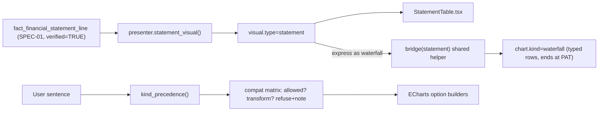

# SPEC-09: Statement Visual, Correct Waterfall & Chart Portfolio

**Features:** FEAT-025 (financial statement table visual), FEAT-026 (chart portfolio + correct waterfall + explicit-kind precedence) · **Bugs closed:** BUG-08, BUG-09, BUG-22, BUG-23, BUG-34, waterfall false-success (diag_D B11) · **Steps:** P4.1–P4.5, P4.8, P4.9 · **Verbatims:** V7, V15, V21 (+ V20 multi-year layout) · **Status:** Draft v3 (23-Oct-2026)

> **BLUF.** Statements get their own typed visual, `visual.type="statement"`, rendered by a bespoke **StatementTable** (indented lines, bold subtotals with rules, `(negatives)`, lakh-crore grouping, FY columns latest-first, sticky first column, no sorting, no inline bars, source footnote with document + page). "Express as waterfall" uses **one signed P&L bridge helper** shared by backend and frontend that **must end at reported PAT** and **never fabricates EBITDA**. An explicit chart word in the user's sentence always wins over heuristics. The portfolio grows from ~15 to 26 ECharts kinds, gated by a **data-shape compatibility matrix** (histograms only for distributions, never statements). "9/10" becomes measurable via 14 finance rubric criteria. Tech: **ECharts + bespoke StatementTable**, typed whitelisted visuals, no free-form A2UI.

---

## 1. Purpose & verbatim trace

| Verbatim | Requirement | Section |
|---|---|---|
| V21 | "if I ask for a table, I should get a table … income statement is a table … Histogram makes no sense" | §4.1–4.2, §4.6 |
| V21 | "can you express it as a waterfall?" | §4.3 |
| V21 | "in Excel, you have a portfolio of different plots … we should also have a portfolio on the backend" | §4.5 |
| V21 | "whether we need AUI … plotly dash … four out of 10. We need a nine out of 10" | §4.7 rubric, §4.8 tech |
| V20 | Yahoo-style multi-year statement | §4.1 multi-FY columns |
| V7 / V15 | Re-plot any chart on request; context kept | §4.4, §4.6 |
| V21 | "aurora is least of my concerns" | §4.9 (low priority) |

## 2. Current state (evidence from diag_C)

| Area | Status | Evidence |
|---|---|---|
| Statement default = table | Partial | `presenter.py:154-219` (P&L), `:221-272` (BS), `:274-333` (CF) emit `vis.type="table"`; generic `TableRenderer.tsx` |
| Statement formatting | Missing | Sortable columns break line order; inline bar on `amount_cr` (`TableRenderer.tsx:97-131`); negatives "-x"; no FY headers; single FY + prior only |
| Waterfall re-plot | **Broken** | Backend `turn_runner.py:275-296` rebuilds from raw `last_rows`; frontend `compat.ts:71-73` prefers `table.rows` over `chart.data`; `options.ts:392-420` treats untyped rows as positive deltas, trims > 9 rows to "Others", appends Total = Σ → Total ≈ 411,000 vs revenue 137,000 (probe §A3) (BUG-08) |
| EBITDA fabrication | **Broken** | `plan.ts:146`, `compat.ts:130`, `chart_rules.py` single-row branch: `ebitda = rev*0.68` or `(rev+pbt)/2`; `/\bpbt\b|profit/` accepts PAT as PBT (BUG-09) |
| False success | **Broken** | `turn_runner.py:282-312` says "I've switched the screen view to a waterfall" even when rows are empty (fedback2 L331-341, ×3) |
| Explicit kind | Broken | `chart_rules.py:42-50` forces waterfall for revenue+profit+show; "as a line chart" → waterfall (BUG-22) |
| Portfolio | Partial (~15/29) | `combo/heatmap/box/gauge` in contract without renderer (`plan.ts:135-211`) (BUG-23) |
| Rubric | Partial | `docs/chart_quality_rubric.md` 8 generic criteria; no statement/finance standard; "Table" row demands inline bars |
| Grade ordering | Cosmetic bug | grade axis by count (BUG-34) |
| Orb | Partial | `VoiceOrb` only when `panelMode==='minimised'` (`FloatingConversationPanel.tsx:236-247`), default `docked` (`page.tsx:62`) |

## 3. Target design



## 4. Rules & algorithms

### 4.1 `visual.type="statement"` contract

```jsonc
{
  "type": "statement",
  "statement": "pnl" | "balance_sheet" | "cash_flow",
  "scope": "standalone" | "consolidated",
  "title": "Statement of Profit and Loss (Standalone)",
  "unit": "INR_crore",                 // display "₹ crore"
  "periods": ["FY26","FY25","FY24","FY23","FY22"],   // latest first
  "period_labels": {"FY26": "FY 2025-26"},
  "show_yoy": true,                    // adds "YoY %" for periods[0] vs periods[1]
  "sections": [
    {
      "id": "income", "label": "Income",
      "rows": [
        {"line_code": "REV_OPS", "label": "Revenue from operations", "level": 1, "kind": "line",
         "values": {"FY26": 0.0, "FY25": 0.0}, "yoy_pct": 0.0, "note_ref": "<note>",
         "source": {"doc": "ONGC AR FY2025-26", "page": 0 /* from SSOT source_page; placeholder */}, "is_restated": false},
        {"line_code": "TOT_INC", "label": "Total income", "level": 0, "kind": "subtotal", "values": {}}
      ]
    }
  ],
  "totals_check": {"identity": "A = E + L", "passed": true, "max_abs_delta_cr": 0.0},
  "source": {"primary": "ONGC Annual Report FY2025-26, Standalone, pp. <from SSOT>", "basis": "audited",
             "extraction": "pdftotext+gate", "verified": true},
  "as_of": "2026-05-xx",
  "footnotes": ["Figures in ₹ crore. Negative values in parentheses."]
}
```

| Field | Type | Rule |
|---|---|---|
| `rows[].level` | int 0–3 | indent = `level × 16px` |
| `rows[].kind` | `line` \| `subtotal` \| `total` | subtotal: bold + top hairline; total: bold + double top rule |
| `rows[].values` | map period → number \| null | null → "—"; never 0 for missing |
| `rows[].yoy_pct` | number \| null | omitted for subtotals whose base ≤ 0 |
| `rows[].source` | `{doc, page}` | required when `source.verified=true`; renders in the row tooltip |
| `sections[].label` | string | rendered as a non-numeric header row (small caps, muted) |

Values are emitted only from `verified=TRUE` SSOT rows (SPEC-01). If any period lacks verified rows, that column is omitted and a caveat says so (no fallback to unverified numbers).

### 4.2 StatementTable renderer rules

| # | Rule | Check |
|---|---|---|
| S1 | First column = line label, sticky on horizontal scroll, indentation by `level` | DOM `position: sticky` |
| S2 | FY columns latest-first (left → right), header = `FY 2025-26` with unit row "₹ crore" | header text |
| S3 | Numbers right-aligned, `font-variant-numeric: tabular-nums lining-nums` | computed style |
| S4 | Indian grouping `1,37,000`; 0 dp for ₹ crore ≥ 100, 2 dp below 100; percentages 1 dp | formatter unit test |
| S5 | Negatives as `(1,234)` in default ink (not red) — accounting convention; YoY negative in maroon token | formatter |
| S6 | Subtotal rows bold with 1 px top rule; total rows bold with double rule; line rows regular | style snapshot |
| S7 | **No column sorting, no inline bars, no zebra on subtotal rows** | absence test |
| S8 | YoY % column muted, only when `show_yoy` | — |
| S9 | Footnote: unit, basis (standalone/consolidated), "Source: {doc}, pp. {pages}", as-of, restated marker `†` | text present |
| S10 | Max 3 KPI tiles above a statement (Revenue, PAT, PAT margin) — or none when the user asked "just the table" | count |
| S11 | Light + dark contrast ≥ 4.5:1 for body, ≥ 3:1 for rules | `lint:contrast` |
| S12 | Keyboard: row focus, `Enter` on a line asks "why did {line} change?" chip (V21 "take actions on that") | Playwright |
| S13 | Export (xlsx/PDF/CSV) reproduces indentation, bold, `(neg)` formats (SPEC-10) | export test |

### 4.3 Signed P&L bridge helper (BUG-08, BUG-09)

**Single source:** `yukti/contracts/statement_line_classes.json` maps `line_code` → `bridge_class`:

| bridge_class | Sign in bridge | Examples |
|---|---|---|
| `start` | absolute bar | Revenue from operations |
| `add` | + | Other income |
| `deduct` | − (value stored positive is negated) | Purchases, production & operating expense, statutory levies, employee benefits, finance costs, DD&A, exploration write-offs, other expenses, tax expense |
| `signed` | as reported (sign kept) | Exceptional items, share of JV profit (consolidated), deferred tax credit |
| `subtotal` | marker bar (absolute, not a step) | Total income, PBT, EBITDA *only if the line exists in SSOT* |
| `end` | absolute bar | Profit for the year (PAT) |
| `skip` | excluded | OCI items, EPS, per-share lines |

**Algorithm (`bridge(statement, period, granularity="standard")`):**
1. Take rows for `period` in statement order; map classes; drop `skip`.
2. Running total `r = start.value`; for each `add/deduct/signed` row: `delta = +v | −v | v`; `r += delta`; emit `{label, value: delta, type: "delta"}`.
3. For `subtotal` rows present in data: emit `{label, value: reported_value, type: "total"}` and assert `|r − reported_value| ≤ 0.5` (₹ crore); else **abort**.
4. Emit `end` = reported PAT as `type:"total"`; assert `|r − PAT| ≤ 0.5`.
5. `granularity="standard"` merges deduct lines below 2% of revenue into "Other expenses (net)" (sum preserved; never an unsigned "Others" bar).
6. On abort or missing start/end: return `BridgeError{reason}`; the turn answers: "I can't build a reliable bridge from these lines ({reason}). Here is the statement table." with `visual` unchanged. **Never** synthesise EBITDA, DD&A or "OPEX & Levies".

Implemented twice from the same JSON: `yukti/backend/app/brain/bridge.py` and `yukti/frontend/src/charts/bridge.ts`, both tested against shared fixtures `yukti/contracts/fixtures/bridge/*.json` (FY22–FY26 standalone from SSOT once P1 lands; synthetic fixture now, labelled).

**Re-plot paths:**
- Backend `turn_runner.py:275-296`: if `last_vis.type=="statement"` and target is `waterfall` → `bridge()`; if `last_vis.chart.kind == target` → keep `last_vis.chart`, only flip display; never rebuild from `last_rows`.
- Frontend `compat.replot`: when `base.type=="statement"` → `bridge.ts`; when `requested === base.chart?.kind` and `chart.data` exists → return base chart; waterfall uses `chart.data` whenever rows carry `type`.
- Delete EBITDA synthesis in `plan.ts:146`, `compat.ts:130`, `chart_rules.py` single-row branch; PBT regex no longer matches PAT/"profit".
- **Drill from a bar (V21 "take actions on that … what happened"):** clicking a `delta` bar, or its chip "Why did <line> change?", sends a typed follow-up `{intent: "why", line_code, fy_from, fy_to}` that is answered by the SPEC-08 §6 grounded-why path (BEH-03.07 shape). No LLM-generated numbers; same RBAC as the source answer.
- **False-success rule:** the spoken/display confirmation "Here's the waterfall" is emitted only after the visual is produced; otherwise the BridgeError copy (EN + HI). The Live voice must read the contract text (SPEC-11).
- Waterfall renderer: connector lines between bars (rubric C-waterfall), deltas coloured by sign (positive token / maroon), totals in neutral ink, labels `(x)` for negatives.

### 4.4 Explicit-kind precedence (BUG-22)

Resolution order for `chart.kind` on every turn:
1. **Explicit kind in the current utterance** (EN/HI lexicon: "line chart/रेखा", "bar/column/कॉलम", "pie/donut/पाई", "waterfall/bridge/वॉटरफॉल", "table/tabular form/सारणी/टेबल", "heatmap", "histogram", "scatter", "combo", "stacked", "100% stacked", "treemap", "funnel", "gauge", "tornado", "sankey", "sunburst", "map").
2. Explicit re-plot command on the previous visual ("show it as …", "express as …", "इसे … में दिखाओ").
3. Data-shape default (§4.6 "default" column).
4. Heuristic shortcuts **only** when the sentence contains bridge wording ("bridge", "waterfall", "from revenue to profit", "walk").
If (1)/(2) is not allowed for the data shape → nearest allowed kind + one-line note (never silent), e.g. "A histogram needs a distribution; the income statement is shown as a table. Say 'waterfall' for a bridge."

### 4.5 Chart portfolio (Excel-class) — status & plan

| # | Kind | Status today | Action | Step | Priority |
|---|---|---|---|---|---|
| 1 | Table (generic / roster) | ✅ | keep | — | — |
| 2 | **Statement table** | ⛔ | add (§4.1–4.2) | P4.2/P4.3 | P0 |
| 3 | Column | ✅ | grade order fix (BUG-34) | P2H.3 | — |
| 4 | Bar (ranked) | ✅ | keep | — | — |
| 5 | Diverging ± bar | ✅ | keep | — | — |
| 6 | Stacked | ✅ | keep | — | — |
| 7 | **100% stacked** | ⛔ | add | P4.4 | P1 |
| 8 | Grouped | ✅ | keep | — | — |
| 9 | Line (≤ 6 series) | ✅ | keep | — | — |
| 10 | Area | ✅ | keep | — | — |
| 11 | **Combo bar + line, dual axis** | 🔴 contract only | add (revenue bars + margin % line) | P4.4 | P0 (CFO default for value + %) |
| 12 | Pie / donut | ✅ | keep | — | — |
| 13 | Waterfall / bridge | 🔴 wrong data | fix (§4.3) | P4.1 | P0 |
| 14 | Histogram | ✅ | restrict to distributions | P4.1 | — |
| 15 | **Box plot** | 🔴 contract only | add (pay by grade, tenure by WC) | P4.4 | P1 |
| 16 | Scatter | ✅ | remove fabricated "rank" axis (`compat.ts:286-296`) | P4.4 | P1 |
| 17 | **Bubble** | ⛔ | add (size encoding) | P4.5 | P2 |
| 18 | **Heatmap** | 🔴 contract only | add (month × WC, grade × WC) | P4.4 | P1 |
| 19 | **Sensitivity grid** (WACC × g, Brent × FX) | ⛔ | add as typed `visual.type="sensitivity_grid"` (heatmap + exact cell values, base case outlined) | P4.5 | P0 for V22 |
| 20 | **Tornado** | ⛔ | add as typed `visual.type="tornado"` (sorted low/high bars around base) | P4.5 | P0 for V22 |
| 21 | Treemap | ✅ | keep | — | — |
| 22 | **Sunburst** | ⛔ | add (cost hierarchy) | P4.5 | P2 |
| 23 | Funnel | ✅ | keep | — | — |
| 24 | **Gauge** | 🔴 → bullet | add (single KPI vs target band) | P4.4 | P2 |
| 25 | KPI tiles / sparkline | ✅ | keep | — | — |
| 26 | **Sankey** | ⛔ | add (revenue → cost buckets → PAT; manpower flows) | P4.5 | P2 |
| 27 | **India state choropleth** | Partial (outline + points) | add state GeoJSON (Survey of India/Datameet, licence check) | P4.5 | P2 |
| 28 | Radar | ⛔ | not planned (low value for finance; opt-in later) | — | — |
| 29 | Small multiples | ✅ | keep | — | — |

DCF composite visuals (`dcf_model`) are owned by SPEC-02; they reuse #19/#20 and the statement table.

### 4.6 Data-shape compatibility matrix

Legend: **D** default · ✅ allowed · 🔄 transform (with note) · ✗ refuse → nearest allowed + note.

| Data shape (detector) | stmt | table | column/bar | line/area | combo | stacked | 100% | pie/donut | waterfall | histogram | box | scatter/bubble | heatmap | sens. grid | tornado | treemap/sunburst | sankey | gauge | map |
|---|---|---|---|---|---|---|---|---|---|---|---|---|---|---|---|---|---|---|---|
| **Financial statement** (`visual.type=statement`) | **D** | ✅ | 🔄 (selected lines × FY) | 🔄 (selected lines over FY) | 🔄 (line + margin) | ✗ | ✗ | ✗ | ✅ (bridge §4.3, P&L only; CF bridge = opening→closing cash) | **✗ never** | ✗ | ✗ | ✗ | ✗ | ✗ | ✗ | 🔄 (P&L flow) | ✗ | ✗ |
| Time series, 1 measure | ✗ | ✅ | ✅ | **D** line | ✗ | ✗ | ✗ | ✗ (note) | 🔄 (period-over-period deltas) | ✗ | ✗ | ✗ | ✗ | ✗ | ✗ | ✗ | ✗ | ✗ | ✗ |
| Time series, ≥ 2 measures same unit | ✗ | ✅ | ✅ grouped | **D** | ✅ | ✅ | ✅ | ✗ | ✗ | ✗ | ✗ | ✗ | ✅ | ✗ | ✗ | ✗ | ✗ | ✗ | ✗ |
| Time series, value + % (mixed units) | ✗ | ✅ | small multiples | small multiples | **D** dual axis | ✗ | ✗ | ✗ | ✗ | ✗ | ✗ | ✅ | ✗ | ✗ | ✗ | ✗ | ✗ | ✗ | ✗ |
| Categorical (nominal), 1 measure | ✗ | ✅ | **D** ranked | ✗ (note) | ✗ | ✗ | ✗ | 🔄 top-7 + Others | ✗ unless typed deltas | 🔄 only ≥ 8 items as value distribution | ✗ | ✗ | ✗ | ✗ | ✗ | ✅ | ✗ | ✗ | ✅ if geo key |
| **Ordinal (grade E1→E9)**, 1 measure | ✗ | ✅ | **D** column in level order ("histogram" request → this) | ✅ | ✗ | ✗ | ✗ | 🔄 | ✗ | ✗ (categorical) | ✗ | ✗ | ✗ | ✗ | ✗ | ✅ | ✗ | ✗ | ✗ |
| Category × category × measure | ✗ | ✅ | ✅ grouped | ✗ | ✗ | **D** | ✅ | ✗ | ✗ | ✗ | ✗ | ✗ | ✅ | ✗ | ✗ | ✅ sunburst | ✗ | ✗ | ✗ |
| Part-of-whole (all ≥ 0) | ✗ | ✅ | ✅ | ✗ | ✗ | ✅ | ✅ | **D** donut (≤ 8) | ✗ | ✗ | ✗ | ✗ | ✗ | ✗ | ✗ | ✅ | ✗ | ✗ | ✗ |
| Contains negatives | ✗ | ✅ | **D** diverging | ✅ | ✅ | ✗ | ✗ | ✗ | ✅ if typed | ✗ | ✗ | ✗ | ✅ | ✗ | ✗ | ✗ | ✗ | ✗ | ✗ |
| **Distribution** (per-record numeric, n ≥ 30) | ✗ | ✅ | 🔄 binned | ✗ | ✗ | ✗ | ✗ | 🔄 bins | ✗ | **D** | ✅ (by group) | ✗ | ✗ | ✗ | ✗ | ✗ | ✗ | ✗ | ✗ |
| Two measures per entity | ✗ | ✅ | small multiples | ✗ | ✅ | ✗ | ✗ | ✗ | ✗ | ✗ | ✗ | **D** scatter | ✗ | ✗ | ✗ | ✗ | ✗ | ✗ | ✗ |
| Three measures per entity | ✗ | ✅ | ✗ | ✗ | ✗ | ✗ | ✗ | ✗ | ✗ | ✗ | ✗ | **D** bubble | ✗ | ✗ | ✗ | ✗ | ✗ | ✗ | ✗ |
| Matrix (2 inputs × output) | ✗ | ✅ | ✗ | ✅ (one line per row) | ✗ | ✗ | ✗ | ✗ | ✗ | ✗ | ✗ | ✗ | ✅ | **D** | ✗ | ✗ | ✗ | ✗ | ✗ |
| One-way sensitivities (input → low/high) | ✗ | ✅ | ✅ | ✗ | ✗ | ✗ | ✗ | ✗ | ✗ | ✗ | ✗ | ✗ | ✗ | ✗ | **D** | ✗ | ✗ | ✗ | ✗ |
| Hierarchy (parent → child, ≥ 0) | ✗ | ✅ | ✅ | ✗ | ✗ | ✅ | ✗ | ✅ | ✗ | ✗ | ✗ | ✗ | ✗ | ✗ | ✗ | **D** | ✅ | ✗ | ✗ |
| Flow (source → target, value) | ✗ | ✅ | ✗ | ✗ | ✗ | ✗ | ✗ | ✗ | ✗ | ✗ | ✗ | ✗ | ✅ | ✗ | ✗ | ✗ | **D** | ✗ | ✗ |
| Geo (state/WC code) | ✗ | ✅ | ✅ | ✗ | ✗ | ✗ | ✗ | ✗ | ✗ | ✗ | ✗ | ✗ | ✗ | ✗ | ✗ | ✅ | ✗ | ✗ | **D** |
| Single value (+ optional target) | ✗ | ✅ | ✗ | ✗ | ✗ | ✗ | ✗ | ✗ | ✗ | ✗ | ✗ | ✗ | ✗ | ✗ | ✗ | ✗ | ✗ | ✅ with target | ✗ |
| Single value, no target | ✗ | ✅ KPI **D** | ✗ | ✗ | ✗ | ✗ | ✗ | ✗ | ✗ (BridgeError copy) | ✗ | ✗ | ✗ | ✗ | ✗ | ✗ | ✗ | ✗ | ✗ | ✗ |

The matrix lives in code as `compat.ts` `ALLOWED[shape][kind]` + `chart_rules.py` mirror, generated doc `docs/chart_compatibility.md` (existing generator `scripts/gen_compat_doc.ts`). A parity test asserts backend and frontend tables are identical.

### 4.7 Finance rubric additions (measurable "9/10")

Added to `docs/chart_quality_rubric.md` as section **F** (applies to `statement`, `waterfall`, `combo`, `sensitivity_grid`, `tornado`, finance tables). **9/10 = all ★ criteria pass and ≥ 90% of the rest.**

| ID | Criterion | Measure | Pass |
|---|---|---|---|
| F1 ★ | Numbers match SSOT | every displayed value vs `fact_financial_statement_line` at display precision | 0 mismatches |
| F2 ★ | No fabricated values | every number has lineage (`source.doc/page` or computed-from ids) | 100% |
| F3 ★ | Waterfall closes | last bar = reported PAT (or closing cash), subtotals = reported | Δ ≤ ₹0.5 cr |
| F4 ★ | Line order = source order | statement rows vs SSOT `order` | 100% |
| F5 | Accounting negatives | negatives rendered `(x)` in tables/exports | 100% |
| F6 | Hierarchy visible | indentation by level; subtotal bold + rule; total double rule | all rows |
| F7 | Units explicit | unit in header or axis ("₹ crore", "%") | every visual |
| F8 | FY labelling | Indian FY labels, latest-first in tables, chronological on time axes | 100% |
| F9 | Tabular figures, right-aligned | computed style | all numeric cells |
| F10 | Source footnote | doc + pages + basis + as-of present | 100% |
| F11 | Insight title | title states the finding (contains a number or direction), not "Updated Chart View" | 100% |
| F12 | Density | ≤ 3 KPI tiles above a statement; statement starts above the fold at 1440×900 | pass |
| F13 | Contrast | light + dark ≥ 4.5:1 text, ≥ 3:1 graphical | `lint:contrast` OK |
| F14 | Export fidelity | xlsx/PDF values = screen values; formats per SPEC-10 | 100% |

Scorecards: one per visual type in light + dark under `docs/reviews/assets/P4_*`, scored by R-O with the checklist (no self-scoring by the implementer).

### 4.8 Technology decision

| Option | Decision | Reason |
|---|---|---|
| **ECharts 5 (keep)** | ✅ | Native heatmap, boxplot, gauge, sankey, sunburst, dual-axis combo, custom-series tornado; `getDataURL`/SVG renderer for export; existing theme + rubric tooling |
| **Bespoke `StatementTable`** | ✅ for statements | Zero new dependency; exact accounting layout; deterministic snapshots |
| AG Grid Community | Optional later for rosters (pinned cols, CSV) | Not needed for v3; RosterTable works |
| Plotly / Dash | ✗ | ~1,300 lines of option code to port, no visible gain, heavier bundle |
| Free-form A2UI / AUI | ✗ | Zero-error finance needs deterministic, testable layouts |
| **Typed whitelisted visuals** | ✅ | `statement`, `sensitivity_grid`, `tornado`, `dcf_model` (SPEC-02), `email_draft` (SPEC-07): "A2UI with a whitelist"; the agent chooses among them |

### 4.9 Orb & aura (low priority per V21)

- Show `VoiceOrb` (48 px) docked at the ask bar's left edge whenever `orbState ∈ {listening, thinking, speaking}` in **docked** and fullscreen modes, not only minimised.
- Optional viewport-edge aura: 6 px inset glow keyed to `orbState`, tokens only, `prefers-reduced-motion` → static; off by default behind `?aura=1` until sponsor review.
- Fix the 5 raw `rgba(...)` colours in `VoiceOrb.tsx:136-159` (token lint).

## 5. Contract summary (additions)

`visual.type` enum adds: `statement`, `sensitivity_grid`, `tornado`, `email_draft` (SPEC-07); `chart.kind` adds: `combo`, `stacked100`, `heatmap`, `box`, `bubble`, `gauge`, `sunburst`, `sankey`, `choropleth` (renderers required before the enum value is emitted by the backend). Waterfall rows: `{label, value, type: "delta"|"total"}` mandatory.

`sensitivity_grid`: `{row_input:{name, unit, values[]}, col_input:{…}, output:{name, unit}, cells:(number|null)[][], base:{row_idx, col_idx}, source}`; `null` cells render "n/m" (SPEC-02 §8: WACC − g < 1pp). `tornado`: `{output:{name, unit, base}, bars:[{driver, low_input, high_input, low_inr, high_inr}]}` sorted by `|high_inr − low_inr|` desc (field names identical to SPEC-02 engine output).

Composite / content-owned visuals rendered here, content owned elsewhere:
- `dcf_model` (SPEC-02/03): tabbed card reusing existing renderers — KPI tiles (intrinsic ₹/share, market ₹/share, upside %, verdict), FCFF and WACC build-up as `statement`-style tables, EV→equity bridge as a typed waterfall, `sensitivity_grid`, `tornado`. Built in P4.5 once SPEC-02 fixtures exist.
- `actions` (SPEC-08 top-5 actions): numbered cards `{items:[{rank, title, impact_inr_cr, owner, evidence_refs[]}]}`; field list is owned by SPEC-08 and this renderer follows it. Built in P4.5.

## 6. Acceptance criteria

1. P&L FY22–FY26 fixtures: `bridge()` last bar = reported PAT within ₹0.5 cr for 5/5 years, in Python and TS (10/10); any present subtotal (PBT, Total income) matches.
2. Grep: 0 matches for `0.68`, `rev \* 0`, `(rev + pbt) / 2` in `plan.ts`, `compat.ts`, `chart_rules.py`.
3. Re-plot "express this as a waterfall" after a statement → typed bridge, text and voice (EN + HI) identical; with a single-value visual → BridgeError copy, no "I've switched…" text (3/3 fedback2 phrasings).
4. Explicit kind: 30-utterance fixture (e.g. "show revenue vs profit for last 5 years as a line chart" → `line`; "plot revenue and PAT trend over 10 years" → `line`; "show revenue, EBITDA and PAT for FY24 in tabular form" → `table`) → 30/30.
5. Statement table: S1–S13 pass in Playwright + unit tests; histogram request on a statement → table + note (0 histograms).
6. Portfolio: each added kind renders from a fixture in light + dark without console errors; `compat` parity test green; 0 contract kinds without a renderer (`answerContract.ts` enum ⊆ `plan.ts` branches).
7. Rubric F scorecards for statement, waterfall, combo, sensitivity grid, tornado: all ★ pass, ≥ 90% others (R-O scored).
8. Orb visible in docked mode for listening/thinking/speaking (Playwright screenshot), token lint clean.

## 7. Test plan

| Suite | Location | Cases |
|---|---|---|
| Bridge parity | `tests/test_bridge.py` + `src/charts/__tests__/bridge.test.ts` (shared fixtures) | 5 FY × 2 impls + 6 error cases |
| Kind precedence | `tests/test_kind_precedence.py` + vitest mirror | 30 |
| Compat parity | `tests/test_compat_parity.py` (reads TS-exported JSON) | 19 shapes × 20 kinds |
| Statement formatter | `src/components/renderers/__tests__/StatementTable.test.tsx` | S1–S13 |
| Renderers | `scripts/render_fixtures.ts` + Playwright screenshots | 11 new kinds × 2 themes |
| Regression | fedback2 waterfall ×3, diag_C probe §A3 | 4 |

## 8. Open questions

| # | Question | Recommendation |
|---|---|---|
| Q1 | Latest-first FY columns (Yahoo/AR) vs chronological? | Latest-first in tables, chronological on chart axes |
| Q2 | EBITDA in the bridge when AR doesn't report it? | Omit; offer "EBITDA (computed: PBT + finance cost + DD&A)" only as a labelled computed subtotal if the sponsor wants it (SPEC-08) |
| Q3 | India state GeoJSON source/licence | Datameet (CC BY 4.0) with attribution; verify before P4.5 |
| Q4 | Aura on by default? | Off until sponsor review (V21 low priority) |

## 9. Status matrix

| Capability | Today | Step |
|---|---|---|
| `visual.type=statement` contract + presenter emit | Missing | P4.2 |
| StatementTable renderer | Missing | P4.3 |
| Signed bridge helper (py + ts) | Missing | P4.1 |
| Waterfall re-plot correctness | Broken | P4.1 |
| EBITDA fabrication removed | Broken | P4.1 |
| False-success message | Broken | P4.1 |
| Explicit-kind precedence | Broken | P4.1 |
| Combo / 100% / heatmap / box / gauge | Broken (contract only) / Missing | P4.4 |
| Sensitivity grid / tornado / bubble / sunburst / sankey / choropleth | Missing | P4.5 |
| Compat matrix incl. new shapes | Partial | P4.4 |
| Finance rubric F1–F14 | Missing | P4.8 |
| Orb docked + aura | Partial | P4.9 |
