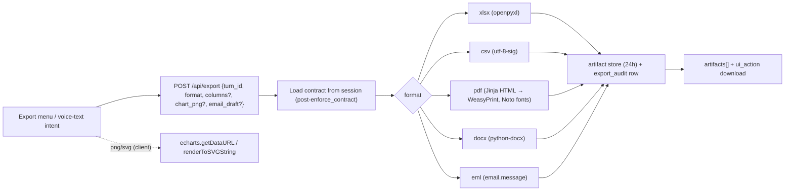

# SPEC-10: Export Suite

**Feature:** FEAT-027 (also serves FEAT-023 V19 export/email, FEAT-029 DCF workbook) · **Bugs closed:** BUG-24, BUG-25, BUG-10 (intent, with SPEC-07) · **Steps:** P4.6 (backend), P4.7 (frontend + intents), P2H.4 (V19 xlsx/eml subset) · **Verbatims:** V2, V7, V19, V21 · **Status:** Draft v3 (23-Oct-2026)

> **BLUF.** Every table and chart gets honest one-click and voice/text export to **xlsx** (accounting formats, widths, frozen header, statement indentation, DCF assumptions sheet), **CSV**, **PDF** (server-side HTML→PDF via **WeasyPrint** with embedded Noto Sans + Noto Sans Devanagari, real tables and the chart image), **PNG/SVG** (client-side ECharts), **docx** and **.eml**. "Google Sheets/Docs" stop pretending: today they download the file with a clear toast; Drive upload via user OAuth comes later. Exports are built **only from the RBAC-masked contract**, are audit-logged, and follow one file-naming rule. ₹ and Devanagari rendering are tested with `pdftotext` + `pdffonts`.

---

## 1. Purpose & verbatim trace

| Verbatim | Requirement | Section |
|---|---|---|
| V2 | Answers as documents and sheets | §4.1–4.6 |
| V19 T4 | "export this as an Excel file? Their names, their designations, their ranks … tenure in Delhi" | §4.1, SPEC-07 §4.4 |
| V19 T5 | Email with the list | §4.6 `.eml` |
| V21 | "there should be an option to export it" (Excel, PDF, PNG/SVG) | §4.1–4.4 |
| V22 | Downloadable assumptions (DCF) | §4.1 assumptions sheet |
| V6/V8 | Hindi + English | §4.3 fonts, §4.8 intents |

## 2. Current state (evidence from diag_C §B3)

| Format | Status | Evidence |
|---|---|---|
| xlsx | Partial | Works; `number_format=General`, width 13, no statement layout, no assumptions sheet (`export_tool.py:116-201`) |
| docx | Implemented | From markdown |
| PDF | **Broken** | reportlab Helvetica, text-only, 90-char truncation (`export_tool.py:142-166`); `pdftotext` → "Revenue ■1,37,000 Cr / ■■■■■■ ■■■■" (BUG-24) |
| CSV | Missing | Download route allows `.csv` (`main.py:375`) but no writer |
| PNG/SVG | Missing | `echarts.getDataURL` unused |
| Google Docs | **Broken (fake)** | dry-run returns `https://docs.google.com/document/d/{export_id}/edit`; frontend opens it (`AnswerCard.tsx:248-251`) (BUG-25) |
| Google Sheets | Misleading | silently downloads xlsx (`main.py:343`, `page.tsx:261`) |
| Voice intents | Partial | only pdf/xlsx literals (`ui_control.py:289-292`); word/csv/sheets/png → None |
| RBAC | Implemented for roster export | `tests/test_export_security.py` passes |

## 3. Target design

- Exports never re-query data. They serialise the session's stored contract for `turn_id` (already masked).
- Chart images for PDF/docx come from the client (`chart_png` data-URL at 2× pixel ratio, max 4 MB). If missing (voice-only export), the PDF includes the table and the note "Chart image not included; download PNG from the card."

## 4. Rules per format

### 4.1 xlsx (openpyxl)

| Rule | Value |
|---|---|
| Sheet 1 name | ≤ 31 chars from the visual title, e.g. `Delhi >5y roster` |
| Title block | Row 1 title (bold 14), row 2 "As of {as_of} · Source: {source} · Basis: {basis}", row 3 blank; header row 4 |
| Header | bold, fill = light neutral, bottom border, **frozen pane at A5**, autofilter on (except statements) |
| Number formats | ₹ crore: `#,##0;(#,##0)` (≥ 100) or `#,##0.00;(#,##0.00)`; Indian grouping optional via `[>=10000000]##\,##\,##\,##0;[>=100000]##\,##\,##0;##,##0` (Q1); %: `0.0%` (store fraction); years: `0.0`; counts: `#,##0`; dates `dd-mmm-yyyy` |
| Widths | `min(max(len(header), max(len(cell_text)))+2, 60)` per column |
| Statements | column A labels with `Alignment(indent=level)`; subtotal rows bold + top thin border; total rows bold + top double border; FY columns latest-first; no autofilter; footnote rows with source doc + pages |
| Masked data | masked cells written as the masked display text ("<5"), never the raw value; aggregate files have no hidden columns |
| DCF workbook (SPEC-02) | sheets `Summary`, `Assumptions` (every input: name, value, unit, source, as-of; input cells blue font, named ranges), `FCFF`, `WACC`, `Sensitivity`, `Tornado`; **live formulas** referencing `Assumptions`; recalculation checked with LibreOffice headless in CI |
| Definition sheet | V19 and any `definition_id` answer adds sheet `Definition` (rule text + citations, "Illustrative" labels) |
| Metadata | Workbook properties: title, creator "Yukti", subject = turn question, keywords `persona=<id>; masked=<bool>` |

### 4.2 CSV

UTF-8 **with BOM** (`utf-8-sig`) so Excel opens ₹/Devanagari correctly; comma-separated; RFC 4180 quoting; header row = display headers; numbers raw (no grouping, negatives `-x`), percent as decimal with header suffix "(%)"; statements flattened with a `level` column and `kind` column; one CSV per table (multi-table answers → zip).

### 4.3 PDF — recommendation: server-side HTML → PDF with **WeasyPrint**

| Option | Verdict | Why |
|---|---|---|
| **WeasyPrint + Jinja HTML/CSS** | ✅ **Recommended** | Uses Pango/HarfBuzz, so Devanagari conjuncts and matras shape correctly; `@font-face` embeds Noto Sans + Noto Sans Devanagari (OFL, bundled under `yukti/backend/assets/fonts/`); tables as real HTML tables (statement styles reused from SPEC-09); chart = client PNG (or SVG) ``; ~60 MB image growth (Pango libs) vs ~400 MB for Chromium; no sandbox flags on Cloud Run |
| reportlab + embedded Noto | ✗ | Fixes ■ boxes but has no reliable Indic shaping (broken conjuncts); re-implementing tables/styles by hand |
| Headless Chrome print route | ✗ for v3 | Highest fidelity but +~400 MB image, slower cold start, needs `--no-sandbox` on Cloud Run; revisit if WeasyPrint fidelity fails F14 |

Layout: A4 portrait (landscape when > 6 numeric columns); header band with Yukti wordmark + title; meta line (as-of, source, basis, persona, masked flag); KPI tiles (≤ 3); chart image (max width 100%); table(s) with repeating header row on page breaks (`thead { display: table-header-group }`); footnotes; footer "Page x of y · Generated by Yukti on {ts} · {Illustrative label if synthetic}". Font stack: `"Noto Sans", "Noto Sans Devanagari", sans-serif`, numerals tabular.

### 4.4 PNG / SVG (client-side)

- `echartsInstance.getDataURL({type:'png', pixelRatio:2, backgroundColor: theme.surface, excludeComponents:['toolbox']})`; SVG via a hidden instance with `renderer:'svg'` and `renderToSVGString()`.
- Title, subtitle (unit, as-of) and source footnote are drawn into the chart (ECharts `title` + `graphic`) before export, so the image is self-describing.
- Tables/statements: PNG via `html-to-image` on the card node (fonts already loaded); SVG not offered for tables.
- Filename per §4.9; downloaded directly (no backend call) but an audit event `POST /api/export/audit {turn_id, format}` is still sent.

### 4.5 docx (python-docx)

Title, meta line, KPI summary sentence, chart PNG (if provided), table with header shading, statement indentation via paragraph left indent, bold subtotals, accounting negatives, footnotes. Email drafts (SPEC-07) render as a letter: To/CC/Subject block + body + count table.

### 4.6 `.eml`

`email.message.EmailMessage`: headers From/To/CC/Subject/Date, `X-Unsent: 1` (Outlook opens as draft), `text/plain` + `text/html` alternatives, attachments (the xlsx artifact) base64 with correct MIME type; UTF-8 headers (RFC 2047) for Hindi subjects.

### 4.7 Google Sheets / Docs

| Phase | Behaviour |
|---|---|
| **Now (v3)** | "Export to Google Sheets" → downloads xlsx; toast: "Google Sheets isn't connected yet, so I've downloaded an Excel file. In Sheets, use File → Import to open it." Docs → docx with the matching toast. Contract never carries a `docs.google.com` URL. Delete the dry-run URL code path (`export_tool.export_google_docs`) and the `yukti-` URL heuristic in `AnswerCard.tsx:248-251`. |
| Later (P5+ / sponsor go-ahead) | Google Identity Services per-user OAuth, scope `drive.file` only; `files.create` with `mimeType` conversion (`application/vnd.google-apps.spreadsheet` / `.document`); returns the real file URL; only for `masked=false` content the user is allowed to see; tokens never stored server-side beyond the session. |

### 4.8 Voice/text intents (EN + Hindi)

Shared pattern file `yukti/contracts/intents/export_intent.json` (SPEC-07 §4.4 base pattern) with format lexicon:

| Format | English triggers | Hindi / Hinglish triggers |
|---|---|---|
| xlsx | excel, xlsx, xls, spreadsheet, workbook | एक्सेल, स्प्रेडशीट, "excel mein" |
| csv | csv, comma separated | सीएसवी |
| pdf | pdf, printable, print | पीडीएफ, प्रिंट |
| png | png, image, picture, screenshot of the chart | फोटो, इमेज, चित्र |
| svg | svg, vector | एसवीजी |
| docx | word, docx, doc, document | वर्ड, डॉक्यूमेंट |
| eml | email file, outlook draft, eml | ईमेल फ़ाइल |
| sheets | google sheets, gsheet | गूगल शीट |
| docs | google docs, gdoc | गूगल डॉक |

Resolution: format words win; "this/it/यह/इसे" binds to the latest visual (SPEC-07 C-1); "the chart" → PNG default, "the table" → xlsx default; ambiguous ("export this") → xlsx for tables, PNG for charts, and say so. Spoken confirmation only after the artifact exists: "Your PDF is ready." / "आपकी पीडीएफ तैयार है।"

### 4.9 File naming

`yukti_{subject}_{scope}_{period}_{persona}_{yyyymmdd-HHMM}[_aggregate].{ext}` — lowercase snake case, ASCII only (Hindi titles transliterated or dropped), ≤ 80 chars before the extension.
Examples: `yukti_delhi_gt5y_roster_wc-del_asof-20261019_cmd_20261023-1012.xlsx`; `yukti_pnl_standalone_fy22-fy26_dir_fin_20261023-1015.pdf`; `yukti_delhi_gt5y_bylevel_wc-del_asof-20261019_e2_hr_20261023-1020_aggregate.xlsx`.

### 4.10 RBAC & audit

1. Source = stored post-`enforce_contract` contract for `(session, turn_id, principal.emp_id)`; a turn from another principal → 403.
2. Masked stays masked (suppressed cells keep "<5"; removed columns never reappear; `columns` requested by the user are intersected with allowed columns, and dropped ones are named in the toast).
3. `_aggregate` suffix + PDF/xlsx banner "Aggregate view (access level: {persona})" when `rbac.decision=aggregate`.
4. Audit table `hrfin_ops.export_audit` (local JSONL fallback): `ts, emp_id, persona, session_id, turn_id, format, filename, sha256, rows, columns ARRAY<STRING>, data_classes ARRAY<STRING>, masked BOOL, delivery ("download"|"eml"|"drive"), client_ip_hash`.
5. Downloads: `GET /api/export/{export_id}` (the existing `/api/download/{file}` route becomes an alias for one release) requires the token of the creating principal; artifacts expire after 24 h; `Content-Disposition: attachment`; no directory listing.

## 5. API / contract

- `POST /api/export` body `{turn_id: str, format: "xlsx"|"csv"|"pdf"|"docx"|"eml"|"sheets"|"docs", columns?: [str], chart_png?: dataURL, chart_svg?: str, email_draft?: EmailDraft}` → `{artifact: Artifact, toast?: str}`.
- `Artifact` = `{export_id, kind, filename, url, rows, columns, masked, created_at, expires_at, sha256}` (contract `artifacts[]`, shared with SPEC-07; superset of SPEC-03 `job.artifacts` `{kind, export_id, filename}`). Storage: local disk in dev; GCS `gs://<project>-yukti-artifacts/exports/` on Cloud Run (SPEC-03), served through `/api/export/{export_id}`.
- `POST /api/export/audit` for client-side PNG/SVG.

## 6. Acceptance criteria

1. xlsx from the FY22–FY26 statement fixture: header frozen at A5; ₹ cells `number_format` = `#,##0;(#,##0)` (or the Indian variant if Q1 = yes); subtotal rows bold; label indents equal `level`; values equal the contract 100%.
2. CSV opens in Excel with ₹ and Devanagari intact (BOM present: first 3 bytes `EF BB BF`).
3. PDF: `pdffonts` lists `NotoSans` and `NotoSansDevanagari` as embedded (`emb yes`); `pdftotext` output contains `₹`, `राजस्व` (or the fixture Hindi title) and **0** occurrences of `■`; table header repeats on page 2 for a 60-row roster; chart image present when `chart_png` supplied (`pdfimages -list` ≥ 1).
4. PNG ≥ 1600 px wide at pixelRatio 2 with title + unit + source visible; SVG valid XML.
5. docx opens (python-docx round-trip) with table + image; `.eml` parses with 1 xlsx attachment, `X-Unsent: 1`.
6. Sheets/Docs: 0 contract URLs containing `docs.google.com`; toast copy as §4.7.
7. Intents: 9 formats × (3 EN + 2 HI) = 45 utterances detected correctly; 10 negatives not detected.
8. RBAC: E2_HR export of the V19 roster → aggregate xlsx (no `name` column, suffix `_aggregate`); export of another principal's turn → 403; every export writes one audit row (100%).
9. Naming regex `^yukti_[a-z0-9_\-]+_\d{8}-\d{4}(_aggregate)?\.(xlsx|csv|pdf|png|svg|docx|eml)$` matches 100% of generated files.

## 7. Test plan

| Suite | Cases | Notes |
|---|---|---|
| `tests/test_export_xlsx.py` | formats, freeze, indent, masked, DCF formulas (LibreOffice recalculation in CI if available) | openpyxl read-back |
| `tests/test_export_pdf.py` | fonts, ₹/Devanagari via `pdftotext`, `pdffonts`, header repeat, image | needs poppler-utils |
| `tests/test_export_csv_docx_eml.py` | BOM, quoting, docx round-trip, eml parse | — |
| `tests/test_export_security.py` (extend) | 11 personas × V19 roster + cross-principal 403 + audit row | — |
| `tests/test_export_intent.py` (shared with SPEC-07) | 45 + 10 | also vitest |
| Playwright `export_menu.spec.ts` | PNG/SVG download, Sheets toast, file names | dev server |

## 8. Open questions

| # | Question | Recommendation |
|---|---|---|
| Q1 | Indian lakh-crore grouping in xlsx (custom format) vs Western `#,##0`? | Indian grouping for ₹ crore (matches the screen); Western for USD |
| Q2 | Add WeasyPrint system deps (Pango) to the Docker image? | Yes; measured image growth recorded at P4.6 |
| Q3 | Drive OAuth: in scope for v3? | No; honest download now, OAuth after P5 with sponsor go-ahead |

## 9. Status matrix

| Capability | Today | Step |
|---|---|---|
| xlsx formatting + statement layout | Partial | P4.6 (V19 subset in P2H.4) |
| DCF assumptions workbook | Missing | P3 (SPEC-02) using P4.6 writer |
| CSV | Missing | P4.6 |
| PDF with Noto + tables + chart | Broken | P4.6 |
| PNG / SVG | Missing | P4.7 |
| docx | Implemented (basic) | P4.6 polish |
| .eml | Missing | P2H.4 |
| Honest Sheets/Docs | Broken (fake URL) | P4.6 + P4.7 |
| Voice/text intents all formats EN+HI | Partial | P4.7 (xlsx in P2H.4) |
| RBAC on export + audit | Partial (no audit) | P4.6 |
| File naming | Missing | P4.6 |
