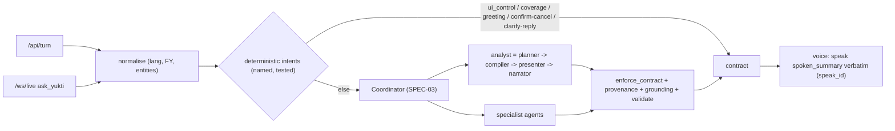

# SPEC-11: One Brain, Provenance Honesty, Voice Fidelity and Numeric Golden Eval

**Features:** FEAT-030 (one-brain consolidation + numeric golden eval + voice reads contract verbatim), FEAT-032 (provenance honesty + degraded-mode transparency) · **Bugs closed:** BUG-04, 05, 12, 17, 18, 19, 21, 31, 33 (+ verifies BUG-02, 08, 16, 22) · **Phase:** P5 (P5.1 fast-paths, P5.2 voice, P5.3 coverage, P5.4 golden eval, P5.5 gate run; numbering as in `UPGRADE_CHECKLIST.md`); provenance labels start in P0 · **Spec owner:** O · **Status:** Draft v3 (23-Oct-2026)

> [!IMPORTANT]
> **BLUF.** Today one question can get three different answers: from the LLM planner, from the legacy ADK NL→SQL agent, or from the Gemini Live model re-voicing it. About 25 keyword fast-paths and hard-coded answers run before the planner. This is the root of the feedback4 "data only up to 2026 / 2024 not available" loop.
> Collapse everything into **one route** (the SPEC-03 coordinator). Each fast-path is deleted, moved into the planner, or kept as a named deterministic intent (table §4).
> Answer "what data do you have" from a **coverage manifest**, never from an LLM. Make voice speak the contract's `spoken_summary` **verbatim**, with per-speak `speak_id` dedupe. Put a **provenance label** on every visual. Show an honest **degraded mode**.
> Replace the shape-only "120/120 PASS" stress test with a **numeric golden eval**: ~60 user-phrased questions with exact SSOT values, 3 multi-turn chains (V19, V20, V22) and a voice smoke test. Release gates block on any wrong KPI number.

---

## 1. Purpose and verbatim trace
| Source | Requirement | Section |
|---|---|---|
| feedback4 (B01/B02): "I can only access data up to 2026…" then "You are absolutely correct… I do have 2024" | One source of truth for coverage; no self-contradiction | §3, §5 |
| feedback2/3 (B03/B12): English contract + Hindi re-voicing concatenated; doubled sentences | Voice = contract text, one bubble per turn | §6 |
| feedback4 (B04): conversation rendered twice + fragment bubbles | Transcript dedupe | §6.3 |
| V18 "every number should be very precise" | Numeric eval, not shape | §8 |
| V23 #6 "keep it illustrative" | Illustrative labels on Gemini policy clauses | §7 |
| diag (BUG-04/33) | Honest fallback + generic errors | §7.3 |

## 2. Current state
| Item | Status | Evidence |
|---|---|---|
| Routing | **Broken (3 brains)** | `turn_runner.py` ≈ 2,600 lines; planner behind `YUKTI_PLANNER=1` with silent fall-through to legacy on error; legacy ADK agent with `SEMANTIC_LAYER_PROMPT` lacking statement tables and saying "FY18–FY27" (`semantic_layer.py:60`); Live model answers without the tool (diag_D §1) |
| Fast-paths | **Broken** | 0a–0e blocks `turn_runner.py:247-1139`; `_maybe_salary_breakdown_turn:1750`, `_maybe_policy_turn:2035`, `_maybe_asset_economics_comparison_turn:2149` |
| Hard-coded answers | **Broken** | `turn_runner.py:1541-1550` (Parliament/Board text), `:1609-1613` (Champang/Borholla), `:2192-2228` (`or 33108.97`, 42.6%/29.1%, FX 84.0); `draft_document.py:54-63, 105-131` |
| Coverage answer | **Missing** | No manifest; LLM self-describes (diag_D B02) |
| Voice fidelity | **Broken** | `page.tsx:397-446` appends Live transcript to the contract message; `live_session.py:804` clears `_is_speak_only`; narrator English-only (BUG-17/18/19) |
| Provenance | **Broken** | False "Audited + Yahoo / BigQuery" labels (`compiler.py:552…743`, `presenter.py:155,487`); local JSON reported as SQL (`compiler.py:867-1007`) |
| Error text | **Broken** | `turn_runner.py:1448` leaks `str(e)[:100]` ("Reauthentication…") |
| Eval | **Broken (shape-only)** | `run_30x4_stress_test.py:424-440` passes on HTTP 200 + rows > 0; reuses cached results `:368-393`; `eval/run_gate.py` has no offline mode |

## 3. Target: one route

**Rules**
1. Exactly **one** contract per turn. Every path ends in `enforce_contract → provenance → grounding → validate`.
2. **No silent fall-through.** If the planner fails, the turn returns an honest error or the verified snapshot (§7.3), never the legacy agent.
3. **Deterministic intents are named, registered and unit-tested** (`app/intents/*.py`, each with ≥ 10 positive and ≥ 10 negative phrasings). There are no anonymous `in q_clean` branches (target: `grep -c "in q_clean" turn_runner.py` = 0).
4. The **session state** (spec_history, last visual, pending actions, jobs) is a single object written by every path. No path pushes `{}` into the history (fixes `turn_runner.py:577`).

## 4. Disposition of every fast-path / hard-code (from diag_D)
| # | Today (location) | What it does | Disposition | Target | Step |
|---|---|---|---|---|---|
| 1 | 0a screen-control regex `turn_runner.py:247-342` | "show as table", "dark mode", "export to pdf", **"switch role"** | **Keep as deterministic intent** `ui_control`; **delete `set_persona`** (BUG-06, SPEC-06); route export phrases to the `export` intent (BUG-10, SPEC-07/10) | `app/intents/ui_control.py` | P0 (persona), P5.1 |
| 2 | Access check static regex `turn_runner.py:345-380` | Refuses before data paths | **Keep**, and also run `enforce_contract` after every result. Policy from `rbac_policy.yaml` (SPEC-06) | `brain/rbac.py` | P2H |
| 3 | Greeting / capability strings `turn_runner.py:~425-470` | "who are you", Hindi capability | **Keep as deterministic intent** `greeting`; the capability text is generated from the coverage manifest (§5) | `app/intents/greeting.py` | P5.1 |
| 4 | Salary breakdown `_maybe_salary_breakdown_turn` `:1750` (+ fudge `:1881-1900`) | Pay component split | **Move into planner** as template `salary_components` over Employee-360 (SPEC-04); delete the scaling fudge (BUG-26) | compiler template | P2H |
| 5 | Policy `_maybe_policy_turn` `:2035` | Leave/policy clause lookup | **Keep as deterministic intent** `policy_lookup` behind the coordinator classifier; clause search requires a clause match (no answer-cache serve, B05); "Illustrative" label (§7) | `app/intents/policy.py` | P5.1 |
| 6 | Asset economics comparison `_maybe_asset_economics_comparison_turn` `:2149` (regex `:2161-2165`) | Mumbai High vs Bassein FY26 | **Delete** (BUG-21). Planner multi-metric spec covers it (SPEC-05) | — | P5.1 |
| 7 | 0b contextual follow-up `:580` | "breakdown by discipline", "only E5 and above" | **Move into planner** SpecPatch (spec_history) | planner | P5.1 |
| 8 | 0c headcount `:766` | "how many employees in Ahmedabad" | **Move into planner** (headcount template exists) | planner | P5.1 |
| 9 | 0d histogram engine `:944` | Distributions | **Move into planner** as chart kind `histogram` + compiler template | planner/compiler | P5.1 |
| 10 | 0e document drafting `:1139` + hard-coded Parliament/Board text `:1541-1550` | Board note, Parliament reply | **Move to** `doc_export_agent` / `hr_transfer_agent` (SPEC-03/07); **delete** the static text | agents | P3, P5.1 |
| 11 | Legacy semantic router → answer cache `:1343, :1720` (128 certified contracts) | Cosine ≥ 0.60 serves a cached answer | **Keep only** exact certified-query matches with identical params (existing `_answer_is_cacheable`); disable cosine-only serving | `answer_cache.py` | P5.1 |
| 12 | Legacy ADK NL→SQL agent (`agent.py:193-214`) | Free-form SQL | **Delete from the default route.** Keep behind `YUKTI_LEGACY_AGENT=1` for admin debugging only | — | P5.1 |
| 13 | Regex post-rewrites, Brent text `:1609-1613` | Injects "Champang and Borholla become EBITDA-negative" | **Delete** (BUG-12) | — | P5.1 |
| 14 | Fallback constants `:2192-2228` (`or 33108.97`, 42.6%/29.1%, FX 84.0) | Fills numbers when a query fails | **Delete**; return "not available" (BUG-12) | — | P5.1 |
| 15 | Planner regex overrides (~15) `planner.py:~400-480` | Statement routes, guards | **Keep as a deterministic pre-classifier inside the planner**, each with a test; add the FY-clarify rule (SPEC-08 §3) | planner | P2F.1 |
| 16 | `insight_context.py:138-233` canned corpus + `director_finance_action` | "why"/"actions" | **Delete**; replaced by `fin_diagnostics_agent` (SPEC-08) | — | P2F |
| 17 | `draft_document.py:54-63` (Champang table), `:105-131` (401 vs 146) | Static numbers | **Delete**; build from the session cohort (SPEC-07) | — | P2H |
| 18 | Waterfall override `chart_rules.py:42-50`; EBITDA synthesis `plan.ts:146`, `compat.ts:130` | Forces/invents | **Delete**; explicit kind wins; no synthesis (SPEC-09) | — | P4 |
| 19 | Gemini Live answering without `ask_yukti` | Free-form voice answers | **Restrict** the Live prompt: data/policy/HR questions must call `ask_yukti`; small talk only otherwise; Live's own text is never shown when a contract exists (§6) | `live_session.py` | P5.2 |
| 20 | `turn_runner.py:1448` error text | Leaks internals | **Replace** with generic text + error code (§7.3) | — | P0 |

## 5. Coverage manifest (deterministic "what data do you have")
- **Module:** `app/coverage/manifest.py` builds `CoverageManifest` at startup and every 15 min from `hrfin_gold.v_fin_coverage` (SPEC-01 §5.5), the HR/field table profiles (SPEC-04/05), `doc_chunks_ar` FY list, the WACC table and the policy corpus. When BigQuery is down it uses the snapshot's embedded manifest.
- **Schema:** `{generated_at, source: bq|snapshot, finance: [{scope, statement, fy_min, fy_max, line_count, source_systems}], market: {yahoo_available, last_price_date}, wacc: {fy_min, fy_max}, hr: [{table, grain, as_of, rows, synthetic: true}], field: {...}, documents: [{type, fy_list, count}], policies: {count, illustrative_count}}`.
- **Intent `coverage`** (regex: `what (data|information) (do you|you) have|which years|data (available|coverage)|kya data hai|kitne saal ka data|do you have .* (balance sheet|income statement|cash flow|data) for`): returns `visual.type="table"` (domain, scope, years, source, label) + `spoken_summary`, e.g. "I have ONGC's standalone income statement, balance sheet and cash flow from FY17 to FY26 from the annual reports, consolidated statements …". "Do you have the balance sheet for 2024?" → "Yes, FY2023-24 …", and the BS is offered as a chip.
- **LLM rule:** every LLM system prompt (planner, coordinator, narrator, Live) receives the manifest summary. The narrator rejects any sentence matching `\b(only|up to|until|not available|don'?t have)\b.*\b(FY|20\d\d|data)\b` unless it is generated from the manifest (`grounding_drop: coverage_claim`).

## 6. Voice fidelity
### 6.1 Speak the contract verbatim
- **Requirement:** for every turn that produces a contract, the audio the user hears = `spoken_summary` (string-equal transcript, normalised for punctuation), in the turn's language (`hi` → the narrator produces Hindi `spoken_summary`, BUG-19).
- **Implementation options (spike P5.2, pick by evidence):**
  - **(A) Server TTS (preferred if the spike passes).** Cloud Text-to-Speech Chirp 3 HD voice "Leda" synthesises `spoken_summary`; audio is streamed on `/ws/live` as `{"type":"speak","speak_id","turn_id","audio"}`. Gemini Live is used for ASR + turn-taking only, and its own audio after a tool call is suppressed.
  - **(B) Live reads the tool result.** The `ask_yukti` tool response carries `speak_verbatim: <text>` and the Live system prompt says "read it exactly, add nothing".
  - **Acceptance for the choice:** 20 scripted turns × en/hi; pick (B) only if ≥ 19/20 transcripts are string-equal; otherwise (A).
### 6.2 Language
The narrator translates `spoken_summary` and `display_text` by `language` (en, hi, hi-en). Numbers use the Indian system ("₹1.38 lakh crore" / "एक लाख अड़तीस हज़ार करोड़"). The visual stays in English labels with Hindi title/subtitle (SPEC-09).
### 6.3 Dedupe (BUG-17/18, feedback4 B03/B04)
| Rule | Detail |
|---|---|
| One feed model | The panel thread and main feed render from one store (`state/feed.ts`); no second `messages` list |
| `speak_id` | Every spoken output has a unique `speak_id` = `turn_id:n`. A feed message is keyed by `turn_id` |
| Contract wins | When a contract exists for `turn_id`, the bubble text = `display_text`; Live transcript chunks with that `turn_id` are **not** appended (they go to the debug log) |
| Late chunks | Transcript chunks arriving after `turn_complete` for a closed `speak_id` are dropped (no new bubble) |
| Barge-in | Local barge-in is suppressed while our own audio plays (echo), unless the mic energy is > threshold for ≥ 300 ms and the ASR text is not a substring of the current `spoken_summary`. `live_session.py:804` must not clear `_is_speak_only` mid-speak |
| Partial utterances | End-of-speech needs ≥ 700 ms silence; fragments < 3 words that end in a function word ("is the policy about") are held, not submitted (B27) |

## 7. Provenance labels and degraded mode (FEAT-032)
### 7.1 Contract v3 field `provenance` (owner O; additive)
```json
"provenance": {
  "type": "object", "required": ["label"],
  "properties": {
    "label": {"enum": ["verified_ar", "verified_xbrl", "yahoo_consolidated", "derived_ar", "modelled", "illustrative", "synthetic", "local_snapshot", "mixed"]},
    "detail": {"type": "string", "description": "e.g. 'ONGC AR FY2023-24, Standalone P&L p.245'"},
    "snapshot_date": {"type": "string", "format": "date"},
    "components": {"type": "array", "items": {"type": "object", "properties": {"label": {"type": "string"}, "share_of_rows": {"type": "number"}}}}
  }
}
```
### 7.2 Label rules
| Label | Badge text | When |
|---|---|---|
| `verified_ar` | "Verified · Annual Report" | All values from `verified=TRUE` AR rows |
| `verified_xbrl` | "Verified · NSE XBRL (₹1 cr)" | Any XBRL row |
| `yahoo_consolidated` | "Yahoo view · Consolidated" | Yahoo rows |
| `derived_ar` | "Derived from AR" | Ratios computed by a fixed formula from verified AR lines only (SPEC-01 §7.3): revenue/employee, cost/employee, PAT/employee, employee cost % revenue, EBITDA margin. Shows the formula on hover |
| `modelled` | "Modelled" (action ₹ impacts show "Modelled estimate", SPEC-08 §7.3) | WACC, variance attribution, action ₹ impact estimates, field allocations (SPEC-05) |
| `illustrative` | "Illustrative" | DCF results, Gemini-generated policy clauses (V23 #6, BUG-31) |
| `synthetic` | "Synthetic data" | Any employee-level or field-level synthetic row (SPEC-04/05); always shown when a person is named |
| `local_snapshot` | "Local snapshot <date>" | BigQuery unavailable; served from the verified snapshot |
| `mixed` | Shows the components | More than one of the above |
Removal list (P0): every "Audited…", "Yahoo Finance (ONGC.NS)", "Compiled SQL / BigQuery" string not backed by the actual path (`compiler.py:552,587,632,667,708,743`, `presenter.py:155,487`, `pipeline.py:235`).
### 7.3 Degraded mode
| Condition | Detection | User sees | Behaviour |
|---|---|---|---|
| ADC expired / RefreshError | `/health` checks a token refresh every 60 s; status `{adc: ok|expired}` | Banner: "Live data and voice are unavailable. Showing the verified snapshot of <date>." | Finance answers from the snapshot with `local_snapshot`; HR and agent answers return the generic error; voice button disabled |
| BigQuery unreachable | Dry-run failure | Same banner (data part) | As above |
| LLM error | Planner/coordinator exception | "I couldn't work that out just now. Please try again in a minute. (ref E-PLN-1234)" | No legacy fall-through; logged with turn_id |
| Yahoo unavailable | Market loader status | Caveat on the Yahoo view / DCF: "Market data as of <date>" or "unavailable" | DCF proposal disabled if no price exists in the last 10 trading days |
`/health` JSON: `{status, adc, bq, llm, live, snapshot_date, coverage_generated_at, version}`. Error text never includes exception strings (BUG-33).

## 8. Numeric golden eval (replaces `run_30x4_stress_test.py`)
### 8.1 Harness
- Location: `yukti/backend/eval/golden_v3/` → `cases_finance.yaml`, `cases_hr.yaml`, `chains.yaml`, `voice_smoke.yaml`, `run_golden.py`, `report.md`.
- **Fresh session per case/chain**; answer cache disabled (`YUKTI_ANSWER_CACHE=0`); no result reuse between runs (fixes `run_30x4_stress_test.py:368-393`).
- Each case runs **3 phrasings** (canonical, colloquial, Hindi/Hinglish) via both `/api/turn` and `/api/voice-turn` (text-injected).
- **Assertions:** `visual.type`; numeric values extracted from `visual` rows/series **and** from `spoken_summary`/`display_text` (Indian-format parser) compared to the expected value with tolerance; `provenance.label`; `sources[]` contains the doc + page for AR values; RBAC outcome; `clarify` presence; no forbidden content (e.g. "Mumbai High" in F32).
- **Expected values:** literal values below (pinned from the AR, so SSOT regressions are caught) **plus** an oracle SQL per case against the SSOT/Employee-360 for values that depend on regenerated synthetic data or on WACC.
- Case schema:
```yaml
- id: F01
  persona: CMD
  phrasings: ["What was ONGC's revenue from operations in FY24?", "FY24 revenue kitna tha?", "revenue 2023-24"]
  expect:
    visual_type: kpi
    values: [{line_code: PL.REV_OPS, fy: FY24, scope: standalone, value_inr_cr: 138402.13, tol: 0.05}]
    provenance: verified_ar
    cite: {doc: ONGC_AR_FY2023-24.pdf, page_label: "245"}
```

### 8.2 Finance cases (standalone, ₹ crore unless stated; literal values from the ARs)
Single-FY questions use **as-reported** values; trend questions use **latest restated** values (SPEC-01 §7.1). Page refs are printed folios (UI convention); PDF page = folio + 2 for AR FY24–FY26. "10-yr" = AR FY26 10-yr table, PDF p.23–24 (printed p.21–22), tolerance ₹0.1 cr.

| ID | Persona | User phrasing (canonical) | Expected | Source |
|---|---|---|---|---|
| F01 | CMD | What was revenue from operations in FY24? | 1,38,402.13 | AR FY24 p.245 |
| F02 | CMD | Profit after tax 2023-24 | 40,525.97 | AR FY24 p.245 |
| F03 | DIR_FIN | How much tax did ONGC pay in FY25? (tax expense) | 11,149.50 | AR FY25 p.271 |
| F04 | CMD | FY26 profit before tax | 42,414.89 | AR FY26 p.295 |
| F05 | CMD | EPS last year (context: latest FY26) | ₹28.31 (FY25) | AR FY25 p.271 |
| F06 | CMD | Can you show me the balance sheet for 2024? | `statement`; Total assets 4,46,020.89; Total equity 3,05,976.51 | AR FY24 p.243 |
| F07 | DIR_FIN | Total assets as of March 2026 | 4,61,276.20 | AR FY26 p.293 |
| F08 | DIR_FIN | Cash flow from operations FY25 | 73,010.24 | AR FY25 own CF (P1.3 confirms; equals AR FY26 p.298 comparative) |
| F09 | DIR_FIN | Operating cash flow FY24 | 65,335.52 | AR FY24 p.248 |
| F10 | CMD | FY26 CFO | 69,272.39 | AR FY26 p.298 |
| F11 | DIR_FIN | Closing cash and cash equivalents FY26 | 83.51 | AR FY26 p.293/299 (V04 tie-out) |
| F12 | CMD | Show me the income statement | `clarify` (4 options FY26/FY25/5-yr/10-yr); 0 rows | SPEC-08 §3 |
| F13 | CMD | Revenue trend for the last 10 years | line, 10 points FY17→FY26: 77,907.8 · 85,004.1 · 1,09,654.6 · 96,213.6 · 68,141.1 · 1,10,345.4 · 1,55,517.3 · 1,38,402.1 · 1,37,846.3 · 1,32,508.1 | 10-yr |
| F14 | CMD | PAT for the last 5 years | FY22–FY26: 40,305.7 · 40,096.5 · 40,526.0 · 35,610.3 · 32,894.0 | 10-yr |
| F15 | DIR_FIN | ROCE in FY23 | 39.82% (33.84% incl. exceptional items) | 10-yr ratios |
| F16 | CMD | ROCE trend 5 years | 29.01 · 39.82 · 30.60 · 26.54 · 22.46 (%) | 10-yr |
| F17 | DIR_FIN | Royalty paid in FY17 | 11,574.8 | 10-yr |
| F18 | DIR_FIN | Statutory levies FY24 | 36,797.5 | 10-yr |
| F19 | CMD | Other levies incl. SAED, FY25 vs FY26 | 4,032.4 vs 63.0 | 10-yr |
| F20 | CMD | Capex in FY25 | 62,057.3 | 10-yr |
| F21 | CMD | Capex last 10 years | FY17→FY26: 28,006.4 · 72,901.6 · 29,449.8 · 29,538.5 · 26,859.3 · 27,741.3 · 30,208.4 · 37,494.2 · 62,057.3 · 35,878.4 | 10-yr |
| F22 | CMD | Dividend declared for FY26 | 16,668.9 (265%) | 10-yr |
| F23 | DIR_FIN | Debt-equity ratio FY26 | 0.02 : 1 | 10-yr |
| F24 | DIR_FIN | Borrowings and lease liabilities FY26 | 7,823.4 and 25,821.8 | 10-yr |
| F25 | DIR_FIN | Exploration write-offs FY25 | 9,825.8 (survey 2,345.8; exploratory wells 7,480.0) | 10-yr |
| F26 | DIR_FIN | DD&A FY26 | 25,133.82 | AR FY26 p.295 |
| F27 | DIR_FIN | Finance cost FY24 | 4,081.31 | AR FY24 p.245 |
| F28 | DIR_FIN | Other income FY24 (single FY, as reported) | 10,778.19 | AR FY24 p.245 |
| F29 | DIR_FIN | Other income last 3 years (trend) | FY24 = 10,735.5 with `†` restated footnote; FY25 10,479.4; FY26 10,355.8 | 10-yr / AR FY25 p.271 |
| F30 | CMD | PAT FY19 (single FY) | 26,715.8 as reported (AR FY19) | AR FY19 (MANIFEST_v3 §3) |
| F31 | CMD | PAT trend 10 years, FY19 point | 26,764.6 with `†` | 10-yr |
| F32 | CMD | Why did revenue fall in FY23? | Corrects the premise: revenue **rose** ₹45,171.9 cr (+40.9%) to 1,55,517.3; no "Mumbai High"/"Bassein" text | 10-yr; BUG-21 |
| F33 | CMD | Why did PBT fall in FY26? | waterfall from 46,759.8 to 42,414.9 (Δ −4,344.9); top 3: revenue −5,338.2, levies +4,820.4, exchange loss −1,931.7 | SPEC-08 §6.5 |
| F34 | DIR_FIN | WACC for the last 10 years | line, 10 points = `fact_wacc_annual.wacc_pct` (oracle) | SPEC-02 |
| F35 | DIR_FIN | Why was WACC high in FY23? | waterfall; Shapley contributions sum to ΔWACC (oracle) | SPEC-02 §5.3 |
| F36 | CMD | Top 5 actions for FY26 | `actions` with ≤ 5 items; must include L02 (debtor days 32 vs 29) and L08 (exchange loss 2,698.9 vs 767.2) | SPEC-08 §7 |
| F37 | CMD | Consolidated revenue FY26 | = AR consolidated P&L FY26 (oracle) with scope label | SPEC-01 |
| F38 | CMD | Show the Yahoo view of the income statement | `statement` with `yahoo_consolidated` badge, FY23–FY26; or the degraded caveat if Yahoo is not loaded | SPEC-01 §9 |
| F39 | CMD | Number of employees FY26 | 23,117 | 10-yr |
| F40 | DIR_HR | Employees 10 years ago | 33,660 (FY17) | 10-yr |
| F41 | DIR_FIN | Expenditure on employees FY26 | 10,210.7 | 10-yr |
| F42 | CMD | Revenue per employee FY26 | ₹5.581 cr (= 1,32,508.14 ÷ avg(24,368, 23,117) = ÷ 23,742.5 average headcount, SPEC-04 `avg_headcount`), label `derived_ar` ("Derived from AR") | derived |
| F43 | CMD | Crude oil production FY26 | 20.501 MMT incl. JV (ONGC 19.332 + JV 1.170), basis stated | AR FY26 p.9, p.55 |
| F44 | DIR_FIN | Gas sold FY24 | 15.927 BCM | 10-yr |
| F45 | CMD | Contribution to exchequer FY23 | 74,639.5 | 10-yr |
| F46 | CMD | CSR spend FY26 | 948.9 | 10-yr |
| F47 | CMD | What data do you have? | `coverage` table; standalone FY17–FY26 (statements), FY13–FY26 (summary) | §5 |
| F48 | CMD | Do you have the balance sheet for 2024? | "Yes" + coverage; offers chip; no "only up to 2026" | BUG-05 |
| F49 | E2_FIN | Run a DCF on ONGC | refusal + alternative (WACC series) | SPEC-03 §8 |
| F50 | DIR_FIN | Run a DCF and tell me if ONGC is undervalued | `proposed_action` (agent `dcf_agent`), no job started | SPEC-03 |
| F51 | CMD | FY26 mein ONGC ka PAT kitna tha? | 32,894.02; `language=hi`; Hindi spoken summary | AR FY26 p.295 |
| F52 | DIR_FIN | Express this as a waterfall (after F33's table) | waterfall ends at PBT FY26 42,414.9 (PBT bridge context; the P4.1 statement bridge ends at PAT); no EBITDA synthesis | BUG-08/09 |

### 8.3 HR cases (oracle values; Employee-360 is regenerated in P2H, so values are computed by reference SQL at eval-build time and pinned per data release)
| ID | Persona | Phrasing | Expected |
|---|---|---|---|
| H01 | CMD | How many employees are in Delhi by level? | bar, grades ordered E1→E9 (BUG-34), Σ = oracle Delhi headcount |
| H02 | CMD | How many have been in Delhi for more than 5 years? | = oracle with the SPEC-07 canonical rule (continuous stay at the current station `> 1826` days, i.e. strictly > 5.0 years; executives by default) |
| H03 | CMD | Show me their names | table, rows = H02 count; name, designation, grade, total service, Delhi tenure; `synthetic` badge |
| H04 | CMD | Export this as an Excel file | xlsx link; row count = H03 (BUG-10) |
| H05 | CMD | Draft an email to Director HR | `email_draft` (SPEC-07) with cohort count = H02, xlsx attached; no static numbers (BUG-11) |
| H06 | E2_HR | Show names of Delhi employees | aggregate-only or refused per SPEC-06 matrix |
| H07 | DIR_HR | Average CTC of an E1 officer | = oracle Employee-360 (SPEC-04) |
| H08 | DIR_HR | Total employee cost FY26 | = `fact_hr_aggregates.employee_benefits_expense_inr_cr` FY26 (reconciled, SPEC-04) |
| H09 | DIR_HR | Women share of workforce | = oracle; within ±0.1pp of BRSR (SPEC-04 gate) |
| H10 | E1_HR (self) | What is my leave balance? | own `self_emp_id` only (BUG-07) |
| H11 | E2_HR | Switch role to CMD | refused; persona unchanged (BUG-06) |
| H12 | E3_HR | How many casual leaves can I take? | clause with `illustrative` badge; not the study-leave clause (B05) |
| H13 | CMD | Delhi mein kitne executives 5 saal se zyada hain? | = H02, Hindi response |
| H14 | DIR_HR | Joining pay of an E1 officer | = `dim_grade` entry pay (BUG-26) |
| H15 | DIR_FIN | Employee cost per boe FY26 | = oracle (SPEC-04 × production anchor), `modelled` |

### 8.4 Multi-turn chains (all steps must pass; fresh session)
| Chain | Steps (user) | Assertions |
|---|---|---|
| **V19** (BEH-02) | 1 "How many people are in Delhi by level?" → 2 "Who has been there more than 5 years?" → 3 "Show me their names" → 4 "Export this as an Excel file" → 5 "Draft an email to the Director HR with this list" | H01–H05 values; context carry-over (entity Delhi, cohort id) across all steps |
| **V20** (BEH-03) | 1 "Can I see the income statement?" → 2 "Last 5 years" → 3 "What was the WACC for the past 10 years?" → 4 "Why was it high in FY23?" → 5 "Why did profit fall in FY26?" → 6 "What are the top 5 actions?" | F12 → 5-col statement (F14 values) → F34 → F35 → F33 → F36 |
| **V22** (BEH-05) | 1 "Can you run a DCF and tell me if ONGC is undervalued?" → 2 "Yes, run it" → (job completes) → 3 "What if WACC is 11%?" → 4 "Download the model" | proposal → job succeeded ≤ 20 s → result card with disclaimer → new proposal pre-filled `wacc_pct=11` → xlsx with live formulas |

### 8.5 Voice smoke (scripted WS, TTS-generated audio fixtures; FL-run)
6 utterances: F01 (en), F51 (hi), F12 + "last year" (clarify by voice), F50 + "haan, chalao" (confirm by voice), H11 (escalation by voice), "what data do you have". Assertions: exactly 1 agent bubble per turn; heard transcript string-equal to `spoken_summary` (§6.1); unique `speak_id`; 0 fragment bubbles; Hindi answer in Hindi.

## 9. Release gate thresholds (P5 exit; also run at every phase gate for the subset that exists)
| Metric | Threshold | Blocking? |
|---|---|---|
| Wrong number on any KPI line (F-cases, any phrasing) | **0** | Yes |
| Finance case pass rate (all phrasings × both APIs) | ≥ 98% | Yes |
| HR case pass rate | ≥ 95% | Yes |
| Chains V19 / V20 / V22 | 100% of steps | Yes |
| RBAC cases (F49, H06, H10, H11) | 100% | Yes |
| Provenance label correct | 100% | Yes |
| Grounding drops in "why" answers (numbers outside allowed set reaching the user) | 0 | Yes |
| Voice smoke | 6/6 | Yes |
| Coverage contradictions (any "only up to/not available" claim that contradicts the manifest) | 0 | Yes |
| p95 latency, sync text turns (Cloud Run) | ≤ 6 s | No (report) |
| `grep -c "in q_clean" app/turn_runner.py` | 0 | Yes |
| Backend pytest (offline) | 100% pass, 0 errors | Yes |

## 10. Acceptance criteria
| ID | Criterion |
|---|---|
| AC-01 | Every disposition in §4 is implemented; a test proves each "delete" path is gone (e.g. "why did revenue fall in FY23" never returns the asset comparison) |
| AC-02 | Coverage intent answers F47/F48 deterministically with the LLM disabled (mock raises) |
| AC-03 | Voice spike decision recorded in `docs/DECISIONS.md` with the 20-turn evidence |
| AC-04 | 0 duplicate/fragment bubbles across the voice smoke and a 30-turn soak |
| AC-05 | With ADC revoked: banner shown, finance answers labelled `local_snapshot`, no exception text in any response |
| AC-06 | §9 thresholds met on the release candidate; `report.md` committed with run id and git SHA |
| AC-07 | `run_30x4_stress_test.py` archived; CI runs `run_golden.py --offline-subset` (no-LLM deterministic cases) on every PR |

## 11. Test plan
Unit: intent registry tests; coverage manifest builder; provenance label resolver; dedupe reducer (`feed.ts`) with recorded event sequences from feedback3/4. Integration: golden eval (§8) on local + Cloud Run. Voice: §8.5 + soak. Degraded: ADC-revoked run.

## 12. Open questions
1. Voice option A (server TTS, Chirp 3 HD "Leda") vs B (Live reads verbatim): OK to run the spike in P5.2 and decide on evidence?
2. Golden values for synthetic HR data are pinned per data release. Who signs off a re-pin (recommended: O with an R-O review)?
3. Keep the legacy ADK agent behind an admin flag, or delete it entirely (recommended: flag for one release, then delete)?

## 13. Status matrix
| Item | Status |
|---|---|
| One route | Broken (3 brains) |
| Fast-path dispositions | Missing |
| Coverage manifest | Missing |
| Voice verbatim + dedupe | Broken |
| Provenance labels | Broken (false labels) |
| Degraded mode | Broken (silent, leaky) |
| Numeric golden eval + chains + voice smoke | Missing (shape-only test exists) |
| Release gates | Missing |
