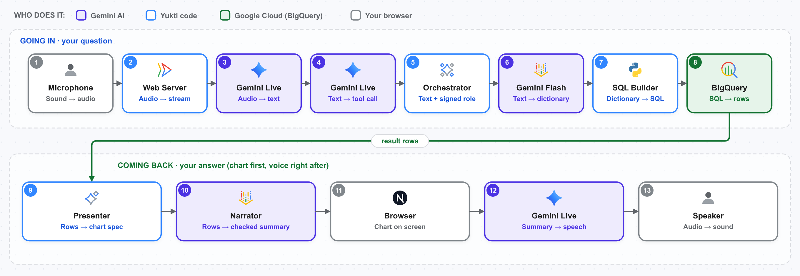

# Voice-to-SQL in Yukti: From Gemini Live to BigQuery

> **Architecture in one line.** Yukti is a **single-agent, multi-tool** architecture that combines the best of both worlds. An **agentic front end** (Gemini Live) understands intent, context and multilingual speech in English, Hindi and Hinglish, with natural conversational flow. **Deterministic code** on the back end does every calculation: certified SQL on BigQuery, access rules, and checked narration. That keeps the AI out of the arithmetic, so no number is invented, calculations are exact and repeatable, and every answer is traceable and auditable.

> **BLUF.** Yukti answers spoken HR and Finance questions from BigQuery, but **no AI model ever writes SQL**. AI is used only to *hear*, *understand* and *speak*: Gemini Live turns speech into a question and calls Yukti's `ask_yukti` tool; Gemini 2.5 Flash turns that question into a small typed plan (`QuerySpec`, in effect a dictionary of what is needed: metric, split, filters, period). From the plan onward, **deterministic Python code** checks access, builds parameterised SQL from a governed catalog, validates it, caps its cost with a BigQuery dry run, and runs it. A typical data answer takes **about 3 seconds** end to end (median 2.9 s at the last gate).

---

## 1. The 30-second pitch

> *"Yukti is a single-agent, multi-tool system: an agentic voice front end and a deterministic back end. Yukti lets ONGC leaders ask HR and Finance questions by voice. Gemini Live listens and speaks; Gemini Flash turns the question into a structured plan. Yukti's own code, not the AI, writes the SQL from a certified catalog, applies the caller's access rules before the query runs, caps the cost of every query, and checks that every number Yukti says out loud is in the result. The same plan always produces the same SQL, so answers are repeatable and auditable."*

---

## 2. Why SQL, and why BigQuery

HR & Finance (Yukti) is fundamentally an **OLAP / aggregation problem**: slicing headcounts by station, grade and tenure, rolling up 10 years of Schedule III statements, and applying corporate definitions (for example, "continuous stay of more than 1,826 days") consistently across about **38 million rows**. **SQL is the native language for this**, and **BigQuery** is built to run these scans and group-bys quickly and cheaply.

The hard part is not writing SQL. It is applying ONGC's definitions **exactly the same way every time**. So Yukti uses AI only to understand the question (a dictionary of what is needed), and keeps the definitions in certified SQL that code applies.

*Not everything is aggregation:* HR policy questions use document search (Vertex AI Search), and DCF valuation uses its own calculation engine.

---

## 3. The core design pattern (shared with Urvi / WellPulse)

**Both voice agents use AI only to fill in a dictionary; trusted code does the filtering and computation.** Urvi uses narrow tools, so one AI step is enough. Yukti answers open-ended analytics across many tables, so a planner fills the dictionary.

```text
[Spoken audio]
      │
      ▼
[1. Speech → dictionary]  (AI)
  Urvi:  Gemini Live calls a narrow tool directly
         well_profile({"well_id": "GK-129", "months": 36})
  Yukti: Gemini Live calls one broad tool → ask_yukti({"query": "…"})
         then Gemini 2.5 Flash fills the plan dictionary
         {"metric": "headcount", "dimensions": ["grade"], "filters": [...]}
      │
      ▼
[2. Validate, then call trusted code]  (code)
  Urvi:  well_profile(well_id, months)
  Yukti: QuerySpec.model_validate(plan) → access rules → compiler.compile(spec)
      │
      ▼
[3. Deterministic filtering and computation]  (code, not AI)
  • Filter records by well, field, status, station, grade, tenure
  • Compute: decline curves and ML classifiers (Urvi); certified SQL on BigQuery (Yukti)
      │
      ▼
[4. Verified output]
  • Screen: the full result (charts, tables, 3D map)
  • Voice: a short summary for Gemini Live to speak in English or Hindi
    (Yukti checks every spoken number against the result)
```

| | **Urvi (WellPulse)** | **Yukti (HR & Finance)** |
|---|---|---|
| Voice tools | Many narrow tools with typed arguments (e.g. `well_profile(well_id, months)`) | One broad tool, `ask_yukti(query)`, plus `ui_control` for the screen |
| Who fills the dictionary | Gemini Live, in the tool call | Gemini 2.5 Flash, in the planner (`QuerySpec`) |
| Why | Questions map to a known set of well and field operations | Questions span 86 tables of metrics, filters and periods, too many for fixed tool parameters |
| Trusted computation | Python analytics (decline curves, ML classifiers) | Access rules + certified SQL on BigQuery |

---

## 4. The data's journey: every conversion and who does it



The question changes format about a dozen times. **Only steps 3, 4, 6, 10 and 12 use AI**; everything else is code, BigQuery or the browser.

### Going in

| # | From → To | Who | Where |
|---|---|---|---|
| 1 | Sound → **digital audio** (PCM, 16 kHz, mono) | Browser microphone + audio worklet (noise gate, resampling) | `frontend/public/audio-processor.js`, `src/services/audioAnalyser.ts` |
| 2 | Audio → **binary WebSocket frames** | Browser → Yukti web server (same-origin proxy) → FastAPI | `frontend/server.js` → `backend/app/live_session.py` |
| 3 | Audio → **text transcript** | **Gemini Live** (`gemini-3.8-live`, Vertex AI `us-central1`) | `live_session.py` |
| 4 | Text → **tool call** `ask_yukti(query="…")` | **Gemini Live** decides this is a data question (its instructions forbid answering numbers from memory) | `live_session.py` |
| 5 | Text → **cleaned text** + signed role | Yukti code: fixes common speech-to-text slips; the role comes from the signed session cookie, never from what was said | `turn_runner.py`, `auth.py` |
| 6 | Text → **`QuerySpec` JSON** (metric, dimensions, filters, period, chart) | **Gemini 2.5 Flash** used as a structured-output function | `brain/planner.py`, `brain/query_spec.py` |
| 7 | `QuerySpec` → **parameterised SQL** | Yukti code: access check, then the SQL compiler | `brain/rbac.py`, `brain/compiler.py` |
| 8 | SQL → **result rows** | **BigQuery** (`hrfin_*_v3` datasets, `asia-south1`) | `brain/compiler.py` (`execute`) |

### Coming back

| # | From → To | Who | Where |
|---|---|---|---|
| 9 | Rows → **chart / table spec** (answer contract JSON) | Yukti code: small-cell masking, role masking, chart builder | `brain/presenter.py`, `brain/rbac.py` |
| 10 | Rows → **2-sentence summary text** | **Gemini 2.5 Flash** drafts it; Yukti code rejects any number not in the rows | `brain/narrator.py` |
| 11 | Chart spec → **picture on screen** | Browser (Next.js + Apache ECharts) | `src/components/AnswerCard.tsx` |
| 12 | Summary text → **speech** (PCM, 24 kHz) | **Gemini Live**, voice *Leda* | `live_session.py` |
| 13 | Audio → **sound** | Browser audio playback | `src/services/audioAnalyser.ts` |

The chart (step 9) is pushed to the screen **as soon as it is ready**, before Gemini Live finishes speaking (steps 10–13), so the visual appears first and the voice follows.

---

## 5. End-to-end architecture

```text
 🎤 User (voice or text)
    │  PCM 16 kHz over WebSocket (/ws/live)
    ▼
 ┌──────────────────────────────────────────────────────────┐
 │ Gemini Live (AI)                                          │
 │  • speech → text; decides which tool to call              │
 │  • ui_control(...)  → screen-only changes (no query)      │
 │  • ask_yukti(query) → every data / policy / DCF question  │
 └───────────────────────────┬──────────────────────────────┘
                             │ question text
                             ▼
 ┌──────────────────────────────────────────────────────────┐
 │ Turn orchestrator (code, turn_runner.py)                  │
 │  • signed role from cookie; ASR clean-up                  │
 │  • 15-step ladder, first match wins:                      │
 │    screen commands → ACCESS CHECK → greeting / coverage → │
 │    HR policy (Vertex AI Search) → DCF / revenue / oil →   │
 │    PLANNER (below) → small talk                           │
 └───────────────────────────┬──────────────────────────────┘
                             │ open data question
                             ▼
 ┌──────────────────────────────────────────────────────────┐
 │ Planner (AI as a function: Gemini 2.5 Flash, planner.py)  │
 │  • question + history + catalog → QuerySpec JSON          │
 │  • follow-ups become a patch on the previous plan         │
 └───────────────────────────┬──────────────────────────────┘
                             │ QuerySpec
                             ▼
 ┌──────────────────────────────────────────────────────────┐
 │ Governed compilation (code)                               │
 │  rbac.py     → allow / aggregate / refuse for this role   │
 │  compiler.py → certified template or generated SQL,       │
 │                @parameters, row cap, small-cell counts    │
 │  validator   → SELECT-only, allow-listed datasets         │
 │  dry run     → refuse if scan > 500 MB                    │
 └───────────────────────────┬──────────────────────────────┘
                             │ parameterised SQL
                             ▼
 ┌──────────────────────────────────────────────────────────┐
 │ BigQuery (hrfin_gold_v3 …, asia-south1)                   │
 │  • runs off the event loop (asyncio.to_thread)            │
 │  • finance-only local snapshot if BigQuery is unreachable │
 └───────────────────────────┬──────────────────────────────┘
                             │ rows
                             ▼
 ┌──────────────────────────────────────────────────────────┐
 │ Answer (code + AI)                                        │
 │  • mask cells < 5 and restricted columns for the role     │
 │  • presenter → chart / table   • narrator → summary text  │
 │  • chart pushed to screen; summary returned to Gemini     │
 │    Live, which speaks it                                  │
 └──────────────────────────────────────────────────────────┘
```

> **Not every question becomes SQL.** Screen commands ("make it a bar chart") never leave the browser and backend UI layer; HR policy questions go to **Vertex AI Search**; DCF valuation, revenue drivers and oil-price questions use their own engines. Only open data questions reach the planner and BigQuery.

---

## 6. Who does what: each component, its input and its output

Read top to bottom: each row hands its **output** to the next row as **input**. Rows marked **AI** call a Gemini model; everything else is ordinary code or a Google Cloud service.

| # | Component (tool) | Type | Input → Output | What it does, in one line |
|---|---|---|---|---|
| 1 | **Browser audio worklet** (`audio-processor.js`) | Code (browser) | Microphone sound → 16 kHz PCM audio frames | Cleans and resamples your voice so it can be streamed. |
| 2 | **Yukti web server** (`server.js`) | Code (Node.js) | Audio frames / HTTP calls → the same, forwarded to the backend | One address for the browser; passes `/ws/live` and `/api/*` to FastAPI. |
| 3 | **Gemini Live** (`gemini-3.8-live`) | **AI** | Audio → transcript text + a tool call | Listens, understands what kind of request it is, and calls a tool instead of answering from memory. |
| 4 | **`ui_control` tool** (`ui_control.py`) | Code | `{action, value}` → screen command | Changes the screen (chart type, theme, export, overlay) without any query. |
| 5 | **`ask_yukti` tool** → **Turn orchestrator** (`turn_runner.py`) | Code | Question text + signed role → routed request | Cleans the text, checks access, and sends the question to the first handler that matches (policy, DCF, market, or the planner). |
| 6 | **Planner** (`planner.py`, Gemini 2.5 Flash) | **AI** (as a function) | Question text + recent turns + catalog → **`QuerySpec` (structured form)** | Fills in *what* to measure, how to split it, which filters and which period; never SQL. |
| 7 | **Access policy** (`rbac.py` + `rbac_policy.yaml`) | Code | `QuerySpec` + role → allow / aggregate / refuse | Decides what this role may see; can turn a "names" request into counts by grade. |
| 8 | **SQL compiler** (`compiler.py`) | Code | `QuerySpec` → **SQL text + parameters** | Looks up tables, columns and certified definitions and writes the SQL the same way every time. |
| 9 | **SQL safety validator** (`semantic_layer.py`) | Code | SQL text → pass / block | Allows only a single read-only `SELECT` on approved datasets. |
| 10 | **BigQuery** (`hrfin_*_v3`, `asia-south1`) | Google Cloud service | SQL + parameters → **result rows** | Dry-runs the query (refuses if > 500 MB), then runs it. |
| 11 | **Masking** (`rbac.py`: `enforce_contract`, small-cell suppression) | Code | Rows + role → masked rows | Hides restricted columns and groups smaller than 5 for E1–E4. |
| 12 | **Presenter** (`presenter.py`) | Code | Masked rows → chart / table spec (answer contract JSON) | Chooses the chart, axes, KPI cards and takeaways. |
| 13 | **Narrator** (`narrator.py`, Gemini 2.5 Flash) | **AI** + code check | Rows + allowed numbers → 2-sentence summary text | Writes the spoken summary; code rejects any number that is not in the rows. |
| 14 | **Browser** (Next.js + ECharts) | Code (browser) | Answer contract JSON → chart on screen | Draws the answer as soon as it arrives. |
| 15 | **Gemini Live** (voice *Leda*) | **AI** | Summary text → 24 kHz speech audio | Reads the verified summary aloud in Indian English, Hindi or Hinglish. |

### What exactly is the `QuerySpec`? (a "dictionary", more precisely a typed form)

Simple and accurate: **Gemini Flash fills in a dictionary of what is needed, and the SQL builder turns that dictionary into a SQL command.** Precisely, the form passes through three shapes:

1. **JSON text from Gemini.** The planner calls Gemini with a fixed answer schema (`response_mime_type="application/json"`, `response_schema=PLAN_SCHEMA`), so Gemini can only reply with JSON in that shape.
2. **A Python dictionary.** `json.loads(...)` turns that text into key-value pairs.
3. **A typed `QuerySpec` object.** `QuerySpec.model_validate(...)` checks every key and type (Pydantic). A wrong field, a bad fiscal year such as `FY2025`, or a missing metric is rejected before it ever reaches the SQL compiler.

It is **more than flat key-value pairs**: some values are lists or small nested forms. For example, `filters` is a list where each filter has its own `field`, `op` and `value`, and `period` has `fy` or `from`/`to`. The main fields are:

| Key | Meaning | Example |
|---|---|---|
| `metric` | What to measure | `"headcount"` |
| `dimensions` | How to split it | `["grade"]` |
| `filters` | Conditions (list of `{field, op, value}`) | `[{"field": "wc", "op": "=", "value": "WC-DEL"}]` |
| `period` | Fiscal year or range | `{"fy": "FY26"}` or `{"from": "FY17", "to": "FY26"}` |
| `grain` | Totals or one row per person | `"aggregate"` or `"row"` |
| `sort`, `limit` | Ordering and size | `{"by": "headcount", "dir": "desc"}` |
| `self_scope` | "My …" questions about the caller only | `true` |

Follow-up questions ("only Mumbai", "as a pie chart") produce a smaller **patch** form (`SpecPatch`) that changes just those keys on the previous `QuerySpec`.

---

## 7. Worked example

**Signed in as CMD, the user says:** *"How many executives have been in Delhi for more than 5 years, by grade?"*

**Step 4 — Gemini Live tool call**
```json
{ "name": "ask_yukti", "args": { "query": "How many executives have been in Delhi for more than 5 years, by grade?" } }
```

**Step 6 — Gemini 2.5 Flash plan (`QuerySpec`)** *(abridged)*
```json
{
  "intent": "data",
  "chart_kind": "column",
  "spec": {
    "metric": "headcount",
    "grain": "aggregate",
    "dimensions": ["grade"],
    "filters": [
      { "field": "wc", "op": "=", "value": "WC-DEL" },
      { "field": "station_tenure_years", "op": ">", "value": 5 }
    ]
  }
}
```

**Step 7 — SQL from the certified definition** (`DELHI_GT5_CONT_V1` in `brain/definitions.yaml`, simplified)
```sql
SELECT e.current_grade_id AS grade, COUNT(*) AS headcount
FROM `hrfin_gold_v3.ssot_workforce_employee` e
JOIN `hrfin_gold_v3.v_continuous_stay` s
  ON s.emp_id = e.emp_id AND s.is_current_stay = TRUE
WHERE e.employment_status = 'Active'
  AND e.wc_id = 'WC-DEL'
  AND e.current_grade_id IN UNNEST(@grades)               -- E1 … E9
  AND DATE_DIFF(DATE '2026-10-19', s.continuous_from_date, DAY) > 1826
GROUP BY grade
```

**Step 8 — BigQuery result** → rows such as `E1 35 · E2 90 · E3 87 · E4 67 …`

**Steps 9–13** → column chart on screen; Leda says *"…E2 is the largest group with 90…"*. Every number spoken is checked against the rows.

**Same question as an E1 officer asking for *names*:** the access check downgrades the plan from a named list to counts by grade **before** the SQL is built, adds a per-group count so groups under 5 show as "<5", and the card offers **"Request access from Director (HR) / Executive Director (HR)"**.

---

## 8. The stages in detail

### Stage 1 — Hearing and routing (Gemini Live + orchestrator)
* Gemini Live streams audio both ways and exposes exactly three tools: `ask_yukti(query)`, `ui_control(action, value)` and its alias `control_screen`. Its instructions require `ask_yukti` for every data, policy, what-if or follow-up question.
* Gemini Live passes **text**, not a plan. Planning happens in Stage 2.
* The orchestrator's 15-step ladder runs the **access check before any data handler** and answers many questions without SQL (see §5 and §6).

### Stage 2 — Understanding (planner, AI as a function)
* Gemini 2.5 Flash maps the question, recent turns and the catalog of allowed metrics and dimensions into a `QuerySpec`. Follow-ups ("only Mumbai", "as a pie chart") become a **patch** on the previous plan.
* If the period is ambiguous for a financial statement, Yukti asks *"Which year?"* instead of guessing.
* The plan is validated; anything that cannot be compiled falls back safely rather than producing an invented query.

### Stage 3 — Governed compilation (code)
1. **Access policy first** (`rbac.py`, `rbac_policy.yaml`): each compiled query carries data classes (`general_hr`, `general_fin`, `fin_internal`, `policy`, `named`, `pay_aggregate`, `pay_individual`, `apar`, `sensitive`, `self`, `board_confidential`, `valuation_run`). For the signed role the policy decides **allow**, **aggregate** (e.g. names → counts by grade) or **refuse** with a rule reference.
2. **Templates or generation** (`compiler.py`): certified templates and definitions (e.g. `DELHI_GT5_CONT_V1`, Schedule III statements via `CORP_METRIC_TO_SSOT`) are used where they exist; otherwise SQL is generated from the semantic model (`semantic_model.yaml`).
3. **Business rules made exact:** station names resolve to work-centre codes (`semantic/entities.json`); "more than 5 years" becomes `> 1826` days of continuous stay as of the data anchor date (19 Oct 2026); grades expand to the exact E1–E9 sets.
4. **Values are parameters** (`@grades`, `@wc_id`), never pasted into SQL text. Results are capped at 2,000 rows; for E1–E4 a per-group population count is added so small cells can be suppressed; "my …" questions are scoped to the caller's own employee id.

### Stage 4 — Guarded execution (BigQuery)
1. **SQL safety validator** (`SemanticLayer.validate_sql_safety`): comments and literals are masked, then the statement must be a single `SELECT`/`WITH`, contain no forbidden operations, and reference only allow-listed project datasets.
2. **Dry run and cost cap:** a free BigQuery dry run estimates bytes scanned; above 500 MB (`MAX_BYTES_BILLED`) the query is refused. The real job also carries `maximum_bytes_billed` and the label `datacloud:ai-agent`.
3. **Non-blocking:** the BigQuery client runs in a worker thread so voice and other users stay responsive.
4. **Degraded mode:** if BigQuery is unreachable, **corporate finance** questions are served from the bundled verified snapshot and labelled *"Local snapshot"*; HR questions show an honest error instead.

### Stage 5 — Answering (code + AI)
* Post-query masking (`enforce_contract`) and small-cell suppression run for every answer; session memory keeps only the masked version, so later exports and follow-ups cannot reveal hidden data.
* The narrator may use **only numbers present in the result** (`allowed_numbers`); any other figure is rejected and a deterministic sentence is used instead.

---

## 9. Why not let the AI write SQL?

| | LLM writes SQL directly | Yukti (AI plans, code writes SQL) |
|---|---|---|
| **Repeatability** | The same question can produce different SQL and different numbers | The same plan always produces the same SQL |
| **Correctness of definitions** | The model may guess joins, columns and thresholds | Definitions such as continuous stay `> 1826` days and Schedule III line order are coded once and reused |
| **Access control** | Relies on the model obeying instructions | Policy applied in code on the plan **before** the query and on the result **after** it |
| **Injection and misuse** | Prompt text can steer the generated SQL | Values are parameters; the validator allows only read-only queries on allow-listed datasets |
| **Cost** | A bad query can scan large tables | Dry run refuses anything over 500 MB |
| **Speed** | Retry loops when SQL fails | One compile and one query; median ~2.9 s end to end |

---

## 10. Limits and known gaps (be upfront about these)

* **Understanding is still AI.** Determinism starts at the plan. If Gemini Flash misreads the question, the SQL will be exact but for the wrong question. This is measured with the golden question set; the question and the plan are shown and logged for every answer.
* **"More than" vs "at least".** Certified definitions use strict `>` (e.g. `> 1826` days), but some generic plans currently produce `>=` (e.g. "more than 3 years" became "3 years or more"). Fix pending.
* **Answer titles** do not always repeat every filter (e.g. "more than 3 years" missing from an E3 card title). Fix pending.
* **The local fallback covers corporate finance only**, not HR.
* **Access requests and conversation memory are held in memory** on a single Cloud Run instance; they reset on restart.

---

## 11. FAQ

**Q1. Doesn't BigQuery already do natural language to SQL?**
BigQuery has Gemini features that help analysts write and explain SQL in the console and notebooks. Yukti adds what those do not: **real-time voice**, a **governed plan-then-compile** design where no model writes the executed SQL, **role-based access applied before and after each query**, number-checked narration, and a voice-plus-chart experience for executives.

**Q2. Does this replace SQL analysts?**
It answers routine, repeatable questions instantly (headcount, tenure, statements, trends). Analysts remain essential for curating definitions, certified templates and the semantic model, which is what keeps answers correct.

**Q3. How are permissions enforced?**
The role comes from a server-signed session, never from speech. `rbac.py` decides per data class whether a query is allowed, reduced to aggregates, or refused, before the SQL runs; masking and small-cell suppression run again on the result. E1–E4 officers see aggregates only and can request access from their Director / Executive Director.

**Q4. Why BigQuery and not Cloud SQL?**
Yukti's workload is analytical (sums, trends and group-bys over ~38 million rows). BigQuery is pay-per-use with no idle cost and handles these scans well; at current usage it costs about a dollar a month. Cloud SQL suits small, frequent transactional updates and bills for an always-on instance.

---

## 12. Key files

| Concern | File |
|---|---|
| Voice session, tools, dual delivery | `yukti/backend/app/live_session.py` |
| 15-step routing ladder | `yukti/backend/app/turn_runner.py` |
| Planner and plan schema | `yukti/backend/app/brain/planner.py`, `brain/query_spec.py` |
| Access policy | `yukti/backend/app/brain/rbac.py`, `brain/rbac_policy.yaml` |
| SQL compiler and execution | `yukti/backend/app/brain/compiler.py` |
| Certified definitions | `yukti/backend/app/brain/definitions.yaml`, `brain/certified/library.yaml` |
| Semantic catalog and entities | `yukti/backend/app/brain/semantic_model.yaml`, `semantic/entities.json` |
| SQL safety validator | `yukti/backend/app/tools/semantic_layer.py` (`validate_sql_safety`) |
| Number-checked narration | `yukti/backend/app/brain/narrator.py` |
| Cost cap and datasets | `yukti/backend/app/config.py` (`MAX_BYTES_BILLED`, dataset allow-list) |
