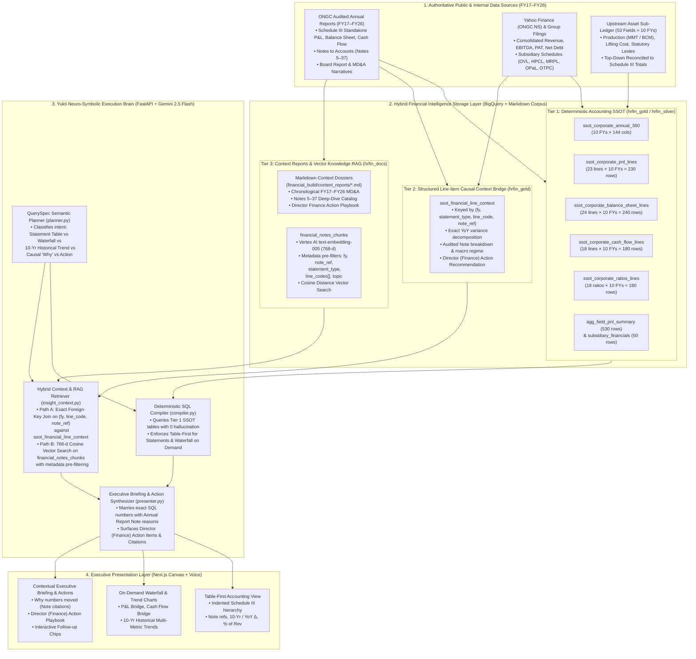

# Reference Architecture: Neuro-Symbolic Hybrid Financial Intelligence (SSOT + Contextual Knowledge RAG)

## 1. Executive Summary (Why Pure SQL or Pure Vector RAG Fails in Finance)

For an enterprise Finance Director or CMD analyzing ONGC's 10-year performance (`FY17–FY26`), **neither a standalone BigQuery numbers table nor a standalone Vector RAG pipeline is sufficient**:

| Approach | Strength | Fatal Weakness for a Finance Director |
|---|---|---|
| **BigQuery Numbers Table Only** | 100% deterministic math, zero hallucination, exact Schedule III subtotals and 10-year trends. | **Zero causal memory.** Cannot explain *why* FY26 PAT fell `-7.6%` (`₹32,894 Cr` vs `₹35,610 Cr`), *why* Non-Current Investments jumped `+₹15,075 Cr` in FY25 (OPaL CCD conversion), or *why* FY20 had a `₹6,685 Cr` exceptional impairment. |
| **Pure Document / PDF Vector RAG Only** | Captures qualitative MD&A commentary, footnotes, and regulatory context. | **Broken arithmetic & table chunking loss.** Splitting 300-page PDF Annual Reports into text chunks scrambles multi-column Schedule III tables, hallucinates YoY percentages, and cannot reconcile 53 oil/gas fields to corporate totals. |
| **Our Solution: 4-Tier Neuro-Symbolic Hybrid Financial Architecture** | **100% deterministic BigQuery numbers (`FY17–FY26`) + Foreign-Key Line-Item Context Bridge + `text-embedding-005` Semantic Vector RAG + Director (Finance) Action Playbook.** | **None.** Every number is computed in SQL with `0.00` reconciliation error, while every line item, historical movement, and variance bridge is automatically enriched with audited Annual Report Note context and actionable Director (Finance) recommendations. |

---

## 2. Four-Tier Reference Architecture Diagram

---

## 3. How Context Reports Are Saved, Indexed, and Retrieved

### 3.1 Three Complementary Persistence Formats for Context
To guarantee both **human auditability** and **sub-second machine retrieval**, every Annual Report explanation (`FY17–FY26`) is stored in three synchronized layers:

1. **Human-Readable Markdown Context Reports (`financial_build/context_reports/*.md`):**
   - `01_FY17_to_FY26_Chronological_MDA_Dossier.md`: Complete 10-year historical chronicle of ONGC's crude/gas price realizations, production volumes, statutory levy regimes (SAED windfall tax, royalty, OIDB cess), capex milestones (KG-DWN-98/2, Mumbai High redevelopment), exceptional impairments, and dividend payouts.
   - `02_Schedule_III_Notes_5_to_37_Context_Catalog.md`: Line-by-line accounting note disclosures for Property, Plant & Equipment (Note 5), Capital Work-in-Progress & Exploratory Wells (Note 6), Non-Current Investments (Note 8 — OPaL, HPCL, MRPL, OVL), Borrowings & Lease Liabilities (Notes 16, 17, 20), Abandonment Provisions (Note 18), Revenue & Other Income (Notes 24, 25), Production & Statutory Levies (Note 26), Exploration Write-Offs (Note 28), and DD&A/Impairments (Note 30).
   - `03_Director_Finance_Action_Playbook.md`: Concrete, quantified financial interventions mapped to each variance trigger (e.g., Western Onshore chemical EOR vs infills, dry-well write-off governance in KG/Kutch basins, OPaL post-recapitalization feedstock optimization, and working-capital treasury sweeps).

2. **Structured Line-Item Context Bridge Table (`ongc-hr-finance-agent.hrfin_gold.ssot_financial_line_context`):**
   - Keyed deterministically by `(fy, statement_type, line_code, note_ref)`.
   - Columns:
     - `context_id` (`STRING`)
     - `fy` (`STRING` — `FY17` to `FY26`, plus `FY17_FY26` for 10-year structural context)
     - `statement_type` (`STRING` — `PNL`, `BALANCE_SHEET`, `CASH_FLOW`, `RATIOS`, `SUBSIDIARY`, `FIELD_ECON`)
     - `line_code` (`STRING` — e.g., `PAT`, `REV_OPS`, `EXP_STAT_LEVIES`, `BS_NON_CURR_INV`, `CF_OPERATING`, `RAT_DEBT_EQUITY`)
     - `line_name` (`STRING`)
     - `note_ref` (`STRING` — e.g., `Note 24`, `Note 26`, `Note 8`, `Ind-AS 7`)
     - `amount_cr` (`FLOAT64`) & `yoy_delta_pct` (`FLOAT64`)
     - `what_happened_summary` (`STRING` — 1-sentence executive summary of the Annual Report event)
     - `annual_report_context` (`STRING` — detailed quantitative decomposition from the Annual Report Note & MD&A)
     - `historical_10yr_context` (`STRING` — how this year's figure compares to the 10-year `FY17–FY26` trajectory)
     - `director_finance_action` (`STRING` — specific decision/action item for the Finance Director / CMD)
     - `source_citation` (`STRING` — exact Annual Report Note & page/section citation)

3. **Semantic Vector Knowledge Store (`ongc-hr-finance-agent.hrfin_docs.financial_notes_chunks`):**
   - Stores chunked context reports and note disclosures embedded with **Vertex AI `text-embedding-005` (`768` dimensions)**.
   - Pre-filtered by `fy`, `statement_type`, `note_ref`, and `line_codes` array before computing exact cosine distance (`1.0 - ML.DISTANCE(embedding, query_vec, 'COSINE')`).

---

## 4. Two-Path Hybrid Retrieval Protocol at Query Time

Whenever the Finance Director asks a question (whether viewing a statement table, comparing a 10-year historical trend, or asking *"Why did X happen and what should we do?"*):

1. **Path A — Deterministic Context Join (`<80 ms`):**
   - Given the compiled `QuerySpec` (`subject`, `metric`, `period`, `filters`), Yukti queries `hrfin_gold.ssot_financial_line_context` matching `(fy, statement_type, line_code)`.
   - This guarantees that even when the user simply asks *"Show FY26 Balance Sheet"* or *"Compare Revenue and PAT from FY17 to FY26"*, the response automatically includes the exact Annual Report context (`what_happened_summary`) and `director_finance_action` for that statement/metric!
2. **Path B — Semantic Vector RAG (`<250 ms`):**
   - Simultaneously, Yukti embeds the user's natural-language question with `text-embedding-005` and retrieves the top-K relevant narrative chunks from `hrfin_docs.financial_notes_chunks` (filtered by `fy` when specified).
   - This answers arbitrary open-ended follow-up questions (e.g., *"How did the SAED windfall tax removal affect FY25 and FY26 margins?"*, *"Why did FY20 record an exceptional loss?"*, or *"What happened to OPaL debt in FY25?"*) with cited Annual Report passages.
